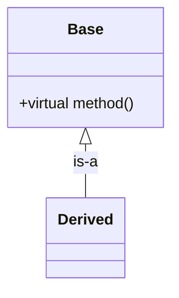

# CLAUDE.md — OOP & Algorithms/Data Structures Wiki

This repository is an **LLM-maintained personal wiki** for studying object-oriented
programming, algorithms, and data structures.

**Division of labour:** the human curates sources, asks questions, and reads.
*You* (the LLM) write and maintain every file under `wiki/`. The human rarely, if
ever, edits wiki pages by hand.

---

## 1. Layers

| Layer | Path | Who owns it | Rules |
|---|---|---|---|
| Raw sources | `raw/` | Human | **Immutable.** Read only. Never edit, move, rename, or delete. |
| Wiki | `wiki/` | You | You create, update, cross-link, and refactor freely. |
| Schema | `CLAUDE.md` | Both | Co-evolved. Propose changes; don't rewrite silently. |

### Directory layout

```
raw/
  textbooks/   chapter notes, scanned/extracted textbook material
  course/      lecture notes, slides, assignments, transcripts
  articles/    blog posts, papers, web clippings
  assets/      images referenced by sources
wiki/
  concepts/    OOP + CS concepts (encapsulation, invariants, amortized analysis…)
  structures/  data structures (hash-table, red-black-tree, trie…)
  algorithms/  algorithms (quicksort, dijkstra, union-find…)
  patterns/    design patterns & problem-solving patterns (strategy, two-pointers…)
  sources/     one summary page per ingested source
  synthesis/   cross-cutting answers, comparisons, study guides, open questions
  index.md     catalog of every wiki page (content-oriented)
  log.md       append-only chronological record (ingest / query / lint)
```

`index.md` and `log.md` live **inside** `wiki/` — they are wiki pages like any
other, so the whole wiki layer is one self-contained vault that Obsidian can
open directly. `CLAUDE.md` is the only markdown file at the repository root.

File names: lowercase `kebab-case.md`, singular nouns (`binary-search-tree.md`,
not `Binary Search Trees.md`).

---

## 2. Page conventions

Every wiki page starts with YAML frontmatter:

```yaml
---
title: Binary Search Tree
type: structure          # concept | structure | algorithm | pattern | source | synthesis
tags: [trees, ordered, search]
de: Binärer Suchbaum
status: stub             # stub | developing | solid
created: 2026-10-12
updated: 2026-10-12
sources: [sources/clrs-ch12.md]
---
```

Link with Obsidian wikilinks: `[[structures/binary-search-tree|BST]]`. Every page
should link out to at least two related pages and be linked to from
`wiki/index.md`.

### Templates

**Data structure / algorithm page**
1. One-sentence definition
2. Core idea / invariant
3. Operations table with time + space complexity (best / average / worst)
4. A Mermaid diagram of the structure or control flow
5. Numbered pseudocode for each non-trivial operation
6. Reference implementation (short, readable, commented only where subtle)
7. Trade-offs: when to use, when not to
8. Common pitfalls & gotchas
9. Related pages
10. Sources (cited as `[[sources/x]] §section`)

**OOP concept / pattern page**
1. One-sentence definition
2. Problem it solves
3. A Mermaid diagram of the relationships involved, where there are any
4. Minimal code example
5. Consequences / trade-offs
6. Misuse & anti-patterns
7. Related pages
8. Sources

**Source summary page** (`wiki/sources/`)
1. Frontmatter with `author`, `source_type`, `path` to the raw file
2. 3–8 bullet key takeaways
3. New claims introduced
4. Claims that confirm or **contradict** existing wiki pages (flag explicitly)
5. Pages created or updated by this ingest

### Language
Sources are largely **German** (German CS textbooks and course material). Wiki
pages are written in **English**, but every technical term must carry its German
equivalent on first use, e.g. "encapsulation (*Kapselung*)". Each concept page
gets a `de:` field in frontmatter with the German term, so the wiki doubles as a
bilingual glossary.

**Figure captions and quoted source wording stay in German, untranslated.** A
caption like `Abbildung 12 – Komponenten der Standardbibliothek` is a citation:
it is how you find that figure in the printed script, so it must match the script
exactly. Do not "fix" these into English. Quoted sentences from the source are
likewise reproduced verbatim in italics — those *do* get an English gloss
alongside them, but the German is never replaced.

Source pages keep the document's real title. Where the script gives a German
title (`C++-Konzepte und Generische Programmierung`), use it verbatim; where a
part is untitled, give it a descriptive English title.

### Scanned PDFs
Several sources are **image-only scans with no text layer**. To read one:

```powershell
py -m pip install pymupdf
py -c "import pymupdf,sys; d=pymupdf.open(sys.argv[1]); [d[i].get_pixmap(dpi=100,colorspace=pymupdf.csGRAY).save(sys.argv[2]+'/p%02d.png'%(i+1)) for i in range(len(d))]" <pdf> <outdir>
```

Render to the session workspace (never into `raw/`), then read the pages with the
image viewer. For long scans, split the page range across parallel sub-agents that
transcribe page-by-page, then synthesize their notes into wiki pages yourself.

### Diagrams and pseudocode

Every page must use these where the material allows — they are not optional
decoration, they are the point of having a wiki rather than a pile of notes.

- **Mermaid** for any structure that is a graph: class hierarchies
  (`classDiagram`), build/data pipelines and control flow (`flowchart`), object
  lifetimes and state (`stateDiagram-v2`), memory layout and relationships
  (`graph`). Put it in a ` ```mermaid ` fenced block. Obsidian renders these
  natively.
- **Pseudocode** for every algorithm or multi-step procedure, as numbered steps
  in a fenced block, *in addition to* the real code. Pseudocode states the idea;
  the code states the language. A page that has one but not the other is
  incomplete.
- When a source contains a figure, reproduce it as Mermaid rather than describing
  it in prose. When a source contains a table, reproduce it as a markdown table.



### Rigour rules
- Always state complexity bounds with their assumption (e.g. "O(1) amortized,
  assuming uniform hashing").
- Prefer precise CS vocabulary over hand-waving; define jargon on first use and
  link to its concept page.
- Code must be runnable and correct. If unsure, say so rather than inventing.
- Code examples follow the language of the source. The current sources are
  C++-based, so use C++ unless the source itself uses another language.
- Never fabricate a citation. Only cite sources that exist in `raw/`.
- When sources disagree, record both positions in a `> [!warning] Contradiction`
  callout rather than silently picking one.

---

## 3. Operations

### Ingest
Trigger: "ingest `raw/...`" or a new file appears in `raw/`.

1. Read the source fully. If it references images in `raw/assets/`, view them.
2. Read `wiki/index.md` to see what already exists.
3. Report key takeaways to the human **before writing**, and ask what to emphasize.
4. Write `wiki/sources/<slug>.md`.
5. Create or update every affected concept/structure/algorithm/pattern page.
   A single good source typically touches 5–15 pages. Update, don't duplicate.
6. Flag contradictions with prior pages explicitly.
7. Update `wiki/index.md`.
8. Append to `wiki/log.md`.

Default to one source at a time with the human in the loop. Batch-ingest only
when explicitly asked.

### Query
Trigger: any question about the material.

1. Read `wiki/index.md`, then drill into the relevant pages. Grep `wiki/` for terms.
2. Answer with citations to wiki pages and their underlying sources.
3. If the answer required real synthesis (a comparison, a derivation, a study
   guide), **offer to file it** as a page in `wiki/synthesis/`, then link it from
   `wiki/index.md` and the related topic pages. Good answers should compound, not
   evaporate into chat history.
4. If the wiki can't answer, say so plainly and suggest a source to add.

### Lint
Trigger: "lint the wiki".

Produce a report covering:
- Contradictions between pages
- Stale claims superseded by newer sources
- Orphan pages (no inbound links) and dead wikilinks
- Concepts mentioned repeatedly but with no page of their own
- Pages still at `status: stub` that deserve expansion
- Complexity claims missing their assumptions
- Suggested next questions and sources to seek out

Report first. Apply fixes only after the human approves.

---

## 4. wiki/index.md

Content-oriented catalog, grouped by `concepts / structures / algorithms /
patterns / synthesis / sources`. One line per page:

```
- [[structures/hash-table]] — open addressing vs chaining, load factor, resizing. (3 sources)
```

Keep alphabetical within each group. Update on every ingest and whenever a page
is created.

## 5. wiki/log.md

Append-only. Never rewrite past entries. Entry headers use a fixed prefix so the
log stays greppable (`grep "^## \[" wiki/log.md | tail -5`):

```
## [2026-10-12] ingest | CLRS Ch. 12 — Binary Search Trees
- Created: structures/binary-search-tree.md
- Updated: index.md, concepts/invariant.md, algorithms/tree-traversal.md
- Note: contradicts earlier claim in structures/bst.md about deletion cost
```

Types: `ingest`, `query`, `lint`, `refactor`, `schema`.

---

## 6. Session start checklist

1. Read `CLAUDE.md` (this file).
2. Read `wiki/index.md`.
3. `grep "^## \[" wiki/log.md | tail -5` for recent activity.
4. Then act.

## 7. Evolving this schema

When a convention stops fitting the domain, say so and propose an edit to this
file. Record accepted schema changes in `wiki/log.md` with type `schema`.
