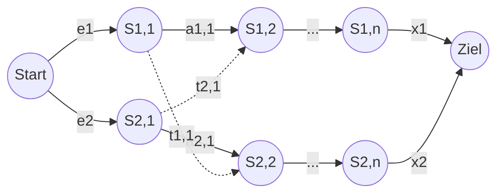

**Assembly-line scheduling (*Ablaufkoordination von Montagebändern*)** is the classic textbook [[concepts/dynamic-programming|dynamic-programming]] example: choosing, station by station, which of two parallel assembly lines a car chassis should travel on in order to minimize total manufacturing time.

## Problem statement (§0.16.2.1)

- A car factory builds cars by mounting parts onto a chassis.
- The factory has 2 assembly lines (*Montagebänder*) with *n* stations S_{i,j}, line 1 ≤ i ≤ 2, station 1 ≤ j ≤ n.
- Station S_{1,j} has the same function as S_{2,j}, but a different processing time a_{i,j} (e.g. due to differing degrees of modernization).
- Transition time from S_{i,j} to S_{i,j+1} (staying on the same line) is negligible.
- Transition time from S_{i,j} to the following station j+1 of the *other* line is t_{i,j}.
- e_i: time for the chassis to enter line *i*.
- x_i: time for a finished car to leave the factory from line *i*.
- **Question**: which path minimizes total manufacturing time?



- Complexity to compute the total time of one given path: **Θ(n)**.
- Number of possible paths: **Θ(2^n)** — the set of stations used by line 1 is a subset of {1,…,n}; there are 2^n such subsets, so exhaustive search is infeasible for large *n*. ⇒ use dynamic programming.

### Framing as a shortest-path problem on a DAG

This problem is structurally a **shortest-path problem on a 2-track [[structures/dag|directed acyclic graph]]**: stations are vertices, same-line transitions (weight a_{i,j}) and cross-over transitions (weight t_{i,j}) are directed edges, entry/exit costs e_i/x_i are edges from a virtual start/to a virtual goal node, and the task is to find the minimum-weight path from Start to Ziel. The `min`-based recurrence below is exactly the relaxation step of a shortest-path algorithm on this DAG, evaluated in topological (station) order.

## Step 1/4: structure of the optimal solution (§0.16.2.2)

The fastest possible path from Start to S_{1,j}:

- For j = 1 there is only one possible path.
- For 2 ≤ j ≤ n there are 2 possibilities: the chassis came from S_{1,j-1} (no transition time), or from S_{2,j-1} (transition time t_{2,j-1}).

**Observation**: determining the optimal solution (fastest path to S_{1,j}) requires the optimal solutions of subproblems (fastest paths to S_{1,j-1} and S_{2,j-1}) — this is **optimale Teilstruktur** (optimal substructure), one of the two criteria (together with *überlappende Teilprobleme*, overlapping subproblems) for the applicability of [[concepts/dynamic-programming|dynamic programming]].

## Step 2/4: recursive formulation of the minimal cost (§0.16.2.3–0.16.2.4)

Let f_i[j] be the fastest possible time from start to S_{i,j}, and f* the shortest time from start to goal (Ziel):

```
Initialisierung:   f1[1] = e1 + a1,1                                        (25)
                   f2[1] = e2 + a2,1                                        (26)
Induktion:         f1[j] = min(f1[j-1] + a1,j,                              (27)
                               f2[j-1] + t2,j-1 + a1,j)                     (28)
                   f2[j] = min(f2[j-1] + a2,j,                              (29)
                               f1[j-1] + t1,j-1 + a2,j)                     (30)
                   ∀ 2 ≤ j ≤ n
Terminierung:      f* = min(f1[n] + x1, f2[n] + x2)                         (31)
```

```
// Recursive (naive) DP recurrence for assembly-line scheduling
1. f1[1] = e1 + a[1][1]
2. f2[1] = e2 + a[2][1]
3. for j = 2 to n:
4.     f1[j] = min( f1[j-1] + a[1][j],
5.                  f2[j-1] + t[2][j-1] + a[1][j] )
6.     f2[j] = min( f2[j-1] + a[2][j],
7.                  f1[j-1] + t[1][j-1] + a[2][j] )
8. f_star = min( f1[n] + x1, f2[n] + x2 )
```

## Step 3/4: computing the minimal cost (§0.16.2.4)

- **Ungünstig** (unfavorable): naive recursive evaluation of equations (25)–(31), which ignores optimal substructure, costs **Θ(2^n)**.
  - Let r_i(j) be how often f_i[j] is accessed when computing f*:

    ```
    r_1(n) = r_2(n) = 1                                                 (32)
    r_1(j) = r_2(j) = r_1(j+1) + r_2(j+1)   ∀ 1 ≤ j < n                 (33)
    ```

    ⇒ r_i(j) = 2^{n−j}, e.g. f1[1] is computed 2^{n-1} times — the classic overlapping-subproblems blow-up.
- **Besser** (better): iterative bottom-up computation. For j ≥ 2, f_i[j] depends only on f1[j-1] and f2[j-1]; compute f_i[j] in order of increasing station number *j*, storing them in a table.

```
// Efficient bottom-up (tabulated) DP — O(n) instead of Θ(2^n)
1. f1[1] = e1 + a[1][1]
2. f2[1] = e2 + a[2][1]
3. for j = 2 to n:                      // fill table in increasing j
4.     f1[j] = min(f1[j-1] + a[1][j], f2[j-1] + t[2][j-1] + a[1][j])
5.     f2[j] = min(f2[j-1] + a[2][j], f1[j-1] + t[1][j-1] + a[2][j])
6. f_star = min(f1[n] + x1, f2[n] + x2)
// Complexity: O(n) time, O(n) space for the tables f1[], f2[]
```

### DP table

| j | f1[j] | f2[j] |
|---|---|---|
| 1 | e1 + a1,1 | e2 + a2,1 |
| 2 | min(f1[1]+a1,2, f2[1]+t2,1+a1,2) | min(f2[1]+a2,2, f1[1]+t1,1+a2,2) |
| ... | ... | ... |
| n | min(f1[n-1]+a1,n, f2[n-1]+t2,n-1+a1,n) | min(f2[n-1]+a2,n, f1[n-1]+t1,n-1+a2,n) |

f* = min(f1[n] + x1, f2[n] + x2).

## Step 4/4: reconstruction of the optimal path

> [!warning] Scan gap
> Printed pages 440–443 of the source script are **missing from the supplied scans**. These pages most likely contain the explicit Step 4/4 procedure (reconstructing the actual optimal path, not just its cost) and the complexity summary for this example. The reconstruction below is inferred from the general [[concepts/dynamic-programming|DP recipe]] (store at each f_i[j] which predecessor achieved the `min`, then backtrack from f*), **not transcribed verbatim from the source** — see "Open questions".

```
1. // During the forward pass, additionally record which branch of each min() won:
2. for j = 2 to n:
3.     if f1[j-1] + a[1][j] <= f2[j-1] + t[2][j-1] + a[1][j]:
4.         pred1[j] = 1   // stayed on line 1
5.     else:
6.         pred1[j] = 2   // crossed over from line 2
7.     // symmetric for pred2[j]
8. // Backtrack from the winning terminal line (1 if f1[n]+x1 <= f2[n]+x2, else 2):
9. line = (f1[n] + x1 <= f2[n] + x2) ? 1 : 2
10. path = [S_{line, n}]
11. for j = n down to 2:
12.     line = (line == 1) ? pred1[j] : pred2[j]
13.     path.prepend(S_{line, j-1})
14. return reverse(path)
```

## Complexity

- Naive recursive evaluation: **Θ(2^n)** (overlapping subproblems recomputed exponentially often).
- Bottom-up tabulated DP: **O(n)** time, **O(n)** space for the f1[], f2[] tables.

See [[concepts/big-o-notation]] and [[concepts/complexity-classes]].

## Trade-offs: when to use, when not to

- This recurrence pattern (two tracks, `min` over a constant number of predecessors per step) generalizes to any shortest-path problem on a layered/leveled [[structures/dag|DAG]]: whenever a problem can be modeled as a DAG with a small, bounded in-degree per vertex, the same O(n)-time DP skeleton applies.
- Because the DAG here has exactly 2 tracks, the per-station work is O(1); a *k*-track variant would cost O(k) per station and O(nk) overall.

## Common pitfalls & gotchas

- Writing only the recursive formulation (eqs. 25–31) and evaluating it directly, without tabulating bottom-up, silently reintroduces the Θ(2^n) blow-up.
- Forgetting the cross-over transition times t_{i,j-1} apply when switching lines, but not when staying on the same line (negligible transition time).

## Related

- [[concepts/dynamic-programming]] — the general recipe this worked example follows.
- [[structures/dag]] — the graph structure this problem reduces to.
- [[algorithms/optimal-binary-search-tree]] — the other DP example in this course.
- [[algorithms/viterbi]] — another DP-on-a-DAG example (the trellis).
- [[concepts/big-o-notation]]
- [[concepts/complexity-classes]]

## Open questions

- Printed pages 440–443 are missing from the scan set. They likely contain the verbatim Step 4/4 reconstruction procedure and a complexity summary for this specific example; the reconstruction pseudocode above is inferred, not transcribed, and should be verified/replaced once those pages are available.

## Sources

- [[sources/grigat-graphs-dynamic-programming]] §0.16.2–§0.16.2.4
