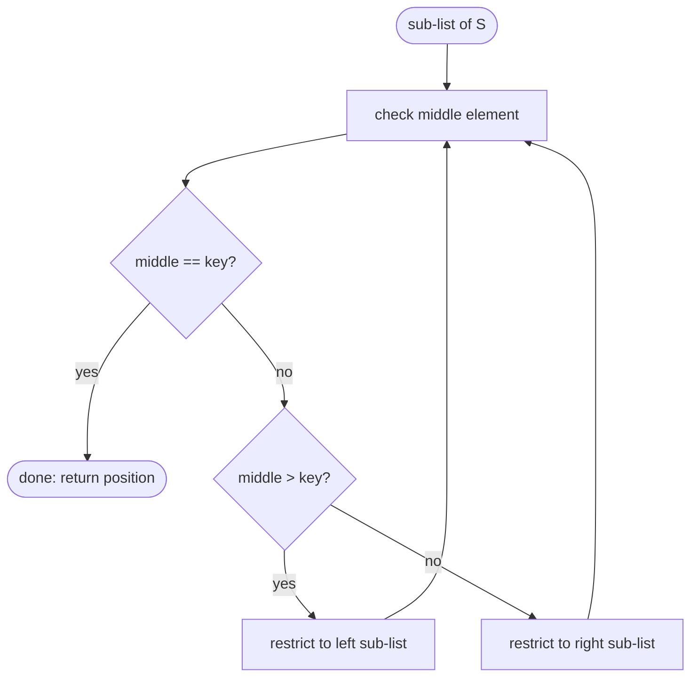

## One-sentence definition

Binary search (*binäre Suche*) finds an element in a **sorted** list by
repeatedly checking the middle element of the current sub-list and
discarding the half that cannot contain the target, giving O(log n) instead
of the O(n) of [[algorithms/linear-search]] (§0.9.2.3).

## How much detail the source gives

The script introduces binary search only as a brief **Anmerkung** (remark)
immediately after the linear "search element in list" example, to make the
point that algorithm choice depends on what the data structure guarantees
(sortedness) — it is *not* given its own worked C++ example, pseudocode with
concrete indices, or a complexity derivation here, unlike `min` in
[[algorithms/linear-search]]. The entire treatment at this point in the
script is the four-step informal procedure below plus the stated complexity;
no array-index arithmetic, recursion vs. iteration discussion, or edge-case
handling (empty list, duplicate keys) is given in these pages.

## Core idea / invariant

**Invariant:** the target key, if present, always lies within the current
sub-list being considered; each step halves that sub-list.

## Specification as an algorithm (verbatim structure from the notes)

1. Prüfe mittleres Element (check the middle element).
2. Falls gesuchtes Element: fertig (if it is the sought element: done).
3. Falls zu groß, benutze linke Teilliste im nächsten Schritt, weiter mit 1
   (if too large, use the left sub-list next, go to step 1).
4. Falls zu klein, benutze rechte Teilliste im nächsten Schritt, weiter mit 1
   (if too small, use the right sub-list next, go to step 1).

## Numbered pseudocode

As reconstructed directly from the above four steps (the notes do not give
array-indexed pseudocode for binary search at this point, unlike the `min`
example):

```
1. procedure binarySearch(S, key)
2.   check middle element of current sub-list of S
3.   if middle element == key then
4.     found -> return position
5.   else if middle element > key then
6.     restrict search to left sub-list; go to step 2
7.   else  // middle element < key
8.     restrict search to right sub-list; go to step 2
9.   end if
```



## Complexity

| Operation | Complexity | Note |
|---|---|---|
| binary search over n sorted elements | O(log n) | Stated directly in the notes as "Komplexität: $O(\log n)$"; no derivation is given at this point (contrast [[structures/binary-tree]] §0.10.4.5, where a similar logarithmic bound for tree height *is* derived algebraically). |

See [[concepts/big-o-notation]] and [[concepts/complexity-classes]] for how
O(log n) compares to the O(n) of [[algorithms/linear-search]].

## Reference implementation

The notes give **no C++ code** for binary search at this point in the
script — only the four-step procedure and the asymptotic complexity, as
transcribed above. This page therefore does not include a C++ listing,
following the rule to state pseudocode-only content as pseudocode rather than
inventing code that is not in the source.

## Trade-offs: when to use, when not to

- Use binary search only when the sequence is already sorted and supports
  efficient middle-element access (e.g. a sorted array/[[structures/vector]]
  with O(1) random access) — the notes' own framing is precisely this
  trade-off: binary search becomes available *because* the data structure
  (a sorted list) guarantees order, echoing [[concepts/abstraction-levels]]'s
  point that algorithm and data structure form one unit.
- Do not use binary search on a structure without efficient random access to
  the middle (e.g. a plain singly linked list, [[structures/linked-list]]) —
  finding the middle element itself would cost O(n), destroying the benefit.

## Related
- [[algorithms/linear-search]]
- [[concepts/abstraction-levels]]
- [[structures/vector]]
- [[concepts/big-o-notation]]
- [[concepts/complexity-classes]]

## Sources
- [[sources/grigat-algorithms-data-structures]] §0.9.2.3
