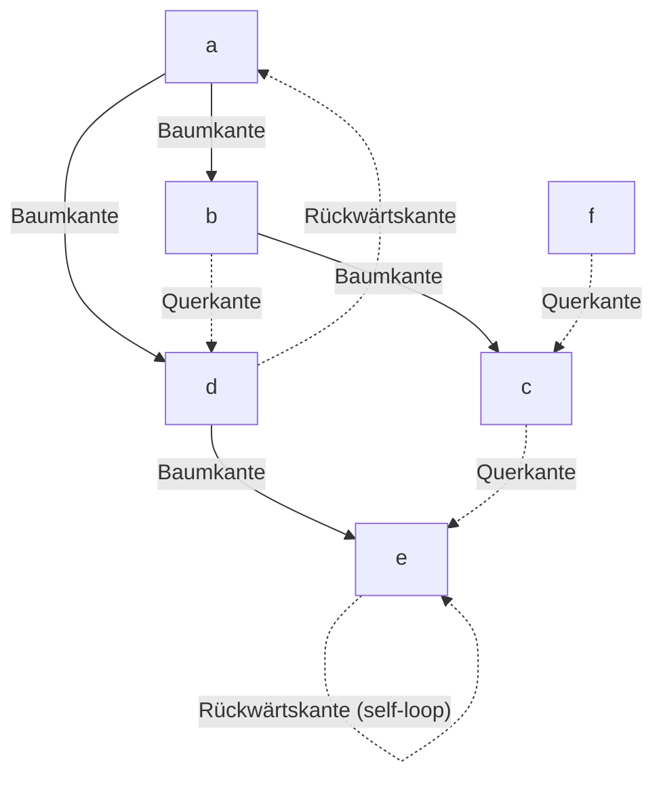

## One-sentence definition

*Breitensuche* (breadth-first search, BFS) systematically visits all nodes of
a graph level by level using a FIFO [[structures/queue|queue]], producing a
*Breitensuche-Spannbaum* (BFS spanning tree)
[[sources/grigat-graphs-dynamic-programming]] §0.14.3.1.

## Core idea / invariant

- BFS is used to find shortest paths from the root node, and to test
  reachability (*Erreichbarkeit*) from the root §0.14.3.1.
- The source explicitly remarks that BFS is used for shortest paths "similar
  to the algorithms of Dijkstra, Prim" (*ähnlich den Algorithmen von Dijkstra,
  Prim*) — i.e. it frames Dijkstra's shortest-path algorithm and Prim's
  minimum-spanning-tree algorithm as **BFS-like generalizations** that
  replace "next unvisited node" with "next cheapest edge" §0.14.3.1.
- Mechanics (from the worked trace, §0.14.3.11): enqueue the root; repeatedly
  dequeue the front node, mark it processed, and enqueue each of its
  unvisited successors at the back of the [[structures/queue|queue]]; when
  the queue empties and unvisited nodes remain, start a new root (as in DFS's
  driver loop) — the resulting trees again form a spanning forest.

## Numbered pseudocode

The source does not print BFS as a `cpp` code block the way it does for DFS;
it is instead walked through narratively, panel by panel, over Abbildung 120.
The following numbered pseudocode is a faithful transcription of that
narrative's queue mechanics (§0.14.3.11), not an independent addition:

```
1. function BFS(root):
2.     mark root as visited
3.     enqueue(queue, root)
4.     while queue is not empty:
5.         u ← dequeue(queue)              // front of queue, marked processed
6.         for each successor v of u:
7.             if v is not yet visited:
8.                 mark v as visited
9.                 enqueue(queue, v)        // tree edge (u,v)
10. for i = 1 to n:                          // driver loop, as in DFS
11.    if node[i] is not yet visited:
12.        BFS(node[i])                      // new root, new spanning tree
```

## Edge classification under BFS (§0.14.3.12)

- Edge (u,v) from u to v, with root w; t(u), t(v) are the nodes' depths
  (levels) in the BFS spanning tree. Nodes are marked at first visit.
  Präorder/Postorder are **not relevant** for BFS.

| Kantentyp (u,v) | Condition (directed graph) |
|---|---|
| Baumkante (tree edge) | v is not yet visited, t(v) = t(u) + 1 |
| Vorwärtskante (forward edge) | **none** — does not occur in BFS |
| Rückwärtskante (back edge) | v is visited, lies on path w → u, 0 ≤ t(v) < t(u) |
| Querkante (cross edge) | v is visited, does **not** lie on path w → u, 0 < t(v) ≤ t(u) + 1 |

## Worked trace (§0.14.3.11, Digraph G, Abbildung 120, root a then f)

Narrative of the run, as printed:
- Search root **a**; search successors of a: **b, d** → enqueue b, enqueue d.
- Search successors of b: **c, d** → enqueue c; d already visited.
- Search successors of d: **a, e** → a already visited; enqueue e.
- Search successors of c: **e** → e already visited.
- Search successors of e: none.
- At root **f**, begin anew; f has no unvisited successor.

Queue snapshots from the figure (✗ = dequeued/processed, pushes at the
right): `a ←` → `✗b ←` (a popped, b pushed) → `✗b d ←` → `✗d c ←` → `✗c e ←`
→ `✗e ←` → `✗ ←` (component {a,b,c,d,e} done) → `f ←` (new root) → `✗ ←`
(done).

## Comparison with DFS on the same Digraph G (§0.14.3.13)

| | DFS | BFS |
|---|---|---|
| Baumkanten | (a,b), (b,c), (c,e), (b,d) | (a,b), (a,d), (b,c), (d,e) |
| Vorwärtskanten | (a,d) | not defined for BFS |
| Rückwärtskanten | (d,a), (e,e) | (d,a), (e,e) |
| Querkanten | (f,c), (d,e) | (b,d), (c,e), (f,c) |

> The same graph yields a **different** spanning tree depending on the search
> strategy: BFS's tree edges reflect shortest-path/level structure, DFS's
> reflect recursive descent (§0.14.3.13, explicit source remark).



## Complexity

As with [[algorithms/depth-first-search]], the per-node work is bounded by
scanning its successors once per the representation costs stated in
[[structures/graph-representations]] §0.14.2.4–§0.14.2.5; each node is
enqueued/dequeued exactly once.

| Representation | Time | Assumption |
|---|---|---|
| Adjacency matrix | O(\|V\|²) | each dequeued node scans its full row (O(\|V\|)) for successors |
| Adjacency list | O(\|V\| + \|E\|) | each node's list is scanned once; the queue itself is O(1) per op |

This combination is not restated verbatim for BFS by the source; it follows
from the representation costs plus the "each node enqueued/dequeued once"
argument above. See [[concepts/big-o-notation]] and
[[concepts/complexity-classes]].

## Related
- [[structures/graph]]
- [[structures/graph-representations]]
- [[structures/spanning-tree]]
- [[algorithms/depth-first-search]]
- [[structures/queue]]
- [[structures/dag]]
- [[algorithms/topological-sort]]

## Open questions
- The source frames Dijkstra's shortest-path algorithm and Prim's
  minimum-spanning-tree algorithm explicitly as generalizations of BFS
  (§0.14.3.1), but neither algorithm is actually worked out anywhere in the
  scanned pages (printed pp. 400–422) — no pseudocode, no worked example, no
  complexity. Should a future source be sought specifically for Dijkstra's
  algorithm and for minimum spanning trees (Prim/Kruskal), so that
  `algorithms/dijkstra` and a minimum-spanning-tree page can be written
  without inventing the missing content?

## Sources
- [[sources/grigat-graphs-dynamic-programming]] §0.14.3.1, §0.14.3.11,
  §0.14.3.12, §0.14.3.13
