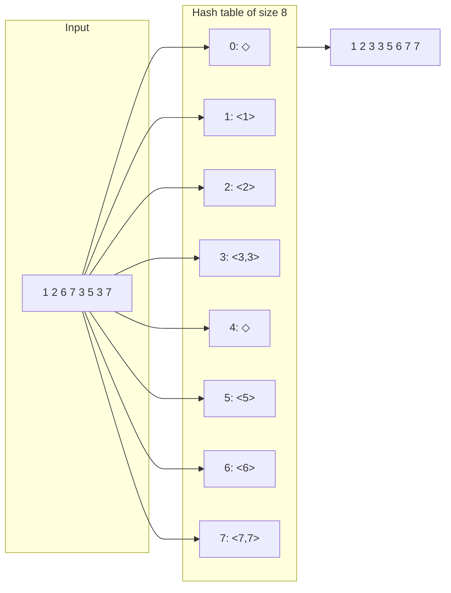

**Bucket sort (*Sortieren durch Fachverteilen*)** distributes elements directly into buckets indexed by their own key value, assuming keys are bounded integers, and then reads the buckets back out in index order to obtain the sorted sequence.

## Idea

Assumption: `key(a_n) ≤ N-1 ∀n`, i.e. the number of distinct keys is finite and known (*Zahl der Schlüssel endlich und bekannt*). A hash table (open hashing) of size `N` is used for the elements (*Hashtabelle (offenes Hashing) der Größe N für Elemente verwenden*). Sub-lists (buckets) are sorted using [[algorithms/insertion-sort|insertion sort]] (*Teillisten sortieren mit Sortieren durch Einfügen*) — relevant when a bucket can hold more than one distinct value or multiple equal keys in an order-sensitive way.

## Algorithm

```
1. function bucketSort(elements, N):
2.     create N empty buckets, indexed 0..N-1
3.     for each element e in elements:
4.         append e to bucket[ key(e) ]
5.     for each bucket, in index order 0..N-1:
6.         sort bucket in place with insertion sort
7.     concatenate bucket[0], bucket[1], ..., bucket[N-1]
8.     return the concatenation as the sorted sequence
```

## Worked example

Example: sorting `<1,2,6,7,3,5,3,7>` with Bucketsort, `N = 8` (Tabelle 31: hash table of size 8). Each bucket is keyed by the element's value itself, since keys `≤ N-1`:

| Index | Bucket contents |
|---|---|
| 0 | ◇ (empty) |
| 1 | `<1>` |
| 2 | `<2>` |
| 3 | `<3,3>` |
| 4 | ◇ (empty) |
| 5 | `<5>` |
| 6 | `<6>` |
| 7 | `<7,7>` |

Reading buckets 0→7 in order and the elements within each bucket produces the sorted sequence: `1,2,3,3,5,6,7,7`.



## Implementation

The source gives bucket sort only as a prose idea plus the worked table (§0.13.5.1–0.13.5.2); **no C++ code is given** for bucket sort in this part of the script.

## Complexity

| | Best | Average | Worst | Extra space | Stable | In-place |
|---|---|---|---|---|---|---|
| Total | — | — | — | O(n + N) (buckets + elements) | yes, if bucket order preserves insertion order and insertion sort within a bucket is stable | no |

The source states no explicit `T(n)` formula for bucket sort itself (unlike selection/insertion/bubble/merge/quick sort, which each get an explicit `C(n)`/`X(n)`/`M(n)` breakdown); it only gives the empirical "DistributionSort" runtime figures in the final comparison table on [[algorithms/sorting-comparison]], which groups bucket sort and radix sort together under that label.

## Related

- [[algorithms/radix-sort]] — applies bucket sort digit-by-digit for arbitrary-size keys.
- [[algorithms/insertion-sort]] — used to sort within each bucket.
- [[algorithms/sorting-overview]]
- [[algorithms/sorting-comparison]]
- [[concepts/big-o-notation]]
- [[concepts/complexity-classes]]
- [[structures/vector]]
- [[algorithms/stl-algorithms]]

## Sources

- [[sources/grigat-trees-sorting]] §0.13.5.1, §0.13.5.2

## Open questions

- The source does not give a general complexity formula (`C(n)`/`X(n)`) for bucket sort, unlike the other algorithms in this section — only the empirical "DistributionSort" figures in the final comparison table apply, and those cover bucket sort and radix sort jointly without separating them.
- Stability is not explicitly asserted by the source; it is inferred here from the mechanism (elements appended to buckets in input order, buckets concatenated in index order) but not stated verbatim.
