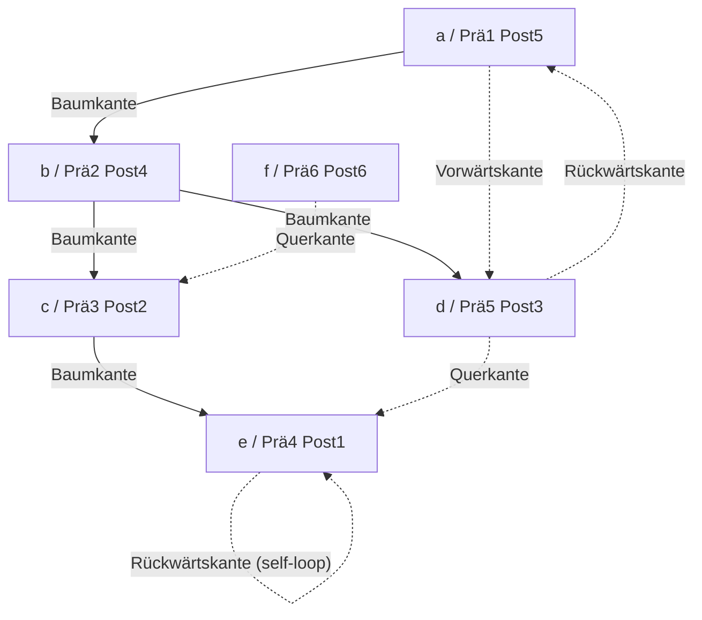

## One-sentence definition

*Tiefensuche* (depth-first search, DFS) systematically visits all nodes of a
graph by recursing into an unvisited successor before backtracking, producing
a *Tiefensuche-Spannbaum* (DFS spanning tree)
[[sources/grigat-graphs-dynamic-programming]] §0.14.3.1.

## Core idea / invariant

- DFS marks nodes visited on first reach and never revisits a marked node.
- It is used to search for cycles (via *Rückwärtskanten*, back edges) and for
  strongly connected components (*stark zusammenhängende Komponenten*)
  §0.14.3.1.
- Because not every node is reachable from a single root, a **driver loop**
  over all nodes is required so that nodes outside the first root's
  [[structures/spanning-tree|spanning tree]] are still visited — the set of
  resulting trees forms a *erzeugender Wald* (spanning forest).

## Numbered pseudocode

Recursive single-source DFS, as given in the source §0.14.3.5:

```
1. function DFS(v):
2.     if v is not yet marked visited:
3.         mark v as visited
4.         for i = 1 to number_of_successors(v):
5.             DFS(successor[i] of v)   // recursive call
```

Driver loop ensuring every node is eventually visited (§0.14.3.5), with the
source's own comment translated:

```
1. for i = 1 to n:
2.     DFS(node[i])   // there might still be unvisited nodes
```

The source does not give an iterative (explicit-stack) version of DFS; only
the recursive form above is transcribed.

### Reference implementation (verbatim, §0.14.3.5)

```cpp
void Tiefensuche(Knoten v)
{
  if (v noch nicht besucht)
  {
    markiere v als besucht;
    for (int i=1; i<= Anzahl_Nachfolger(v); i++)
    {
      Tiefensuche(v.Nachfolger[i]); // Rekursiver Aufruf
    }
  }
}
```

```cpp
for (int i=1; i<=n; i++)
{
  Tiefensuche(Knoten[i]); // es könnten noch Knoten unbearbeitet sein
}
```

## Pre-order and post-order (§0.14.3.7)

- **Präorder** (pre-order): the number giving the order in which node v is
  **reached** during DFS. Präorder(v) = 0 ⟺ v not yet visited.
- **Postorder** (post-order): the number given to v after **all** of v's
  direct and further successors *within the spanning tree* have already
  received a postorder. Postorder(v) = 0 ⟺ not all such successors have been
  assigned a postorder yet.
- Determining postorder requires tracking, per node, which of its
  spanning-tree successors have already finished (e.g. via an adjacency
  matrix).

## Edge classification in DFS spanning trees (§0.14.3.8)

Classification happens at the **first** traversal of edge (v,w):

| Edge type (German) | Edge type | Condition |
|---|---|---|
| Baumkante | tree edge | Präorder(w) = 0 |
| Vorwärtskante | forward edge | Präorder(v) < Präorder(w) |
| Rückwärtskante | back(ward) edge | Präorder(v) ≥ Präorder(w) > 0 **and** Postorder(w) = 0 |
| Querkante | cross edge | Präorder(v) ≥ Präorder(w) > 0 **and** Postorder(w) ≠ 0 |

- **Baumkanten**: edges of the chosen spanning tree.
- **Vorwärtskanten**: lead to an already-visited **successor**.
- **Rückwärtskanten**: lead to an already-visited **predecessor**, towards the
  root; a digraph is acyclic exactly when it has none (see
  [[structures/dag]]).
- **Querkanten**: lead to neither a predecessor nor a successor.

## Worked trace (§0.14.3.10, Digraph G, Abbildung 119)

**Tabelle 35 — Prä- and Postorder for Digraph G:**

| Knoten | a | b | c | d | e | f |
|---|---|---|---|---|---|---|
| Präorder | 1 | 2 | 3 | 5 | 4 | 6 |
| Postorder | 5 | 4 | 2 | 3 | 1 | 6 |

Classification results (as printed in the source):
- **Baumkanten**: (a,b), (b,c), (c,e), (b,d)
- **Vorwärtskanten**: (a,d)
- **Rückwärtskanten**: (d,a), (e,e)
- **Querkanten**: (f,c), (d,e)



Earlier narrative trace of the same run with roots a and f, as printed
(§0.14.3.6): visit root **a** → visit successor **b** → visit successor **c**
→ visit successor **e** (no successor, end of path) → backtrack to **c** (no
unvisited successor) → backtrack to **b** → visit successor **d** (no
unvisited successor) → no unvisited successor of a left → search for a new
root: **f** → no further unvisited nodes from f → traversal complete.

## Complexity

The source states the per-adjacency-test costs for each representation in
[[structures/graph-representations]] §0.14.2.4–§0.14.2.5; combined with the
fact that DFS visits every node once and inspects every outgoing edge once,
this gives:

| Representation | Time | Assumption |
|---|---|---|
| Adjacency matrix | O(\|V\|²) | each visited node scans its full row (O(\|V\|)) to find successors |
| Adjacency list | O(\|V\| + \|E\|) | each node's list (total length \|E\|) is scanned once |

These complexity figures are derived by combining the representation costs
the source states explicitly with the standard "visit each node and edge
once" argument for DFS; the source itself does not restate them for DFS
specifically. See [[concepts/big-o-notation]] and
[[concepts/complexity-classes]] for the notation.

## Related
- [[structures/graph]]
- [[structures/graph-representations]]
- [[structures/spanning-tree]]
- [[algorithms/breadth-first-search]]
- [[structures/dag]]
- [[algorithms/topological-sort]]
- [[algorithms/tree-traversal]]
- [[structures/binary-tree]]

## Sources
- [[sources/grigat-graphs-dynamic-programming]] §0.14.3.1, §0.14.3.5, §0.14.3.6,
  §0.14.3.7, §0.14.3.8, §0.14.3.10
