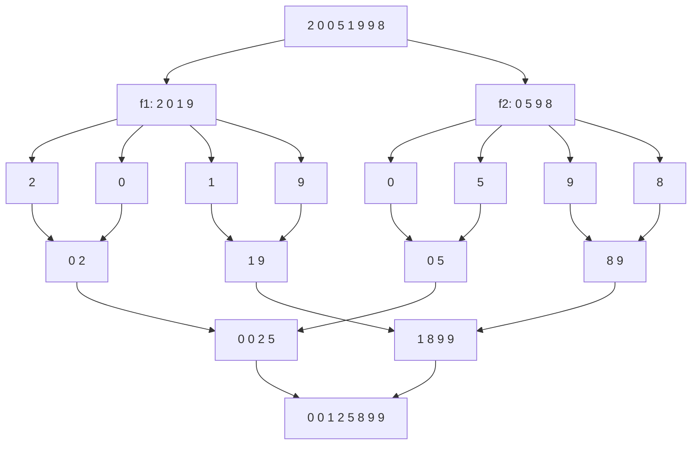
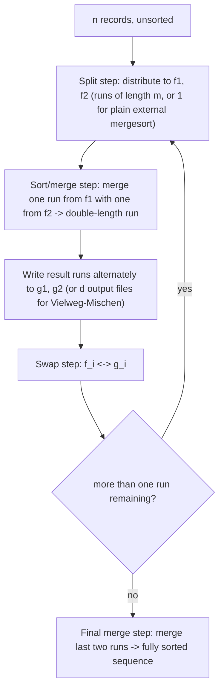

**External sorting (*Externes Sortieren*)** sorts *n* data records that live on external, sequentially accessed storage (magnetic tape, hard disk) by repeatedly merging sorted runs — a disk-aware generalization of in-memory [[algorithms/merge-sort|merge sort]], whose cost is measured in page/block accesses rather than comparisons.

## Motivation and cost model

- Data records are stored externally and **sequentially** as a page sequence (magnetic tape or hard disk); for *n* records, *s* pages are needed, and each page holds exclusively d_s data records — no successor pointers, no B-tree structure, for better storage utilization.
- Goal: sort efficiently via **sequential processing** (*sequenzielle Verarbeitung*) to avoid unnecessary waiting (read/write head movement, tape rewinding) — sequential processing implies few page accesses.
- At least 4 devices/files are needed: 2 for reading (f₁, f₂) and 2 for writing (g₁, g₂).
- Cost is counted as **page accesses**, not element comparisons — this is the key difference from in-memory [[algorithms/merge-sort|merge sort]], which counts comparisons/element moves and assumes O(1) random access to any element.

## Nomenclature

- **Phase**: one *Sortierschritt* (sort/merge step) combined with one *Tauschschritt* (swap step).
- **Lauf** (*run*): a sorted partial sequence. Initially data is unsorted: *n* runs of length 1. Each phase doubles the run length deposited in g₁, g₂ and halves the number of runs. At the end: one remaining run of length *n*.

## The basic procedure (externes Mergesort)

```
1. Aufteilungsschritt (split step):
2.     Split data onto two sequential input files f1 and f2, e.g. two tape drives
3.     (initial partial-sequence length 1).
4. Sortierschritt (sort step), repeat until f1 and f2 are empty:
5.     Merge-sort one partial sequence from f1 with one from f2 into a result
6.     sequence of double length.
7.     Write result sequences alternately into one of the output files g1 and g2.
8. Tauschschritt (swap step): swap g1,g2 with f1,f2.
9. While f1 and f2 still each contain two or more result sequences: go to step 2 (Sortierschritt).
10. Verschmelzschritt (final merge step): merge the (two) remaining sequences of
    f1 and f2 together into the final sorted sequence.
```

### Worked example (§0.15.3.3)

Sorting the sequence `2 0 0 5 1 9 9 8`:

- **Aufteilungsschritt**: split alternately onto f1 = `2 0 1 9` and f2 = `0 5 9 8`.
- Runs of length 1 are merged pairwise into runs of length 2 (`0 2`, `0 5`, `1 9`, `8 9`), then into runs of length 4 (`0 0 2 5`, `1 8 9 9`), then merged into the final run of length 8 (`0 0 1 2 5 8 9 9`) — see **Abbildung 130**.



Phase-by-phase:

- **Phase 1**: 2 runs of length 1 read from f1, f2; the first sorted run of length 2 is stored in g1, further runs alternate between g2 and g1.
- **Phase 2**: devices swap (f1⇆g1, f2⇆g2); runs of length 2 are read from f1, f2 and after merging stored alternately into g1, g2.
- **Phase 3**: the sorted run of length *n* resides in the last two output files.

## Complexity analysis (§0.15.3.4)

For *n* data records and d_s records per page:

```
C_Kosten pro Phase(n, d_s) ∈ O(n / d_s)      // cost per phase: one pass over all pages
Anzahl Phasen = ⌈log₂(n)⌉                     // number of phases
T(n) ∈ O((n/d_s) · log n) = O(n log n)        // total complexity
```

See [[concepts/big-o-notation]] and [[concepts/complexity-classes]].

## Reducing the number of phases

### Direktes Mischen (direct merging)

- Idea: use the entire available main memory (*m* storage slots) to pre-sort the initial runs internally, so initial runs have maximal length *m* > 1 instead of length 1.
- This reduces the number of phases from ⌈log₂(n)⌉ to **⌈log₂(n/m)⌉**.
- Limiting case m = n: data can be sorted completely in memory. Limiting factor: main memory capacity.
- **Worked example (§0.15.3.6)**: *n* = 1000 records, main memory holds 100 records ⇒ splitting onto f1/f2 produces 10 runs of length 100 ⇒ ⌈log₂(1000/100)⌉ = **4 phases**.

### Vielweg-Mischen (multiway merging)

- Idea: use more than two input/output files f1, f2, … and g1, g2, …; with *d* files, run length grows by factor *d* per phase.
- Number of phases reduces from ⌈log₂(n)⌉ to **⌈log_d(n)⌉**.
- Limiting case d = n: data can be sorted completely internally. Limiting factors: main memory capacity and the maximum number of simultaneously open files.

Both techniques generalize the basic two-way *externes Mergesort* above — the same split/merge/swap skeleton applies, only the run-generation width (*Direktes Mischen*) and the merge fan-in (*Vielweg-Mischen*) change — and both reduce directly to ordinary two-way [[algorithms/merge-sort|merge sort]] in the degenerate case *m* = 1, *d* = 2.



## Summary (§0.15.3.8)

- Complexity for external data refers to the number of external storage (page) accesses, not comparisons.
- The [[structures/dictionary|dictionary]] data structure optimized for few page accesses per operation is the [[structures/b-tree|B-tree]]: the number of nodes it needs is governed by page size, pointer storage requirement, and key storage requirement — the same quantities that bound d_s here.
- The sorting procedure designed for sequential data access is external merge sort.
- Depending on the degree of pre-sortedness of the data, it may be sensible to prepare initial runs of fixed or variable length.

## Trade-offs: when to use, when not to

- Use external merge sort (in one of its variants) whenever the data set does not fit in main memory; plain in-memory [[algorithms/merge-sort|merge sort]] (or any comparison sort from [[algorithms/sorting-comparison]]) assumes O(1) random access and is the wrong cost model once disk/tape I/O dominates.
- *Direktes Mischen* trades main-memory capacity for fewer phases; *Vielweg-Mischen* trades open-file-handle capacity for fewer phases. Both are free lunches up to their respective hardware limits.

## Related

- [[algorithms/merge-sort]] — the in-memory two-way merge sort this generalizes to external storage.
- [[structures/b-tree]] — the external-storage dictionary counterpart.
- [[algorithms/sorting-comparison]]
- [[concepts/big-o-notation]]
- [[concepts/complexity-classes]]
- [[concepts/chrono-time-measurement]]

## Sources

- [[sources/grigat-graphs-dynamic-programming]] §0.15.3–§0.15.3.8
