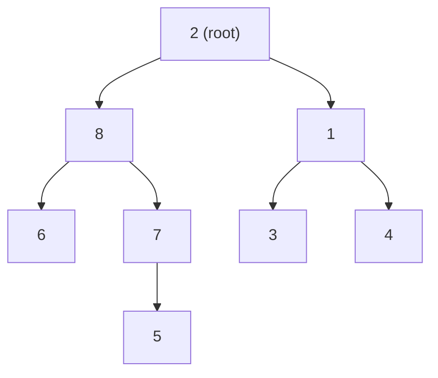
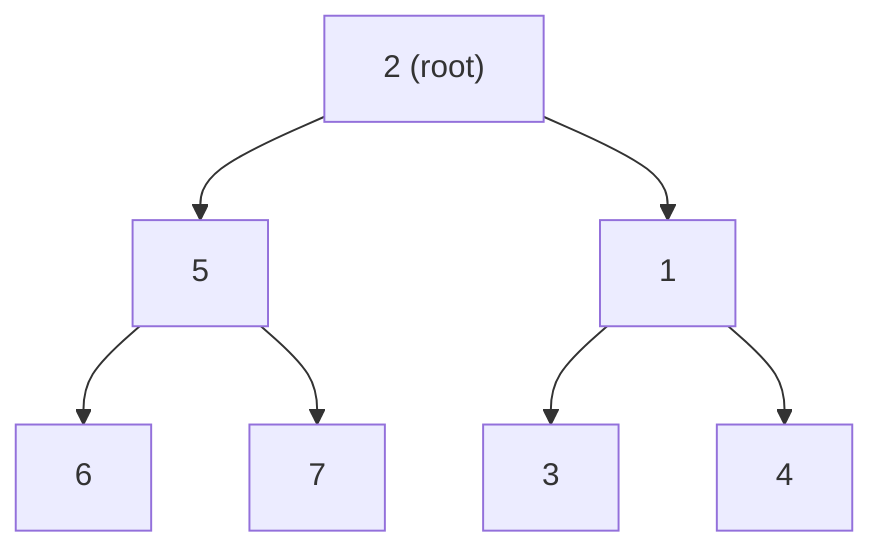
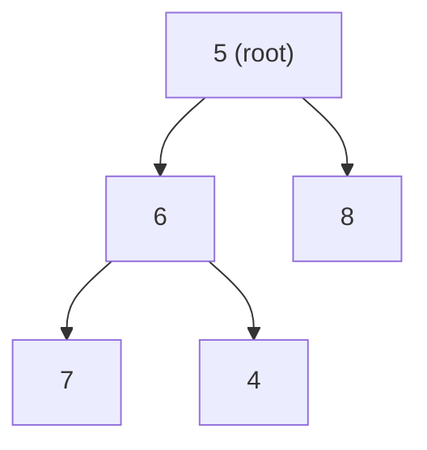

**Heapsort** sorts an array in place by first building a [[structures/heap|heap]] (a left-complete binary tree with partial order) directly inside the array, then repeatedly swapping the root with the last element of the heap, shrinking the heap by one, and restoring heap order with `Sift`.

## Idea

The source frames heapsort as a refinement of a two-step idea:
1. Insert `n` elements into a *Heap*: `T(n) ∈ O(n log n)`.
2. Extract the minimum from the *Heap* `n` times: `T(n) ∈ O(n log n)`.

**Refinement to Heapsort:**
- Construct the heap *in-place* in the array of unsorted input data (*Konstruiere Heap im Array der unsorteirten Eingabedaten*).
- Treat the array as a left-complete binary tree (*links-vollständiger Binärbaum*) and establish partial order (*partielle Ordnung*):
  - Every leaf already trivially satisfies partial order.
  - Apply `Sift` to all inner nodes, starting from the last inner node up to the root; the result is a heap.
- Turn the heap into a sorted list:
  - Swap the root element with the last node of the heap.
  - The former last node now belongs only to the output list (removed from the heap).
  - Apply `Sift` to the new root to restore partial order.
  - Repeat the last three steps until the heap is empty.
- Result: a sorted list of all elements.
- For ascending order, use a max-heap (*Falls aufsteigende Sortierung gewünscht: Maximum-Heap verwenden*).

## Algorithm

```
1. Build heap:
2.     view array a[0..N-1] as a left-complete binary tree
3.     for each inner node v, starting from the last inner node up to the root:
4.         Sift(v)                     // restore partial (heap) order at v
5. Sort via repeated extraction:
6.     heapSize = N
7.     while heapSize > 1:
8.         swap(a[0], a[heapSize-1])   // move root (min or max) to its final slot
9.         heapSize = heapSize - 1     // shrink heap, grow sorted tail
10.        Sift(a[0], heapSize)        // restore heap order on new root
```

## Worked example

Example: sorting `<2,8,1,6,7,3,4,5>` with Heapsort (Abbildung 107, a–o). The array is first laid out as a left-complete binary tree (index `i` has children `2i+1`, `2i+2`):



**Build-heap phase (sub-figures a–d):** `Sift` is applied bottom-up to every inner node, starting at the last inner node (around `6`) and finishing at the root (`2`), via hand-drawn swap arrows in the source. The source scan is partially illegible at the exact intermediate swap targets in (b)/(c); the end state before the root-level sift (sub-figure d) is:


(node `8` is present as a grandchild elsewhere in the tree at this stage, per the source's partial annotation.)

**Extraction phase (sub-figures e–o):** root swapped with the last heap element, removed to the sorted tail, then `Sift` restores heap order on the new root. Reconstructed states, with the sorted tail shown growing right-to-left:

| Sub-figure | Root after sift | Sorted tail so far |
|---|---|---|
| e | 1 (before swap-out) | `[]` |
| f | 8 (new root, pre-sift) | `[1]` |
| g | 2 (after sift-down) | `[1]` |
| i | 4 | `2, 1` |
| j | 3 | `2, 1` |
| k | 8 | `3, 2, 1` |
| l | 4 | `3, 2, 1` |
| m | 7 | `3, 2, 1` |
| n | 5 | `3, 2, 1` |
| o | 5 (final heap shown before scan truncates) | `3, 2, 1` |



The scanned pages end at sub-figure (o) without showing the final extraction steps explicitly; per the general algorithm, repeating swap-and-sift until the heap is empty yields the fully ascending sorted array.

## Implementation

The source gives heapsort only as prose + numbered steps (§0.13.4.1) with the figure sequence as the worked trace; **no C++ code is given for `Sift`, build-heap, or heapsort itself** in this part of the script. See [[structures/heap]] for a concrete heap implementation.

## Complexity

| | Best | Average | Worst | Extra space | Stable | In-place |
|---|---|---|---|---|---|---|
| Build heap | — | O(n log n)* | — | — | — | — |
| n extractions | — | O(n log n)* | — | — | — | — |
| Total | — | O(n log n) | O(n log n) | O(1) | not addressed in source (textbook-standard: not stable) | yes |

*The source states the two component phases each as `T(n) ∈ O(n log n)` ("Einfügen von n Elementen in Heap: T(n) ∈ O(n log n)"; "n-mal Entnahme des Minimums aus Heap: T(n) ∈ O(n log n)"), without separately decomposing best/average/worst cases or giving a tighter `O(n)` bound for the build-heap phase (the latter is a well-known tighter textbook result not stated in this source).

## Related

- [[structures/heap]] — the underlying data structure (owned elsewhere; link only).
- [[algorithms/sorting-overview]]
- [[algorithms/sorting-comparison]]
- [[algorithms/tree-sort]] — the other tree-based sort in this source.
- [[concepts/big-o-notation]]
- [[concepts/complexity-classes]]
- [[structures/vector]]
- [[algorithms/stl-algorithms]] — `std::sort`'s introsort fallback switches to a heapsort-style algorithm on pathological inputs.

## Sources

- [[sources/grigat-trees-sorting]] §0.13.4.1, §0.13.4.2

## Open questions

- The figure sequence (Abbildung 107) in the source is heavily hand-annotated with arrows and is partially illegible in the scan at several intermediate steps (noted inline above); the worked example here reproduces only the legible node labels and sorted-tail annotations.
- No C++ implementation of `Sift` or `buildHeap` is given in this part of the script — flagged rather than invented.
- The source's build-heap complexity is stated as `O(n log n)`, not the tighter `O(n)` bound some textbooks derive for array-based build-heap; recorded as the source states it, per the "never invent facts" rule.
