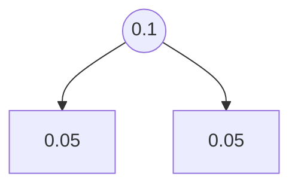
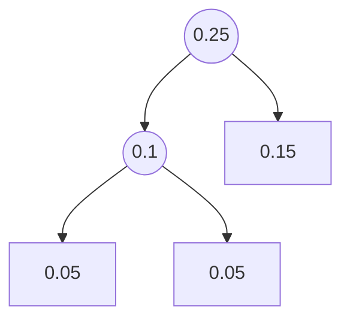
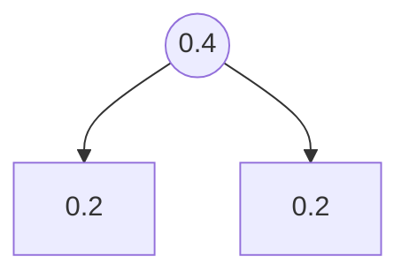
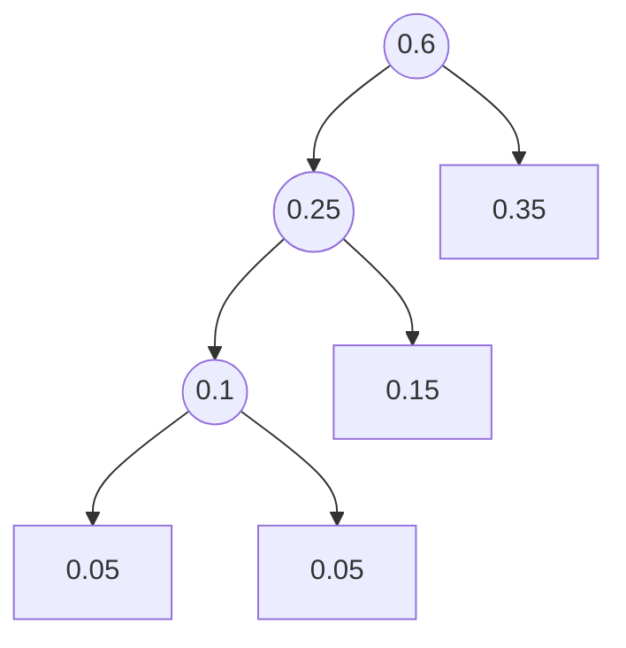
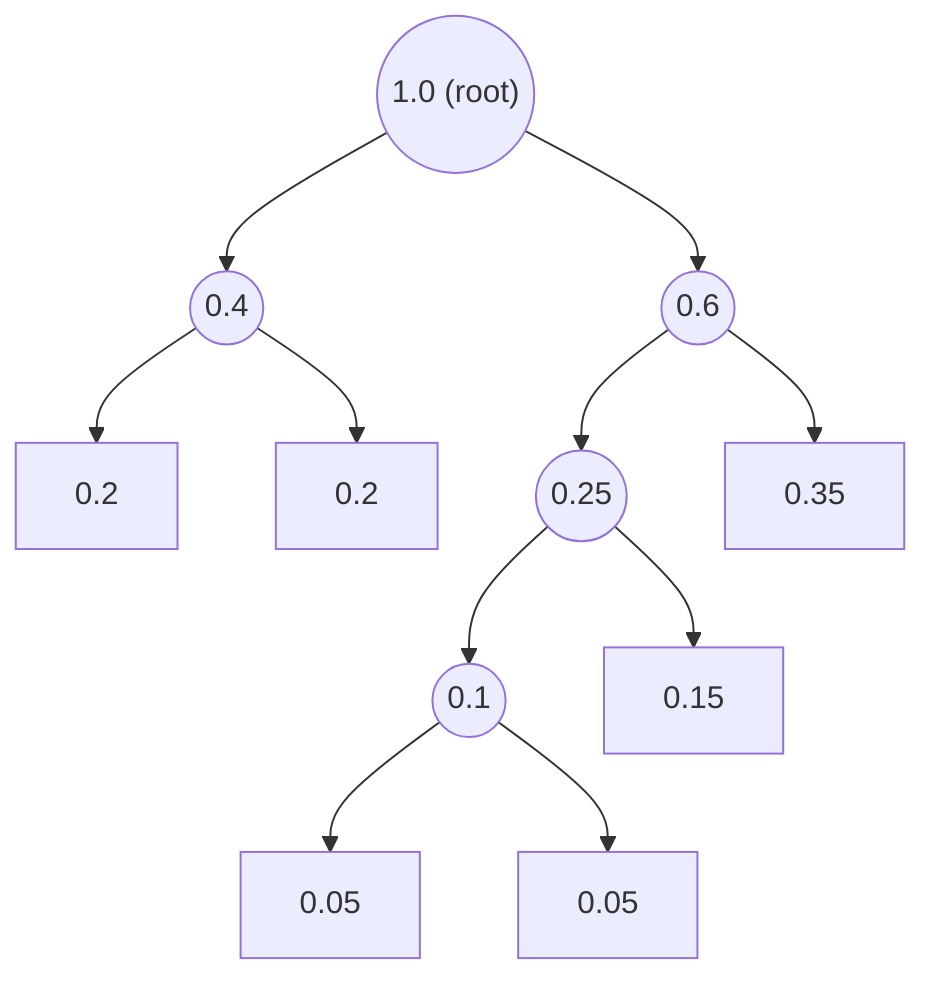
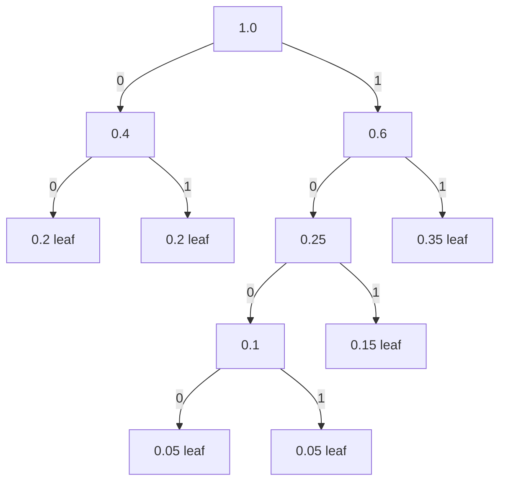

## One-sentence definition

Huffman coding is a greedy, bottom-up algorithm that builds the binary-tree
representation of an optimal [[concepts/prefix-codes|prefix code]] for an
alphabet with given symbol probabilities, minimizing the mean weighted path
length `l̄` (§0.12.4.7).

## Core idea / invariant

A prefix code can be represented as a binary tree in which alphabet symbols
sit at the leaves and the root-to-leaf path spells out each symbol's
codeword (see [[concepts/prefix-codes]]). The optimization task is to find,
among all such trees, the one with **minimal mean weighted path length**:

```
l̄ = Σ_{c∈C} P(c) · l(c)   →   min      ...(22)
```

**Algorithmus von Huffman** (Huffman's algorithm, §0.12.4.7): events *c* from
alphabet *C* of cardinality *n* have probabilities `P(c)`. The goal is to
construct a binary tree with leaves `c ∈ C` and minimal `l̄`. The algorithm
is greedy and recursive: repeatedly take the **two** least-probable remaining
elements and merge them into a new internal node whose weight is their
probability sum, until one root remains.

## Numbered pseudocode (§0.12.4.7)

**Verbatim pseudocode (recursive form, as printed):**
```cpp
Huffman (Alphabet A)   // Erzeuge Huffman-Baum aus nicht-leerer Menge A
{ if A enthält mindestens zwei Elemente
  then
  { entnimm aus Menge A diejenigen zwei Elemente i, j
          mit kleinsten Wahrscheinlichkeiten P(i) und P(j);
    füge neues Element k mit P(k) = P(i) + P(j) zu Menge A hinzu;
    T = Huffman(A); //Rekursive Lösung des verkleinerten Problems
    füge in Baum T Blätter p_i mit Wert i und p_j mit Wert j
                                     als Söhne von Blatt p_k ein;
  }
  else { erzeuge Baum T mit einzigem Element von A in Wurzel}
  return T    // Liefere Baum als Resultat
}
```

**Numbered pseudocode (English restatement, recursive form):**
```
1. function Huffman(A):                     // A = set of (symbol, probability) items
2.     if |A| >= 2:
3.         remove from A the two elements i, j with smallest probabilities P(i), P(j)
4.         create new element k with P(k) = P(i) + P(j); add k to A
5.         T = Huffman(A)                    // recursively solve reduced problem
6.         insert leaves p_i (value i) and p_j (value j) into T as children of leaf p_k
7.     else:
8.         create tree T containing the single remaining element of A as root
9.     return T
```

**Equivalent iterative, heap-driven numbered pseudocode (as illustrated by
the worked example and the complexity analysis, §0.12.4.7–0.12.4.8):**
```
1. Create a leaf node for each symbol c in alphabet C, with weight P(c); insert all leaves into a min-priority queue Q ordered by weight.
2. While Q contains more than one node:
     a. Remove the two nodes x, y with the smallest weights from Q.
     b. Create a new internal node z with children x and y.
     c. Set weight(z) := weight(x) + weight(y).
     d. Insert z into Q.
3. The remaining single node in Q is the root of the Huffman tree.
4. The codeword for each symbol c is given by the path from root to the leaf of c (0 = left edge, 1 = right edge).
```

This iterative form is a direct consequence of repeatedly unwinding the
recursion: each recursive call extracts the two minimum-probability elements,
which is exactly the `deletemin` operation of a [[structures/priority-queue]]
backed by a [[structures/heap]].

## Worked example: a 6-symbol distribution (§0.12.4.7, Abbildung 103)

Six relative frequencies: **0.05, 0.05, 0.15, 0.2, 0.2, 0.35**.

**Step (a)–(c): merge the two smallest (0.05, 0.05) into 0.1**


Remaining sorted list after reinsertion: 0.1 / 0.15 / 0.2 / 0.2 / 0.35.

**Step (d)–(f): merge the two smallest (0.1, 0.15) into 0.25**


Remaining sorted list after reinsertion: 0.2 / 0.2 / 0.25 / 0.35.

**Step (g)–(i): merge the two smallest (0.2, 0.2) into 0.4**


Remaining list: 0.25-subtree (containing 0.1→{0.05,0.05} and 0.15), 0.35
(leaf), 0.4-subtree.

**Step (j)–(k): merge the two smallest (0.25, 0.35) into 0.6**


Remaining items: 0.4-subtree, 0.6-subtree.

**Step (l)–(o): merge the final two items (0.4, 0.6) into the root, weight 1.0**



**Step (p): completed Huffman tree with edge labels (final codewords, §0.12.4.7)**



Reading each root-to-leaf path gives the Huffman codewords; edges labeled
`0` go left, `1` go right. The greedy bottom-up merge of the two
least-probable nodes at every step guarantees a minimal mean weighted path
length — an optimal prefix code for this distribution.

## Complexity analysis (§0.12.4.8)

**Komplexität T der Erzeugung eines Huffman-Baums mit n Elementen**
(Complexity of building a Huffman tree with `n` elements):

- Sorting of the probabilities is done using a **Heap** (see
  [[structures/heap]]).
- Insertion of all elements into the heap: `T1 ∈ O(n log n)`.
- In each of the `n-1` merge steps:
  - Removal of the minimal element (*Entnahme des minimalen Elements*):
    `T_deletemin ∈ O(log n)`.
  - Merging two subtrees (*Verschmelzen zweier Teilbäume*):
    `T_Verschmelzen ∈ O(1)`.
  - Insertion of the new element into the heap (*Einfügen des neuen Elements
    in Heap*): `T_insert ∈ O(log n)`.

Total:
```
T = T1 + (n-1) · (2·T_deletemin + T_Verschmelzen + T_insert)
  ∈ O(n log n)
```

**Huffman tree construction is `O(n log n)`** overall, using a
heap-based [[structures/priority-queue]] for selecting the two
minimum-probability elements at every step. This bound sits in the same
comparison-based complexity class discussed generally in
[[concepts/complexity-classes]]; see [[concepts/big-o-notation]] for the
asymptotic notation itself.

## Reference implementation

No C++ implementation is transcribed for Huffman tree construction in these
pages — the source gives the recursive pseudocode (`Huffman(A)`, verbatim
above) and the complexity derivation via heap operations, but not runnable
code.

## Trade-offs: when to use, when not to

- Huffman coding produces an optimal prefix code for a **known, static**
  probability distribution over the alphabet; if the true distribution
  changes (e.g. across different parts of a file), a single static Huffman
  tree is no longer optimal.
- Compare with [[algorithms/lzw-compression]], which needs no a priori
  probability model at all — it builds its dictionary adaptively from the
  input stream.
- Huffman coding requires a [[structures/priority-queue]] (typically backed
  by a [[structures/heap]]) for the `O(n log n)` construction bound; without
  it, repeated linear scans for the minimum would degrade the bound.

## Common pitfalls & gotchas

- The merge step always removes **two** nodes and inserts **one** — the
  priority queue shrinks by one element per iteration, terminating after
  exactly `n-1` merges, matching the heap-operation count used in the
  complexity derivation.
- Ties in probability do not affect optimality of `l̄`, but they do affect
  which specific tree (and thus which specific codewords) is produced; the
  source does not discuss a tie-breaking rule.

## Related
- [[concepts/prefix-codes]]
- [[structures/heap]]
- [[structures/priority-queue]]
- [[algorithms/lzw-compression]]
- [[structures/trie]]
- [[concepts/big-o-notation]]
- [[concepts/complexity-classes]]

## Sources
- [[sources/grigat-trees-sorting]] §0.12.4.1, §0.12.4.7, §0.12.4.8
