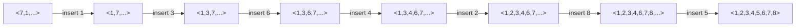

**Insertion sort (*Sortieren durch Einfügen*)** builds up a sorted prefix one element at a time by taking the next element and shifting larger elements of the sorted prefix one position to the right until the correct slot for the new element is found.

## Idea

For each index `j` from `1` to `N-1`, the invariant `a[0..j-1]` is already sorted; the algorithm takes `key = a[j]` and shifts elements of the sorted prefix greater than `key` one slot to the right, then drops `key` into the gap. This is the classic "insert into sorted hand of cards" method.

## Algorithm

```
1. for j = 1 to N-1:
2.     key = a[j]
3.     i = j - 1
4.     while i >= 0 and a[i] > key:
5.         a[i+1] = a[i]
6.         i = i - 1
7.     a[i+1] = key
```

Invariants stated in the source:
- Outer loop: `a[0..j-1]` fertig sortiert before each iteration.
- Inner loop (for `i<j-1`): `a[i+2..j] > key` and sorted; `a[i+1]=a[i+2]`; `a[i] > key`.
- After inner loop: `i==-1` oder `a[i]<=key`.

## Worked example

Example trace for sorting `<7,1,3,6,4,2,8,5>` (Tabelle 27). Italic numbers denote the element just inserted/moved in that row:

| step | a0 | a1 | a2 | a3 | a4 | a5 | a6 | a7 |
|---|---|---|---|---|---|---|---|---|
| start | 7 | *1* | 3 | 6 | 4 | 2 | 8 | 5 |
| insert 1 | *1* | 7 | 3 | 6 | 4 | 2 | 8 | 5 |
| insert 3 | 1 | *3* | 7 | 6 | 4 | 2 | 8 | 5 |
| insert 6 | 1 | 3 | *6* | 7 | 4 | 2 | 8 | 5 |
| insert 4 | 1 | 3 | *4* | 6 | 7 | 2 | 8 | 5 |
| insert 2 | 1 | *2* | 3 | 4 | 6 | 7 | 8 | 5 |
| insert 8 | 1 | 2 | 3 | 4 | 6 | 7 | *8* | 5 |
| insert 5 | 1 | 2 | 3 | 4 | *5* | 6 | 7 | 8 |

Prose: "Füge Element (1) in Liste mit dem 1. Element `<7>` ein", then "Füge Element (3) in sortierte Liste `<1,7>` ein", and so on, each step inserting the next original element into the already-sorted prefix. Final row is fully sorted: `1,2,3,4,5,6,7,8`.



## Implementation

```cpp
template <typename T>
void insertionSort(T *a) //Zahlen in sortierte Folge einfuegen
{
    for (int j = 1; j<N; j++)
    {
        // Invariante: a[0..j-1] fertig sortiert
        T key = a[j];
        // fuege a[j] in sortierte Sequenz a[0..j-1] ein
        int i = j-1;
        while ((i>=0) && (a[i]>key))
        {
            // Invariante fuer i<j-1: a[i+2..j]>key und sortiert,
            //                        a[i+1]=a[i+2], a[i]>key
            a[i+1] = a[i];
            i--;
        }
        // Invariante: i==-1 oder a[i]<=key
        a[i+1] = key;
    }
}
```

## Complexity

| | Best | Average | Worst | Extra space | Stable | In-place |
|---|---|---|---|---|---|---|
| Comparisons `C(n)` | O(n²)* | O(n²) | O(n²) | — | — | — |
| Move operations `M(n)` | O(n²)* | O(n²) | O(n²) | — | — | — |
| Total `T(n) = C(n)+M(n)` | O(n²) | O(n²) | O(n²) | O(1) | yes (shift preserves relative order of equal keys) | yes |

The source states only `C(n) ∈ O(n²)` and `M(n) ∈ O(n²)`, giving `T(n) = C(n) + M(n) ∈ O(n²) + O(n²) = O(n²)`, without separate best/average/worst cases. (*Stability and best-case O(n) behavior for nearly-sorted input are textbook-standard properties of insertion sort, not stated explicitly in this source — see Open questions.*)

## Related

- [[algorithms/sorting-overview]]
- [[algorithms/sorting-comparison]]
- [[algorithms/selection-sort]]
- [[algorithms/bubble-sort]]
- [[concepts/big-o-notation]]
- [[concepts/complexity-classes]]
- [[structures/vector]]
- [[algorithms/stl-algorithms]] — `std::sort`'s small-range optimization often falls back to insertion sort internally.

## Sources

- [[sources/grigat-trees-sorting]] §0.13.2.4, §0.13.2.5, §0.13.2.6

## Open questions

- The source's complexity statement (`T(n) ∈ O(n²)` uniformly) does not distinguish a best case; the source's own §0.13.5.6 recommends insertion sort "zum Einsortieren in nahezu sortierten Datenbestand" (for inserting into an almost-sorted dataset), which implicitly assumes a faster near-sorted case (textbook: `O(n)` best case) without stating the bound explicitly here — marked as a discrepancy to flag rather than silently filled in.
- Stability is not explicitly asserted in this source; it follows from the shift-based implementation (`a[i]>key` strict comparison never moves an equal element past `key`) but is left unconfirmed by the text itself.
