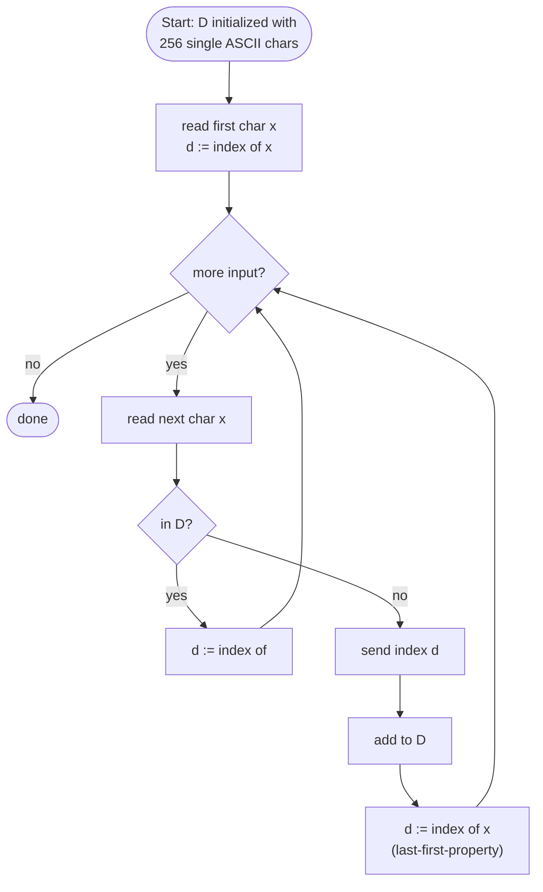
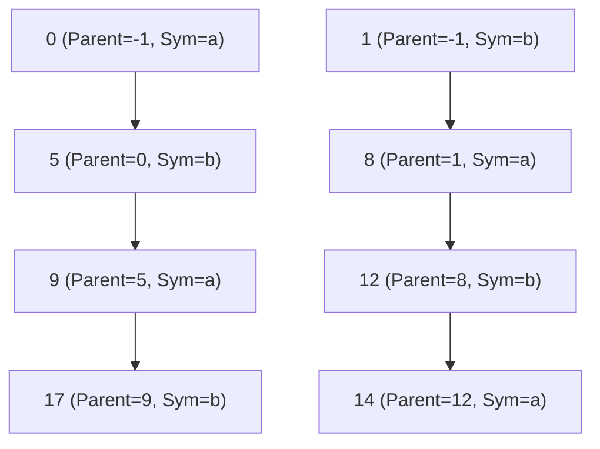

## One-sentence definition

LZW (Lempel–Ziv–Welch) coding is a dictionary-based compression algorithm
that maps variable-length input character sequences to constant-bit-length
dictionary indices (fixed length coding, **FLC**), building its dictionary
on the fly from the input stream itself (§0.12.3.1).

## Core idea / invariant

The algorithm by Lempel and Ziv (1978), modified by Welch (1984) and Phillips
(1992). The **coding table** of LZW coding (*Die Codierungstabelle der LZW
Codierung*):

- is a **Dictionary**,
- maps input character sequences of variable length to individual index
  values of constant bit length (FLC),
- is created only during the encoding process, i.e. depends on the input
  character sequence,
- is reconstructed by the decoder from the data stream, so it does **not**
  need to be transmitted explicitly.



## LZW Encoder with array, without hashing (§0.12.3.2)

**Verbatim pseudocode:**
```cpp
1 Algorithmus LZW_Encoder
2 // Dictionary D leer, Zeichen x, Index d
3 for d:=0 to 255 do              // ASCII Zeichen x zu d=0..255 eintragen
4   füge ASCII-Zeichen x zum ASCII-Index d als 1-Symbol-String zu D hinzu;
5 if (not end-of-input)
6     lies(x);                    // lies Zeichen x aus Eingabedatenstrom
7     d:= Dictionary Index von x;  // erstes Zeichen ist immer im Dictionary
8 else return;
9 endif;
10 while (not end-of-input)
11   lies(x);                     // neues Zeichen x einlesen;
12   if <D[d],x> vorhanden in D    // String um x verlängern und in D suchen
13                                 // falls verlängerter String schon vorhanden
14     d:=Dictionary Index von <D[d],x>;  // Index aktualisieren
15   else                          // falls noch nicht vorhanden
16     sende den Index d;          // Index des längsten vorhandenen Strings senden
17     füge <D[d],x> zum Dictionary hinzu;  // verlängerten String eintragen
18                                 // Sonderbehandlung nötig wenn D bereits voll
19     d:=Dictionary Index von x;  //last-first-property: initialisiere String
20   endif;                        //mit letztem Zeichen des vorherigen Strings
21 endwhile;
```

**Numbered pseudocode (English translation, same structure):**
```
1. Initialize dictionary D with all 256 single ASCII characters at indices 0..255.
2. If input is empty, return.
3. Read first character x; set d := dictionary index of x (always present).
4. While input remains:
     a. Read next character x.
     b. If the string <D[d], x> (current matched string + x) exists in D:
          d := dictionary index of <D[d], x>   (extend current match)
        Else:
          Send index d (index of the longest matched string so far).
          Add <D[d], x> to the dictionary as a new entry (special handling needed if D is full).
          d := dictionary index of x (re-initialize match with x, "last-first property").
5. End while.
```

## LZW Decoder with array, without hashing (§0.12.3.4)

**Verbatim pseudocode:**
```cpp
1 Algorithmus LZW_Decoder
2 // Dictionary D und Strings S, Sv, out zu Beginn leer, Index d, Zeichen x
3 for d:=0 to 255 do                  // ASCII Zeichen x zu d=0..255 eintragen
4   füge ASCII-Zeichen x zum ASCII-Index d als 1-Symbol-String zu D hinzu;
5 if (end-of-input) return "";        // leeren String ausgeben
6 lies (d);                           // ersten Indexwert d von Eingabe einlesen
7 Sv := D[d];                         // "Vorherigen" String Sv auf erstes Zeichen setzen...
8 out := Sv;                          // ...und an Ausgabestring anfügen
9 while (not end-of-input)
10  lies(d);                          //nächsten Indexwert d einlesen
11  if (d vorhanden in D)              // Index d in Dictionary D vorhanden?
12    S := D[d];                      // "neuen" String S aus Dictionary D auslesen
13  else                              // falls d noch nicht in D vorhanden
14    S := Sv + erstesZeichen(Sv);    // String S aus vorherigem String...
15  endif;                            // ...plus dessen erstem Zeichen kombinieren
16  out := out + S;                   // "neuen" String an Ausgabe anhängen
17  Sv + erstesZeichen(S) an nächste freie Position in D speichern;
18  Sv := S;                          // Decodierten String für nächsten Schritt sichern
19 endwhile;
20 return out;                        // Ausgabestring übergeben
```

**Numbered pseudocode (English translation):**
```
1. Initialize dictionary D with all 256 single ASCII characters at indices 0..255.
2. If input is empty, return empty string.
3. Read first index d; set Sv := D[d]; append Sv to output "out".
4. While input remains:
     a. Read next index d.
     b. If d exists in D: S := D[d].
        Else (index not yet in dictionary — the "special case"):
             S := Sv + firstChar(Sv)   (reconstruct the missing entry).
     c. Append S to out.
     d. Store (Sv + firstChar(S)) at the next free position in D.
     e. Sv := S.
5. Return out.
```

**Explanation of the special case (§0.12.3.4):** the decoder only needs the
alphabet, in a predefined order, as initialization. It builds the table
afterward from the received data stream itself. For every received symbol and
corresponding decoded string, a new table entry is created from the new
string and corresponding index, where the new string is one character longer
than the just-previously-decoded string — but its **last character is not yet
known**. The decoder waits for the next received index, decodes it, takes its
first character, appends it to the end of the previously-decoded string (the
**last-first-property**), and enters the result as a new dictionary entry: the
first character is copied from the output column into the last position of
the string in the row above.

## Worked example: encoding/decoding "mississippi" (§0.12.3.3)

Alphabet {i, m, p, s}, input stream **m i s s i s s i p p i**.

| Encoder String | Encoder Index | Sent Index | Decoder String | Decoder Index | Output String |
|---|---|---|---|---|---|
| i | 0 | - | i | 0 | - |
| m | 1 | - | m | 1 | - |
| p | 2 | - | p | 2 | - |
| s | 3 | - | s | 3 | - |
| mi | 4 | 1 | mi | 4 | i |
| is | 5 | 0 | is | 5 | s |
| ss | 6 | 3 | ss | 6 | s |
| si | 7 | 3 | si | 7 | is |
| iss | 8 | 5 | iss | 8 | si |
| sip | 9 | 7 | sip | 9 | p |
| pp | 10 | 2 | pp | 10 | p |
| pi | 11 | 2 | pi | 11 | i |
| - | - | 0 | - | - | - |

The index stream sent for "mississippi" is `1, 0, 3, 3, 5, 7, 2, 2, 0`,
with the dictionary built identically and independently by encoder and
decoder as it is received (special case at sent index 4, discussed below
under the Trie implementation, applies to the general special-case
mechanism, not specifically to this trace).

## Trie-based (hashed) implementation (§0.12.3.5–0.12.3.8)

Storing full strings per dictionary entry is wasteful; **0.12.3.5 LZW
Encoder mit Trie** instead stores each entry as a `(parent address, symbol)`
pair in a hashed Trie: a node's full string key is reconstructed only when
needed by walking up to the root, and its hash can be recomputed at any time
from `(parent, symbol)`.

### Encoder trace: "abababababab" (§0.12.3.5)

Str = current string being matched, Hash = hash function result (collision
resolved via secondary hash `h₁`), Stat = neu (new)/vorh. (already present)/
Koll. (collision), Adr = address assigned, Par = parent pointer, Sym =
symbol on the edge from parent, Send = index actually transmitted (with the
string it represents in parentheses):

| Str | Hash | Stat | Adr | Par | Sym | Send |
|---|---|---|---|---|---|---|
| a | | | 0 | | a | |
| b | | | 1 | | b | |
| ab | h(0,1)=5 | neu | 5 | 0 | b | 0 (a) |
| ba | h(1,0)=8 | neu | 8 | 1 | a | 1 (b) |
| ab | h(0,1)=5 | vorh. | | 0 | | |
| aba | h(5,0)=8 | Koll. | | 5 | | |
| | h₁(5,0)=9 | neu | 9 | 5 | a | 5 (ab) |
| ab | h(0,1)=5 | vorh. | | 0 | | |
| aba | h(5,0)=8 | Koll. | | 5 | | |
| | h₁(5,0)=9 | vorh. | | 5 | | |
| abab | h(9,1)=17 | neu | 17 | 9 | b | 9 (aba) |
| bab | h(8,1)=12 | neu | 12 | 8 | b | 8 (ba) |
| baba | h(12,0)=14 | neu | 14 | 12 | a | 12 (bab) |

**Resulting Trie (§0.12.3.6, LZW Trie von abababababab)** — each node labeled
with its address and its `(Parent, Symbol)` pair:



### Decoder trace: same Trie, from the received index stream (§0.12.3.7)

In = received index, Str = decoded string fragment, Hash = hash computed,
Adr = address found, Par = parent, Sym = symbol, Out = output appended (with
the consumed index in parentheses):

| In | Str | Hash | Adr | Par | Sym | Out |
|---|---|---|---|---|---|---|
| | a | | 0 | – | a | |
| | b | | 1 | | b | |
| 0 | | | | | | a (0) |
| 1 | ab | h(0,1)=5 | 5 | 0 | b | b (1) |
| 5 | ba | h(1,0)=8 | 8 | 1 | a | ab (5) |
| 9 | aba | h(5,0)=8 | 9 | 5 | a | aba (9) |
| 8 | abab | h(9,1)=17 | 17 | 9 | b | ba (8) |
| 12 | bab | h(8,1)=12 | 12 | 8 | b | bab (12) |

**Remarks (§0.12.3.8):**
- When the dictionary is full, new entries can only displace
  (*verdrängen*) old entries.
- When the decoder cannot find an address in the dictionary, the entry was
  created in the encoder's dictionary immediately beforehand (*unmittelbar
  davor*), and the decoder is only missing the **last** character of the
  string — but this is exactly the **first** character of the next string to
  be decoded (here: the same string). So the first and last character of
  this string are identical. This is the **last-first property**, occurring
  at addresses 9 and 12 in the example above.
- Every node contains the parent address and the index of the last
  character; from these, the hash value can be recomputed at any time.

## Complexity

The source does not give an explicit Landau-notation complexity statement
for LZW encoding/decoding on these pages; the array-based variant performs
`O(1)` dictionary work per output symbol assuming direct indexing, while the
Trie/hashed variant trades array lookups for `O(1)`-amortized hashed lookups
(subject to collision handling via the secondary hash `h₁`) at substantially
lower memory cost per dictionary entry (storing `(parent, symbol)` instead of
the full string).

## Reference implementation

No runnable C++ is transcribed in these pages — only the German/English
pseudocode reproduced verbatim above for the array-based encoder/decoder, and
the trace tables for the Trie-based (hashed) variant.

## Trade-offs: when to use, when not to

- The array-based implementation is simple but stores full strings per
  dictionary entry — memory cost grows with string length.
- The Trie-based implementation (§0.12.3.5–0.12.3.8) stores only
  `(parent, symbol)` per node, dramatically reducing memory, at the cost of
  needing a hash function (and collision resolution) to locate dictionary
  entries by `(parent, symbol)` instead of direct array indexing.

## Related
- [[structures/trie]]
- [[structures/hash-table]]
- [[concepts/prefix-codes]]
- [[algorithms/huffman-coding]]
- [[concepts/big-o-notation]]
- [[concepts/complexity-classes]]
- [[concepts/strings-cpp-vs-c]]

## Sources
- [[sources/grigat-trees-sorting]] §0.12.3.1, §0.12.3.2, §0.12.3.3, §0.12.3.4, §0.12.3.5, §0.12.3.6, §0.12.3.7, §0.12.3.8
