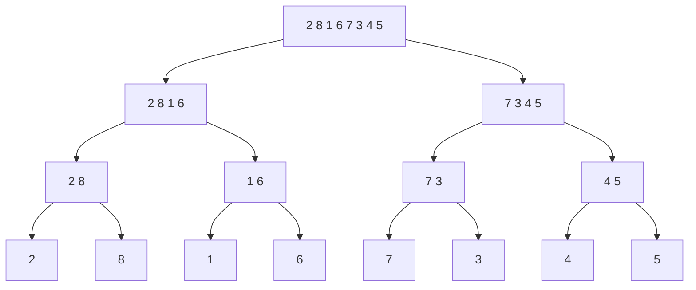

**Merge sort (*Mergesort*)** is a [[concepts/divide-and-conquer|divide-and-conquer]] sort that recursively splits the array in half, sorts each half independently, and then merges the two sorted halves back together in linear time.

## Idea

`mergeSort(a, l, r)` sorts `a[l..r-1]`. If the range holds more than one element it computes the midpoint `m`, recursively sorts `a[l..m-1]` and `a[m..r-1]` (Divide + Conquer), and combines the two sorted sub-ranges with the `merge` operation (Merge). The entire ordering work happens in `merge`; `Divide`/`Conquer` only split indices.

## Algorithm

```
1. function mergeSort(a, l, r):      // sorts a[l..r-1]
2.     if l < r - 1:
3.         m = (l + r) / 2          // integer division rounds down
4.         mergeSort(a, l, m)        // Divide + Conquer left half
5.         mergeSort(a, m, r)        // Divide + Conquer right half
6.         merge(a, l, m, r)         // Merge the two sorted halves
```

**Merge operation** — merges `a[l..m-1]` and `a[m..r-1]`:

```
1. function merge(a, l, m, r):
2.     n1 = m - l                    // size of left part
3.     n2 = r - m                    // size of right part
4.     copy a[l .. m-1] into llist
5.     copy a[m .. r-1] into rlist
6.     i = 0; j = 0; k = l
7.     while k < r:
8.         if i < n1 and j < n2:
9.             if llist[i] < rlist[j]:
10.                a[k] = llist[i]; i++; k++
11.            else:
12.                a[k] = rlist[j]; j++; k++
13.        else:
14.            while i < n1: a[k]=llist[i]; i++; k++
15.            while j < n2: a[k]=rlist[j]; j++; k++
```

## Worked example

Example: sorting `<2,8,1,6,7,3,4,5>` with Mergesort.

**Divide (conceptual splitting, no array changes yet):**

| Stage | Array |
|---|---|
| Divide 1, Conquer 1 | 2 8 1 6 7 3 4 5 |
| Divide 2, Conquer 2 | 2 8 1 6 \| 7 3 4 5 |
| Divide 3, Conquer 3 | 2 8 \| 1 6 \| 7 3 \| 4 5 |
| (leaves) | 2 \| 8 \| 1 \| 6 \| 7 \| 3 \| 4 \| 5 |

**Merge (combining sub-lists back up):**

| Stage | Array |
|---|---|
| Merge 3 | 2 8 \| 1 6 \| 3 7 \| 4 5 |
| Merge 2 | 1 2 6 8 \| 3 4 5 7 |
| Merge 1 | 1 2 3 4 5 6 7 8 |



## Implementation

```cpp
template <typename T>
void mergeSort(T *a, int l, int r)  // sortiere a[l..r-1]
{
    if (l<(r-1))
    {
//==> Divide: Aufteilung in Teilprobleme
        int m = (l+r)/2; // int-Division rundet abwaerts
//==> Conquer: Rekursiv Problemlösung starten
        mergeSort(a, l, m); // sortiere a[l..m-1]
        mergeSort(a, m, r); // sortiere a[m..r-1]
//==> Merge: Teillösungen zusammenfügen
        merge(a, l, m, r);  // Zusammenfuegen der Teillisten
                            // a[l..m-1] und a[m..r-1]
    }
}
```

The merge operation, verbatim (reconstructed from the two consecutive printed pages where the code is split):

```cpp
template <typename T>
void merge (T *a, int l,
            int m, int r)
{
int n1 = m-l; //# links
int n2 = r-m; //# rechts
std::vector<T> llist;
std::vector<T> rlist;
for (int i=0; i<n1; i++)
{ // Kopie linker
  // Teilliste anlegen
  llist.push_back(a[l+i]);
}
for (int j=0; j<n2; j++)
{ // Kopie rechter
  // Teilliste anlegen
  rlist.push_back(a[m+j]);
}

int i=0; int j=0; int k=l;
while (k<r)
{
  if ((i<n1) && j<n2)
  // noch nicht am Ende
  // einer Teilliste
  {
    if (llist[i]<rlist[j])
    // kleineres Element
    // uebernehmen
    { a[k] = llist[i];
      i++; k++;
    }
    else
    { a[k] = rlist[j];
      j++; k++;
    } }

  else
  // am Ende einer
  // Teilliste die
  // restlichen Elemente
  // der anderen Teilliste
  // uebernehmen
    {
        while (i < n1)
        { a[k] = llist[i];
          i++;
          k++;
        }
        while (j < n2)
        { a[k] = rlist[j];
          j++;
          k++;
        }
    } } }
```

## Complexity

**Komplexität bei Implementierung mit Liste (list-based implementation):**

```
T(n) ∈ { O(1)                         falls n = 1
       { O(n) + 2·T(n/2) + O(n)       falls n > 1
```

**Komplexität bei Implementierung mit Array (array-based implementation):**

```
T(n) ∈ { O(1)                         falls n = 1
       { O(1) + 2·T(n/2) + O(n)       falls n > 1
```

**Resolving the recurrence:** sub-list length halves at every recursion step; `n` elements ⇒ `log n` recursion steps of `O(n)` work each ⇒ `T(n) ∈ log n · O(n) = O(n log n)`.

| | Best | Average | Worst | Extra space | Stable | In-place |
|---|---|---|---|---|---|---|
| Total `T(n)` | O(n log n) | O(n log n) | O(n log n) | O(n) (auxiliary `llist`/`rlist`) | yes | no |

The source notes mergesort guarantees `O(n log n)` in all cases (best/average/worst), unlike insertion/bubble/selection sort, but is not in-place — it needs auxiliary `llist`/`rlist` arrays — and is stable.

## Related

- [[concepts/divide-and-conquer]]
- [[algorithms/quicksort]]
- [[algorithms/sorting-overview]]
- [[algorithms/sorting-comparison]]
- [[concepts/big-o-notation]]
- [[concepts/complexity-classes]]
- [[structures/vector]] — `std::vector` is used directly as the auxiliary storage in `merge`.
- [[algorithms/stl-algorithms]] — `std::stable_sort` is typically implemented as a merge sort variant.
- [[algorithms/external-merge-sort]] — the external-storage extension of this same merge operation (owned elsewhere; link only).

## Sources

- [[sources/grigat-trees-sorting]] §0.13.3.2, §0.13.3.3, §0.13.3.4, §0.13.3.5

## Open questions

- None — complexity, stability, and in-place status are all as stated by the source.
