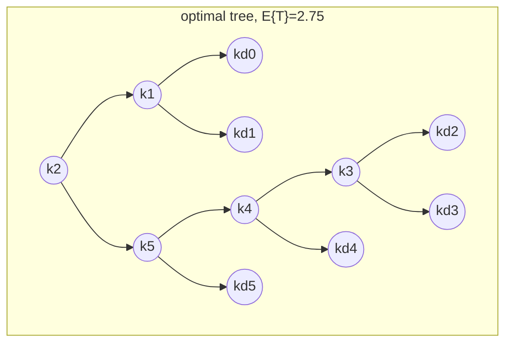
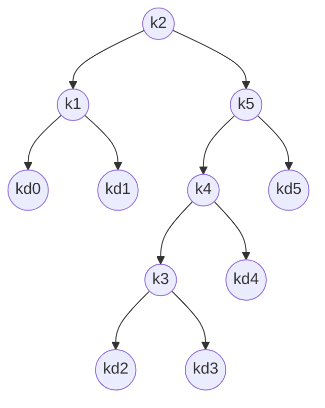

## One-sentence definition

An **optimal binary search tree** is a [[structures/binary-search-tree]]
constructed, via [[concepts/dynamic-programming]], to minimize the expected
search cost when the probability of searching for each key is known in
advance (§0.11.6.1).

## Core idea / invariant (§0.11.6.1–§0.11.6.2)

A plain [[structures/binary-search-tree]] avoids pathological degeneration
via the [[structures/avl-tree]]'s balance invariant, but that is a
*structural* criterion. If, in addition, the individual probabilities with
which elements are searched for are known, a *better* arrangement exists:
one that places frequently-searched keys near the root.

**Given:** a sequence `K = ⟨k1, k2, …, kn⟩` of `n` pairwise distinct keys
with `k1 < k2 < … < kn`, plus `n+1` dummy keys `kd0, kd1, …, kdn` that
represent unsuccessful searches:

- `kd0` represents all keys smaller than `k1`.
- `kdn` represents all keys larger than `kn`.
- `kdi` (for `i = 1, …, n−1`) represents all keys strictly between `ki` and
  `k(i+1)`.

Each real key `ki` is a search probability `Pi`; each dummy key `kdi` has a
search probability `Pdi`. Real keys live in inner nodes; dummy keys live in
leaves. Every search is either successful (a real key found) or
unsuccessful (a dummy key found), so:

```
Σ(i=1..n) Pi + Σ(i=0..n) Pdi = 1         (14)
```

**Expected cost `E{T}`:** let `tiefe_T(p)` be the depth (*Tiefe*) of node
`p` in tree `T`. The cost of finding `pi` is the number of checked nodes,
`tiefe_T(pi) + 1`:

```
E{T} = Σ(i=1..n) (tiefe_T(pi)+1)·Pi + Σ(i=0..n) (tiefe_T(pdi)+1)·Pdi
     = 1 + Σ(i=1..n) tiefe_T(pi)·Pi + Σ(i=0..n) tiefe_T(pdi)·Pdi      (15)
```

### Worked probabilities (Tabelle 19/20)

| i | 0 | 1 | 2 | 3 | 4 | 5 |
|---|---|---|---|---|---|---|
| `Pi` | — | 0.15 | 0.10 | 0.05 | 0.10 | 0.20 |
| `Pdi` | 0.05 | 0.10 | 0.05 | 0.05 | 0.05 | 0.10 |

Abbildung 92 compares two trees over the same keys: (a) a
**height-balanced but suboptimal** arrangement with `E{T} = 2.85`, and (b)
the **optimal** arrangement with `E{T} = 2.75` — balance alone does not
guarantee minimum expected cost.



## The dynamic-programming construction, in the script's four steps

This problem is solved by [[concepts/dynamic-programming]]; the script
presents the construction in four numbered steps.

### Schritt 1/4 — structure of an optimal BST (§0.11.6.3)

- Every subtree must contain keys from a **contiguous range**
  `ki, …, kj` with `1 ≤ i ≤ j ≤ n`, plus the dummy keys `kd(i-1), …, kdj` as
  leaves.
- **Optimal substructure:** every subtree of an optimal BST is itself
  optimal for its own key range. *Proof (by contradiction):* if a subtree
  `T'` over `ki, …, kj` were not optimal, a cheaper tree `T''` over the same
  keys could replace it, strictly decreasing the total cost `E{T}` —
  contradicting `T`'s optimality.
- **Search for the optimum:** for keys `ki, …, kj`, let key `kr`
  (`i ≤ r ≤ j`) be the root. Its left subtree holds `ki, …, k(r-1)`
  (plus `kd(i-1), …, kd(r-1)`); its right subtree holds `k(r+1), …, kj`
  (plus `kdr, …, kdj`). Compare *all* candidate roots `r` and pick the one
  minimizing total expected cost.
- **Empty-subtree convention:** if `r = i` (leftmost key is root), its "left
  subtree" is by convention just the dummy leaf `kd(i-1)`; symmetrically, if
  `r = j`, its "right subtree" is just `kdj`.

### Schritt 2/4 — recursive formulation (§0.11.6.4)

Let `e[i,j]` be the expected cost of searching the optimal subtree over
keys `ki, …, kj`; the goal is `E{T} = e[1,n]`.

Inserting a subtree under a new root increases every node's depth by 1,
hence (from eq. 15) the expected cost increases by:

```
w[i,j] := Σ(l=i..j) Pl + Σ(l=i-1..j) Pdl         (16)
```

giving:

```
e[i,j] = Pr + (e[i,r-1] + w[i,r-1]) + (e[r+1,j] + w[r+1,j])      (17)
```

Since `w[i,j] = w[i,r-1] + Pr + w[r+1,j]`, this simplifies to:

```
e[i,j] = e[i,r-1] + e[r+1,j] + w[i,j]      (18)
```

**The recurrence** (choosing the root `r` minimizing cost):

```
Initialisierung:  e[i,j] = Pd(i-1)   falls j = i-1  ∀ i = 1,…,n        (19)
Induktion:        e[i,j] = min_{i≤r≤j} { e[i,r-1] + e[r+1,j] + w[i,j] }
                  falls i ≤ j                                             (20)
Terminierung:     e[1,n] = min_{1≤r≤n} { e[1,r-1] + e[r+1,n] + w[1,n] }    (21)
```

```
1. function e(i, j):
2.     if j == i - 1:
3.         return Pd[i-1]
4.     best <- +infinity
5.     for r from i to j:
6.         cost <- e(i, r-1) + e(r+1, j) + w(i, j)
7.         if cost < best:
8.             best <- cost
9.     return best
```

### Schritt 3/4 — bottom-up table computation of the optimal cost (§0.11.6.5)

Rather than recomputing overlapping subproblems (as naive recursion would),
tabulate bottom-up:

- `e[1…n+1, 0…n]`: index runs to `n+1` because `e[n+1,n]` is the cost of the
  empty subtree with dummy key `kdn`; the second index starts at `0` because
  `e[1,0]` is the cost of the empty subtree with dummy key `kd0`. Only
  entries with `j ≥ i-1` are needed.
- `wurzel[i,j]`: stores the chosen root for the optimal subtree over
  `ki, …, kj`. Only entries for `1 ≤ i ≤ j ≤ n` are needed.
- `w[1…n+1, 0…n]`: start with `w[i, i-1] = Pd(i-1)` for `1 ≤ i ≤ n+1`; then,
  for each run length `s = j-i+1 ∈ {1, …, n}` and each `i ∈ {1, …, n+1-s}`,
  compute `w[i,j] = w[i,j-1] + Pj + Pdj` with `j = i-1+s` (eq. 16).

**Complexity of computing the optimal tree: O(n³).**

### Schritt 4/4 — top-down construction of the actual tree (§0.11.6.6)

Read `wurzel[1,n]` to get the overall root index `r`; use `kr` as the root
node. Recursively read `wurzel[1, r-1]` and `wurzel[r+1, n]` to determine
the next roots, and so on down to the dummy leaves.

```
1. function OptimalBST(P[1..n], Pd[0..n]):
2.     for i from 1 to n+1:
3.         w[i, i-1] <- Pd[i-1]
4.         e[i, i-1] <- Pd[i-1]
5.     for s from 1 to n:
6.         for i from 1 to n+1-s:
7.             j <- i - 1 + s
8.             w[i,j] <- w[i,j-1] + P[j] + Pd[j]
9.             e[i,j] <- +infinity
10.            for r from i to j:
11.                cost <- e[i,r-1] + e[r+1,j] + w[i,j]
12.                if cost < e[i,j]:
13.                    e[i,j] <- cost
14.                    wurzel[i,j] <- r
15.    return e, wurzel

16. function BuildTree(wurzel, i, j):
17.     if j < i:
18.         return a dummy leaf node
19.     r <- wurzel[i,j]
20.     node <- new node with key k_r
21.     node.left <- BuildTree(wurzel, i, r-1)
22.     node.right <- BuildTree(wurzel, r+1, j)
23.     return node
```

## Worked example: filling the e[i,j] / w[i,j] / wurzel[i,j] tables (§0.11.6.7)

Using the probabilities from Tabelle 19/20 above:

### Tabelle 21: `w[i,j]` (rows `j=5..0`, columns `i=1..6`)

| j\i | 1 | 2 | 3 | 4 | 5 | 6 |
|---|---|---|---|---|---|---|
| 5 | 1.0 | 0.80 | 0.60 | 0.50 | 0.35 | 0.10 |
| 4 | 0.70 | 0.50 | 0.30 | 0.20 | 0.05 | |
| 3 | 0.55 | 0.35 | 0.15 | 0.05 | | |
| 2 | 0.45 | 0.25 | 0.05 | | | |
| 1 | 0.30 | 0.10 | | | | |
| 0 | 0.05 | | | | | |

### Tabelle 22: `e[i,j]` (rows `j=5..0`, columns `i=1..6`)

| j\i | 1 | 2 | 3 | 4 | 5 | 6 |
|---|---|---|---|---|---|---|
| 5 | 2.75 | 2.00 | 1.30 | 0.90 | 0.50 | 0.10 |
| 4 | 1.75 | 1.20 | 0.60 | 0.30 | 0.05 | |
| 3 | 1.25 | 0.70 | 0.25 | 0.05 | | |
| 2 | **0.90** | 0.40 | 0.05 | | | |
| 1 | 0.45 | 0.10 | | | | |
| 0 | 0.05 | | | | | |

### Tabelle 23: `wurzel[i,j]` (rows `j=5..1`, columns `i=1..5`)

| j\i | 1 | 2 | 3 | 4 | 5 |
|---|---|---|---|---|---|
| 5 | **2** | 4 | 5 | 5 | 5 |
| 4 | 2 | 2 | 4 | 4 | |
| 3 | 2 | 2 | 3 | | |
| 2 | 1 | 2 | | | |
| 1 | 1 | | | | |

`e[1,5] = 2.75` matches the optimal tree from Abbildung 92(b)/94;
`wurzel[1,5] = 2` matches the `k2`-rooted tree below. The numeric
candidate-by-candidate derivation behind these tables (§0.11.6.7, printed
p. 329) is: single-key subtrees have one candidate (e.g. `e[1,1] =
min(0.45)`); two-key subtrees compare two candidates (e.g. `e[1,2] =
min(0.90, 0.95) = 0.90`); up to the full five-key problem, which compares
five candidates: `e[1,5] = min(3.05, 2.75, 2.80, 2.75, 2.85) = 2.75`. Note
this final minimum is **tied** between `r=2` and `r=4` (both `2.75`); the
table records `wurzel[1,5] = 2`, i.e. the first minimum encountered.

## Worked example: top-down tree construction (§0.11.6.8)

Reading `wurzel` top-down:

```
1. root of [1,5] = wurzel[1,5] = 2  → place k2 as overall root
2. left subtree [1,1]: wurzel[1,1] = 1 → place k1 (leaves kd0, kd1)
3. right subtree [3,5]: wurzel[3,5] = 5 → place k5 as root of right subtree
4. left subtree of k5 is [3,4]: wurzel[3,4] = 4 → place k4
5. left subtree of k4 is [3,3]: wurzel[3,3] = 3 → place k3 (leaves kd2, kd3)
6. right subtree of k4 is [5,4] (empty) → leaf kd4
7. right subtree of k5 is [6,5] (empty) → leaf kd5
```

The final constructed tree (Abbildung 95(i)):



This matches Abbildung 92(b) exactly, confirming `E{T} = 2.75`.

## Complexity table

| Phase | Complexity | Assumption |
|---|---|---|
| Table computation (`e`, `w`, `wurzel`) | **O(n³)** | `O(n²)` subproblems `e[i,j]`, each scanning `O(n)` candidate roots `r` |
| Tree construction from `wurzel` | O(n) | one visit per final node |
| `member` on the resulting tree | O(log n) typical, bounded by the tree's actual (probability-weighted) depth | optimal only w.r.t. the given probability distribution, not worst case |

See [[concepts/big-o-notation]] and [[concepts/complexity-classes]].

## Trade-offs: when to use, when not to

- Use an optimal BST when search-probability data per key is known in
  advance and is static (or rarely changes) — e.g. compiler symbol tables
  built from profiling data.
- The O(n³) construction cost makes this unsuitable for highly dynamic key
  sets; a plain [[structures/binary-search-tree]] or
  [[structures/avl-tree]] is preferable when keys are inserted/deleted
  frequently, since this structure is static once built.

## Common pitfalls & gotchas

- Forgetting the `n+1` dummy keys representing unsuccessful searches —
  without them, the cost model only accounts for hits, not misses.
- Index off-by-ones in `e[i,j]`/`w[i,j]`: the tables must extend to
  `e[n+1,n]` and `e[1,0]` to represent empty subtrees at the boundaries.

## Related
- [[concepts/dynamic-programming]] — the general technique this algorithm
  instantiates.
- [[structures/binary-search-tree]] — the structure being optimized.
- [[structures/avl-tree]] — an alternative that balances structurally
  instead of by probability.
- [[concepts/big-o-notation]]
- [[concepts/complexity-classes]]

## Sources
- [[sources/grigat-algorithms-data-structures]] §0.11.6.1, §0.11.6.2,
  §0.11.6.3, §0.11.6.4, §0.11.6.5, §0.11.6.6, §0.11.6.7, §0.11.6.8
