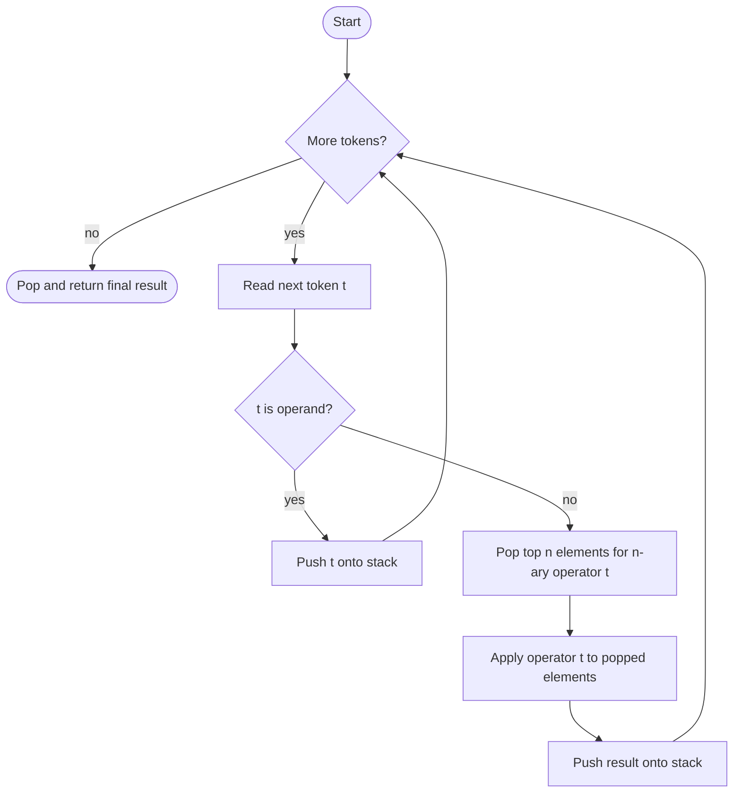

## One-sentence definition

Evaluating a postfix (reverse Polish, *umgekehrte polnische Notation*)
expression means scanning its tokens left to right while using a
[[structures/stack]] to hold intermediate operands and results, with no need
for operator precedence rules or parentheses (§0.4.1.2).

## Core idea / invariant

**Invariant:** after processing a prefix of the token stream, the stack holds
exactly the operand values of all sub-expressions that have been fully
reduced so far, bottom-to-top in the order they still need combining.

**Algorithm (§0.4.1.2):** for each token in the postfix expression:
- if the token is an operand → push it onto the stack
- if the token is an n-ary operator → pop the topmost n elements from the
  stack, apply the operator to them, and push the result back onto the stack

When the stream is exhausted, the stack holds exactly one value: the result.

## Numbered pseudocode

```
1. create an empty stack S
2. for each token t in the postfix expression, left to right:
3.     if t is an operand:
4.         push(S, t)
5.     else if t is an n-ary operator:
6.         operands[n] <- pop the top n elements from S
             (in the order they were pushed, i.e. reverse pop order)
7.         result <- apply(t, operands)
8.         push(S, result)
9. return pop(S)   // the single remaining value is the final result
```

## Worked example: `3 5 + 6 4 - *`

| Step | Token | Action | Stack (bottom → top) |
|---|---|---|---|
| 1 | `3` | push 3 | 3 |
| 2 | `5` | push 5 | 3, 5 |
| 3 | `+` | pop 5, 3 → push 3+5=8 | 8 |
| 4 | `6` | push 6 | 8, 6 |
| 5 | `4` | push 4 | 8, 6, 4 |
| 6 | `-` | pop 4, 6 → push 6−4=2 | 8, 2 |
| 7 | `*` | pop 2, 8 → push 8×2=16 | 16 |
| 8 | — | final result | 16 |

Reading: push 3; push 5; `+` pops 5,3 and pushes 8; push 6; push 4; `-` pops
4,6 and pushes 2; `*` pops 2,8 and pushes 16 (final result).

## Control-flow diagram



## Complexity

| Aspect | Bound | Assumption |
|---|---|---|
| Time | O(m) | m = number of tokens in the postfix expression; each token is processed once with O(1) stack operations (assuming O(1) operator application, e.g. fixed-arity arithmetic) |
| Space | O(m) | worst case all tokens are operands pushed before any operator is seen (e.g. no operators at all); average case space is bounded by the maximum stack depth reached during evaluation |

## Reference implementation

```cpp
#include <sstream>
#include <stack>
#include <stdexcept>
#include <string>

double evaluatePostfix(const std::string& expr)
{
    std::stack<double> s;
    std::istringstream iss(expr);
    std::string token;

    while (iss >> token)
    {
        if (token == "+" || token == "-" || token == "*" || token == "/")
        {
            if (s.size() < 2)
                throw std::runtime_error("malformed postfix expression");
            double rhs = s.top(); s.pop();
            double lhs = s.top(); s.pop();
            double result = 0.0;
            if (token == "+") result = lhs + rhs;
            else if (token == "-") result = lhs - rhs;
            else if (token == "*") result = lhs * rhs;
            else result = lhs / rhs;
            s.push(result);
        }
        else
        {
            s.push(std::stod(token));
        }
    }

    if (s.size() != 1)
        throw std::runtime_error("malformed postfix expression");
    return s.top();
}
```

## Trade-offs: when to use, when not to

- Use postfix evaluation when expressions are already generated in postfix
  (e.g. by a compiler's expression-tree linearization, or an RPN calculator
  input) — it avoids building an explicit precedence parser.
- Converting ordinary infix expressions to postfix first (e.g.
  shunting-yard) is a separate concern not covered by these notes; this page
  only covers evaluating an already-postfix expression.

## Common pitfalls & gotchas

- Binary operators must pop operands in the correct order: the operand
  pushed **second** (top of stack) is the right-hand side, not the left-hand
  side — reversing this silently breaks non-commutative operators (`-`, `/`).
- An expression with too few operands before an operator, or more than one
  value left on the stack at the end, indicates a malformed postfix
  expression and should be treated as an error rather than silently
  truncated.

## Related
- [[structures/stack]]
- [[concepts/operators-and-precedence]]
- [[concepts/abstract-data-type]]

## Sources
- [[sources/grigat-cpp-concepts-generic]] §0.4.1.2
