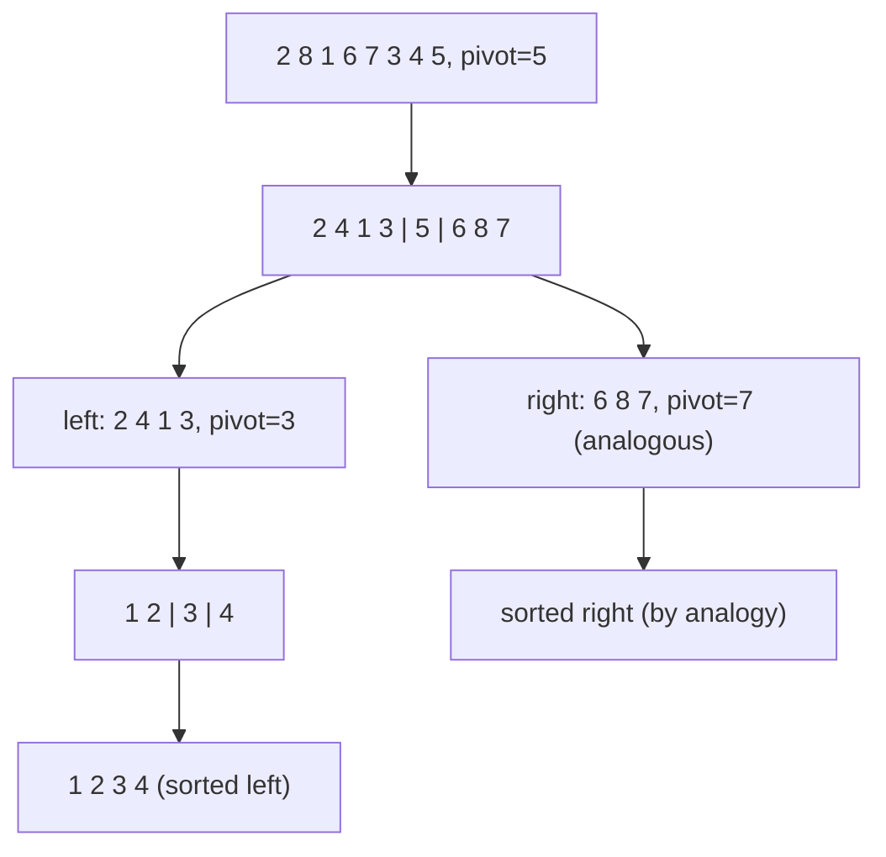

**Quicksort** is a [[concepts/divide-and-conquer|divide-and-conquer]] sort that chooses a pivot element, partitions the array in place so everything `≤` the pivot comes before it and everything `≥` the pivot comes after it, and then recursively sorts the two partitions — with no separate merge step needed.

## Idea

`quickSort(a, l, r)` sorts `a[l..r-1]` by choosing a pivot element *x* (arbitrarily) per step and creating two sub-sequences ordered only with respect to *x*, such that `a[l...m-1] ≤ x = a[m] ≤ a[m+1...r-1]`. The `partition` operation does all the rearranging work (Divide); the two halves are then sorted independently (Conquer), and — because `partition` already places every element on the correct side of the pivot — "Merge nicht erforderlich" (no Merge needed).

## Algorithm

```
1. function quickSort(a, l, r):           // sorts a[l..r-1]
2.     if l < r - 1:
3.         m = partition(a, l, r)         // Divide
4.         quickSort(a, l, m)             // Conquer left part a[l..m-1]
5.         quickSort(a, m+1, r)           // Conquer right part a[m+1..r-1]
                                          // (no Merge needed)

6. function partition(a, l, r):
7.     x = a[r-1]                        // pivot = element with largest index
8.     i = l; j = r-1
9.     while i < j:
10.        while i < j and a[i] <= x: i++
11.        while i < j and x <= a[j]: j--
12.        if i < j: swap(a[i], a[j])
13.    swap(a[i], a[r-1])                // place pivot at its final position
14.    return i
```

## Worked example

Example: sorting `<2,8,1,6,7,3,4,5>` with Quicksort (Tabelle 30, trace for the left partition only; the right sub-list proceeds analogously — "Rechte Teilliste entsprechend"). Pivot is always the last element of the current sub-range.

| step | a0 | a1 | a2 | a3 | a4 | a5 | a6 | a7 | note |
|---|---|---|---|---|---|---|---|---|---|
| start | 2 | 8 | 1 | 6 | 7 | 3 | 4 | 5 | `l,i` initial; `r-1,j` at a7, pivot x=5 |
| scan | 2 | 4 | 1 | 6 | 7 | 3 | 8 | 5 | `i` advances; `j` moves left, swap at a1 |
| scan | 2 | 4 | 1 | 3 | 7 | 6 | 8 | 5 | further `i`/`j` swaps |
| converge | 2 | 4 | 1 | 3 | 5 | 6 | 8 | 7 | `i=j=m=4` reached, pivot `5` placed; left region `a[0..3]`, right region `a[5..7]` |
| recurse left | 2 | 1 | 4 | 3 | 5 | 6 | 8 | 7 | recursive partition of `a[0..3]`, pivot picks `a3=3` |
| converge | 2 | 1 | 3 | 4 | 5 | 6 | 8 | 7 | `i,j` converge at `m=2` |
| done (left) | 1 | 2 | 3 | 4 | 5 | 6 | 8 | 7 | left-most partition done |

Final row shown in the source is `1 2 3 4 5 6 8 7` — positions 6/7 (`8,7`) remain to be fixed by the recursive call on the right sub-list, handled analogously and not detailed further in the source ("Rechte Teilliste entsprechend").



## Implementation

```cpp
template <typename T>
void quickSort(T *a, l, r)   // sortiere a[l..r-1]
{
    if (l<r-1)
    {
        int m = partition(a, l, r);  // Divide
            // Es gilt nun a[l..m-1]<=a[m]<=a[m+1..r-1]
            // mit zwei noch in sich unsortierten Teilfolgen
            // a[l..m-1] und a[m+1..r-1]
        quickSort(a, l, m);                  // Conquer: sortiere a[l..m-1]
        quickSort(a, m+1, r);                // Conquer: sortiere a[m+1..r-1]
                                              // Merge nicht erforderlich
    } }
```

The partition operation, verbatim:

```cpp
template <typename T>
int partition(T *a, int l, int r)
{ // Als Pivotelement x wählen wir das
  // Array-Element mit größtem Index
    T& x = a[r-1]; // Pivotelement
    int i = l;      // Linksindex
    int j = r-1;    // Rechtsindex
    while (i<j) // äußere Schleife
    {//Ab 2. Schleifendurchlauf gilt:
     //a[l..i]<=x<=a[j..r-1], l<i<j<=r-1

        while ((i<j) && (a[i] <= x))
        {
            i++; // Durchlauf von links
        }
        //x<a[i] oder
        //(i==j und x<=a[i]=a[j] und l<i)

        while ((i<j) && (x <= a[j]))
        {
            j--; // Durchlauf von rechts
        }
        // a[j] < x < a[i] oder
        // (i==j und (x<=a[i]=a[j] und l<i)
        //          oder x< a[i]=a[j] ))
        if (i<j) swap (a[i], a[j]);
    } // Ende äußere Schleife,
    // i==j, a[l..i-1]<=x<=a[i..r-1]
    swap(a[i], a[r-1]);
    // Pivotelement mit a[i] tauschen
    // Invariante:
    // a[l..i-1]<=a[i]<=a[i+1..r-1]
    // mit zwei unsortierten Teilfolgen
    return i;
} // Ende von partition
```

## Pivot strategies

The source gives three strategies to avoid unbalanced partitions (*Strategien zur Vermeidung unbalancierter Teillisten*):
- **Last-index element** (as used in `partition` above): the implementation's default.
- **Middle-position element** (*Element an mittlerer Position*) — sinnvoll, falls Liste annähernd sortiert (sensible if the list is already nearly sorted).
- **Random-position element** (*Element an zufälliger Position*) — keine Annahmen über Sortierungsgrad der Liste notwendig (no assumptions about the list's degree of pre-sortedness needed).
- **Median-of-three** (*Element mit mittlerem Wert von drei zufälligen Positionen*) — schließt aus, dass zufällig kleinstes oder größtes Element gewählt wird (excludes accidentally picking the smallest or largest element as pivot).

## Complexity

- Falls Teillisten jeweils gleich groß (balanced splits): **T_avg(n) ∈ O(n log n)**.
- Falls eine Teilliste jeweils nur aus einem Element besteht oder leer ist (maximally unbalanced splits): **T_worst(n) ∈ O(n²)** — a problem particularly for already-sorted or inversely-sorted lists (*insbesondere bei sortierten bzw. invers sortierten Listen*) when using the fixed last-element pivot.

| | Best | Average | Worst | Extra space | Stable | In-place |
|---|---|---|---|---|---|---|
| Total `T(n)` | O(n log n) (balanced splits) | O(n log n) | O(n²) (unbalanced splits, e.g. sorted input) | O(log n) (recursion stack, implied by balanced recursion depth) | not addressed in source (textbook-standard: not stable) | yes |

## Related

- [[concepts/divide-and-conquer]]
- [[algorithms/merge-sort]]
- [[algorithms/sorting-overview]]
- [[algorithms/sorting-comparison]]
- [[concepts/big-o-notation]]
- [[concepts/complexity-classes]]
- [[structures/vector]]
- [[algorithms/stl-algorithms]] — `std::sort` is typically an introsort (quicksort + heapsort fallback + insertion sort for small ranges).
- [[concepts/predicates]], [[concepts/function-objects]], [[concepts/lambda-expressions]] — custom pivot comparisons would use these.

## Sources

- [[sources/grigat-trees-sorting]] §0.13.3.6, §0.13.3.7, §0.13.3.8, §0.13.3.9

## Open questions

- The source does not state quicksort's stability; the standard answer (not stable, because `partition` swaps non-adjacent equal elements) is not confirmed here.
- The source gives no explicit extra-space bound; O(log n) expected recursion-stack depth is inferred from the divide-and-conquer structure under balanced splits, not stated verbatim.
