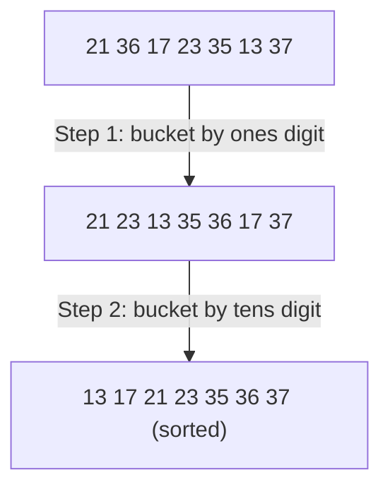

**Radix sort (*Radixsort*, also called *Distributionsort*)** sorts digit-sequences (numbers in a fixed base) by applying [[algorithms/bucket-sort|bucket sort]] once per digit position, from the least-significant digit to the most-significant, concatenating buckets after every pass.

## Idea

Sort digit-sequences to base `m` digit-wise using bucket sort (*Ziffernfolgen zur Basis m ziffernweise mit Bucketsort sortieren*):
- Begin by sorting on the least-significant digit (*Beginn mit Sortierung nach der niederwertigsten Ziffer*).
- Concatenate the sub-lists sorted by the least-significant digit (*Konkatenation der nach niederwertigster Ziffer sortierten Teillisten*).
- Then sort by the next (second-least-significant) digit, and so on (*Sortierung nach zweitniederwertigster Ziffer usw.*) — this is LSD (least-significant-digit-first) radix sort.
- The size of each per-digit hash table equals the radix: `N = m` (*Größe der einzelnen Hashtabellen: N = m*).
- Runtime is **linear**, `O(n)` (!), but only for a constant number of digit positions in the keys, i.e. for a bounded key length/range (*Lineare Laufzeit O(n) (!), aber nur für konstante Stellenzahl der Schlüssel, also für begrenzte Schlüsselmenge*).

## Algorithm

```
1. for digit position p = 0 (least significant) to d-1:
2.     create m empty buckets (0..m-1)
3.     for each element x in the current list (in order):
4.         bucket[ digit(x, p) ].append(x)
5.     concatenate bucket[0], bucket[1], ..., bucket[m-1] into new list
6. the final list (after processing the most significant digit) is sorted
```

## Worked example

Radixsort of the sequence `<21,36,17,23,35,13,37>`, base 10 (two digit positions, `d=2`).

**Step (a) — bucket by least-significant (ones) digit:**

| Digit | Bucket contents |
|---|---|
| 0 | ◇ |
| 1 | `<21>` |
| 2 | ◇ |
| 3 | `<23,13>` |
| 4 | ◇ |
| 5 | `<35>` |
| 6 | `<36>` |
| 7 | `<17,37>` |
| 8 | ◇ |
| 9 | ◇ |

Concatenating buckets 0→9 gives step-1 result: `21,23,13,35,36,17,37`.

**Step (b) — bucket by most-significant (tens) digit, applied to step-1 result:**

| Digit | Bucket contents |
|---|---|
| 0 | ◇ |
| 1 | `<13,17>` |
| 2 | `<21,23>` |
| 3 | `<35,36,37>` |
| 4 | ◇ |
| 5 | ◇ |
| 6 | ◇ |
| 7 | ◇ |
| 8 | ◇ |
| 9 | ◇ |

Concatenating buckets 0→9 gives the final sorted result: `13,17,21,23,35,36,37`.



## Implementation

The source gives radix sort only as a prose idea plus the worked table (§0.13.5.3–0.13.5.4); **no C++ code is given** for radix sort in this part of the script — only the numbered pseudocode above, derived directly from the stated LSD-with-bucket-sort procedure.

## Complexity

| | Best | Average | Worst | Extra space | Stable | In-place |
|---|---|---|---|---|---|---|
| Total | O(n) | O(n) | O(n) | O(n + m) (buckets + elements, per pass) | yes, requires bucket sort passes to be stable | no |

The source states radix sort's runtime as **linear, `O(n)` (!)** — explicitly flagged with an exclamation mark in the source itself — but qualifies it: this holds only for a constant number of digit positions, i.e. a bounded key length/range (*nur für konstante Stellenzahl der Schlüssel*). No separate best/average/worst breakdown is given; the bound is presented as a single qualified `O(n)`.

## Related

- [[algorithms/bucket-sort]] — the per-digit distribution step this algorithm repeats.
- [[algorithms/sorting-overview]]
- [[algorithms/sorting-comparison]]
- [[concepts/big-o-notation]]
- [[concepts/complexity-classes]]
- [[structures/vector]]
- [[algorithms/stl-algorithms]]

## Sources

- [[sources/grigat-trees-sorting]] §0.13.5.3, §0.13.5.4

## Open questions

- The source's `O(n)` runtime claim is conditioned on a constant number of digit positions `d`; it does not spell out the more usual textbook form `O(d·(n+m))`, so the per-pass cost components (`n` elements + `m` buckets) above are inferred from the worked example, not quoted verbatim as a formula.
- Stability of each bucket-sort pass is assumed (buckets preserve insertion order) but not explicitly asserted by the source for radix sort specifically.
