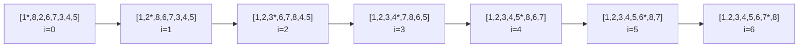

**Selection sort (*Sortieren durch Auswählen*)** repeatedly scans the unsorted suffix of an array for its minimum element and swaps that minimum into the next position of the sorted prefix, growing the sorted part by one element per pass.

## Idea

At step `i`, the invariant `a[0..i-1]` is already fully sorted (*fertig sortiert*); the algorithm searches `a[i..N-1]` for its minimum and swaps it into position `a[i]`, extending the sorted prefix by one element each iteration. It performs exactly `N-1` exchanges regardless of input, but still `O(n²)` comparisons to find each minimum.

## Algorithm

```
1. function selectionSort(a, N):
2.     for i = 0 to N-2:
3.         min_pos = i
4.         for j = i to N-1:
5.             if a[min_pos] > a[j]:
6.                 min_pos = j
7.         swap(a[i], a[min_pos])
```

## Worked example

Example: sorting `<2,8,1,6,7,3,4,5>` by selection (*Beispiel: Sortieren der Folge `<2,8,1,6,7,3,4,5>` durch Auswählen*). Italic cells mark the element just fixed/swapped into place in that row (Tabelle 26):

| step | a[0] | a[1] | a[2] | a[3] | a[4] | a[5] | a[6] | a[7] |
|---|---|---|---|---|---|---|---|---|
| start | 2 | 8 | *1* | 6 | 7 | 3 | 4 | 5 |
| i=0 | 1 | *8* | 2 | 6 | 7 | 3 | 4 | 5 |
| i=1 | 1 | 2 | *8* | 6 | 7 | *3* | 4 | 5 |
| i=2 | 1 | 2 | 3 | 6 | 7 | *8* | *4* | 5 |
| i=3 | 1 | 2 | 3 | 4 | 7 | 8 | 6 | *5* |
| i=4 | 1 | 2 | 3 | 4 | *5* | *8* | 6 | 7 |
| i=5 | 1 | 2 | 3 | 4 | 5 | *6* | *8* | 7 |
| i=6 | 1 | 2 | 3 | 4 | 5 | 6 | 7 | 8 |

The trace prose: "Vertausche 1. Element (i=0) mit Minimum von 2,8,1,6,7,3,4,5", "Vertausche 2. Element mit Minimum von 8,2,6,7,3,4,5", and so on through the 7th element.



## Implementation

```cpp
template <typename T>
void selectionSort(T *a)   //Minimum in unsortierten Zahlen auswählen
{
  for (int i = 0; i<(N-1); i++)
  {
    // Invariante: a[0..i-1] fertig sortiert  (für i>0)
    int min_pos = i;
    // suche nun Minimum in a[i..N] (unsortierter Teilliste)
    for (int j = i; j<N; j++)
    {
      // Invariante: a[min_pos] minimal in a[i..j-1] (für j>i)
      if (a[min_pos] > a[j])
      {
        min_pos = j;
      }
    }
    // Tausche Minimum der Teilliste a[i..N] mit Position a[i]
    swap(a[i], a[min_pos]);
  }
}
```

## Complexity

| | Best | Average | Worst | Extra space | Stable | In-place |
|---|---|---|---|---|---|---|
| Comparisons `C(n)` | O(n²) | O(n²) | O(n²) | — | — | — |
| Exchanges `X(n)` | O(n) | O(n) | O(n) | — | — | — |
| Total `T(n) = C(n)+X(n)` | O(n²) | O(n²) | O(n²) | O(1) | not stable (not addressed on this page per source) | yes |

The source states `C(n) ∈ O(n²)`, `X(n) ∈ O(n)`, and `T(n) = C(n) + X(n) ∈ O(n²) + O(n) = O(n²)` for every case — it does not give separate best/average/worst bounds, because the inner scan always runs to completion regardless of input order.

## Related

- [[algorithms/sorting-overview]]
- [[algorithms/sorting-comparison]]
- [[algorithms/insertion-sort]]
- [[algorithms/bubble-sort]]
- [[concepts/big-o-notation]]
- [[concepts/complexity-classes]]
- [[structures/vector]]
- [[algorithms/stl-algorithms]] — `std::sort` supersedes hand-written selection sort in practice.

## Sources

- [[sources/grigat-trees-sorting]] §0.13.2.1, §0.13.2.2, §0.13.2.3

## Open questions

- The source does not explicitly state whether selection sort is stable; stability is only implied to matter generally by the classification criteria in §0.13.1.2. The standard textbook answer (not stable, because the swap can move an element past an equal one) is **not** confirmed by this source and is left unstated in the complexity table above.
