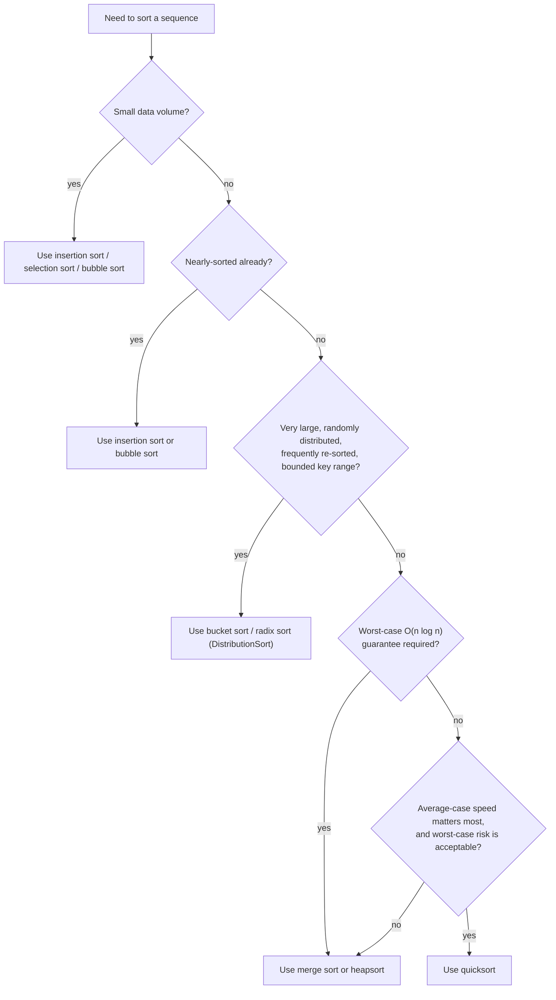

The definitive side-by-side comparison of every sorting algorithm in this wiki, combining the script's stated complexity bounds with its empirical runtime benchmark table and its usage recommendations.

## Complexity comparison

| Algorithm | Best | Average | Worst | Extra space | Stable | In-place | Notes |
|---|---|---|---|---|---|---|---|
| [[algorithms/selection-sort]] | O(n²) | O(n²) | O(n²) | O(1) | not stated | yes | `X(n) ∈ O(n)` exchanges regardless of input; `C(n) ∈ O(n²)` dominates. |
| [[algorithms/insertion-sort]] | O(n²)* | O(n²) | O(n²) | O(1) | not stated (shift-based, likely stable) | yes | Source gives a single `O(n²)` bound, no separate best case; recommended for nearly-sorted data (§0.13.5.6). |
| [[algorithms/bubble-sort]] | O(n²) | O(n²) | O(n²) | O(1) | not stated | yes | `C(n), X(n) ∈ O(n²)` both; recommended for nearly-sorted data alongside insertion sort. |
| [[algorithms/merge-sort]] | O(n log n) | O(n log n) | O(n log n) | O(n) | yes | no | Only algorithm here with a guaranteed `O(n log n)` worst case; recommended for "Standardsituationen". |
| [[algorithms/quicksort]] | O(n log n) | O(n log n) | O(n²) | O(log n) (recursion stack, implied) | not stated | yes | Worst case on (inversely) sorted input with fixed last-element pivot; fast in practice but risky distribution. |
| [[algorithms/heapsort]] | O(n log n)* | O(n log n) | O(n log n)* | O(1) | not stated | yes | Source gives build-heap and n-extraction phases each as `O(n log n)`; recommended for "Standardsituationen" alongside mergesort. |
| [[algorithms/tree-sort]] | — | O(n log n) (inferred)* | — | O(n) | not stated | no | No explicit complexity formula given in source; drawback is needing a complex dynamic structure ([[structures/avl-tree]]). |
| [[algorithms/bucket-sort]] | — | — | — | O(n + N) | likely (inferred) | no | No general `C(n)`/`X(n)` formula given; grouped under "DistributionSort" in the empirical table. |
| [[algorithms/radix-sort]] | O(n) | O(n) | O(n) | O(n + m) | likely (inferred) | no | Linear only for constant digit-count keys ("nur für konstante Stellenzahl der Schlüssel"); grouped under "DistributionSort". |

`*` marks a bound inferred or only partially stated by the source rather than given as a crisp verbatim formula — see each algorithm's own "Open questions" section for the exact caveat.

## Empirical runtime comparison

**Tabelle 33: Laufzeitvergleich schneller Sortierverfahren in Sekunden für 5·10⁶ und 20·10⁶ zufällig gewählte Datensätze** (runtime comparison of fast sorting methods in seconds, for 5 million and 20 million randomly chosen records), measured with [[concepts/chrono-time-measurement|time measurement]] techniques:

| Verfahren | unsortiert n=5·10⁶ | unsortiert n=20·10⁶ | vorsortiert n=5·10⁶ | vorsortiert n=20·10⁶ |
|---|---|---|---|---|
| [[algorithms/quicksort\|QuickSort]] | 0.94 | 4.05 | 0.26 | 1.13 |
| [[algorithms/merge-sort\|MergeSort]] | 1.77 | 7.66 | 1.13 | 4.94 |
| [[algorithms/heapsort\|HeapSort]] | 4.19 | 22.41 | 1.55 | 6.67 |
| [[algorithms/bucket-sort\|DistributionSort]] (bucket/radix) | 0.53 | 2.10 | 0.49 | 2.03 |
| [[algorithms/bubble-sort\|BubbleSort]] | — | — | 0.01 | 0.06 |
| [[algorithms/insertion-sort\|InsertionSort]] | — | — | 0.01 | 0.06 |

BubbleSort/InsertionSort values are only given for already-presorted data; on unsorted large data they would be impractically slow at `O(n²)`, hence left blank/omitted in the source table.

## Usage recommendations (§0.13.5.6)

- Bei geringen Datenmengen einfachen Algorithmus verwenden: for small data volumes, use a simple algorithm ([[algorithms/insertion-sort]], [[algorithms/selection-sort]], [[algorithms/bubble-sort]]).
- Zum Einsortieren in nahezu sortierten Datenbestand: for inserting into an almost-sorted dataset, use [[algorithms/insertion-sort]] or [[algorithms/bubble-sort]].
- Für sehr viele zufällig verteilte und oft zu sortierende Daten: for very large amounts of randomly distributed, frequently-sorted data, adapt a distribution sort ([[algorithms/bucket-sort]] / [[algorithms/radix-sort]]).
- In Standardsituationen: in standard situations, [[algorithms/merge-sort]] and [[algorithms/heapsort]] are recommended.
- Quicksort ist schnell, birgt aber das Risiko ungünstiger Datenverteilung: [[algorithms/quicksort]] is fast but carries the risk of unfavorable data distribution (worst-case `O(n²)`).
- Reference given in the source: "YouTube - Sortieren vertont" https://www.youtube.com/watch?v=kPRAOW1kECg

## Mermaid: decision flowchart for choosing a sort

## Related

- [[algorithms/sorting-overview]]
- [[concepts/divide-and-conquer]]
- [[concepts/big-o-notation]]
- [[concepts/complexity-classes]]
- [[concepts/chrono-time-measurement]]
- [[structures/vector]]
- [[algorithms/stl-algorithms]] — `std::sort` (introsort: quicksort + heapsort fallback + insertion sort for small ranges), `std::stable_sort` (merge-sort based), `std::partial_sort` (heap-based).
- [[concepts/predicates]], [[concepts/function-objects]], [[concepts/lambda-expressions]] — custom comparators for any of these algorithms in C++.

## Sources

- [[sources/grigat-trees-sorting]] §0.13.5.5, §0.13.5.6

## Open questions

- The empirical table groups bucket sort and radix sort under a single "DistributionSort" row, so this page cannot attribute separate empirical numbers to each.
- Tree sort is not included in the empirical comparison table at all (§0.13.5.5 only lists QuickSort, MergeSort, HeapSort, DistributionSort, BubbleSort, InsertionSort) — its absence is reproduced faithfully rather than filled in.
- The source's benchmark table cites "[?]" as its reference (illegible/unspecified citation in the scan) — flagged, not invented.
