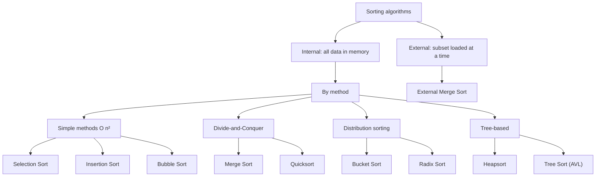

A one-sentence definition: **sorting (*Sortieren*)** is the problem of rearranging a sequence of records into an order determined by a key, and this page is the landing page for every sorting algorithm covered in the wiki.

## The sorting problem (*Sortierproblem*)

**Definition:**
- Given (*Gegeben*): `⟨e₁,...,eₙ⟩`.
- Sought (*Gesucht*): a permutation `⟨e_{i1},...,e_{in}⟩` such that `key(e_{i1}) ≤ key(e_{i2}) ≤ ... ≤ key(e_{in})`.

## Classification of sorting algorithms (*Einteilung von Sortieralgorithmen*)

**Criteria (*Kriterien zur Einteilung von Sortieralgorithmen*):**
- **Internal methods** (*Interne Verfahren*): all data resides simultaneously in main memory (*Hauptspeicher*).
- **External methods** (*Externe Verfahren*): only a subset of the records is loaded at a time — see [[algorithms/external-merge-sort]] (owned elsewhere).
- **By method** (*Methodisch*):
  - *Simple methods* (*Einfache Verfahren*): [[algorithms/insertion-sort]] (Sortieren durch Einfügen), [[algorithms/selection-sort]] (Sortieren durch Auswählen), [[algorithms/bubble-sort]] (Bubblesort).
  - *Divide-and-Conquer* (*Teile-und-Herrsche*): [[algorithms/quicksort]], [[algorithms/merge-sort]] — see [[concepts/divide-and-conquer]].
  - *Distribution sorting* (*Fachverteilen*): [[algorithms/bucket-sort]], [[algorithms/radix-sort]].
  - Also covered here, sorting via trees: [[algorithms/heapsort]] (heap / partial order tree) and [[algorithms/tree-sort]] (AVL in-order traversal).
- **Efficiency** (*Effizienz*):
  - Slow (*Langsam*): `O(n²)`.
  - Fast (*Schnell*): `O(n log n)`.
- **Memory requirements** (*Speicherbedarf*):
  - One shared array for source and destination sequence (*Ein gemeinsames Array für Ausgangs- und Zielfolge*) — **in-place**.
  - Separate arrays for source and destination sequence (*Getrennte Arrays für Ausgangs- und Zielfolge*) — not in-place.
  - Non-linear data structure requiring additional memory for pointers (*Nicht-lineare Datenstruktur, die zusätzlichen Speicher benötigt*).
- **Stable methods** (*Stabile Verfahren*): the order of records with equal key values is **not** altered (*Reihenfolge von Datensätzen mit gleichem Schlüsselwert wird nicht verändert*).

## Cost model (*Kostenmaß*)

**Fundamental operations counted during sorting (*Grundlegende Operationen beim Sortieren*):**
1. Comparison of two keys (*Vergleich zweier Schlüssel*) — usually written `C(n)`.
2. Exchange of two records (*Vertauschen zweier Datensätze*) — usually written `X(n)` or `M(n)` (move operations).

Total cost is `T(n) = C(n) + X(n)` (or `+ M(n)`), and every algorithm page in this wiki states its complexity in exactly these terms, as the source does.

## Mermaid: classification flowchart

## Related

- [[algorithms/sorting-comparison]] — the definitive complexity/empirical comparison table and decision flowchart.
- [[concepts/divide-and-conquer]]
- [[concepts/big-o-notation]]
- [[concepts/complexity-classes]]
- [[algorithms/stl-algorithms]] — `std::sort`, `std::stable_sort`, `std::partial_sort` wrap these ideas in the STL.
- [[concepts/predicates]], [[concepts/function-objects]], [[concepts/lambda-expressions]] — custom comparators usable with `std::sort`.
- [[structures/vector]] — the typical in-memory container these algorithms operate on.
- [[concepts/chrono-time-measurement]] — how the empirical runtime table in [[algorithms/sorting-comparison]] was measured.
- [[structures/heap]], [[structures/avl-tree]], [[structures/binary-search-tree]], [[algorithms/tree-traversal]] — underlying structures used by heapsort/tree sort.

## Sources

- [[sources/grigat-trees-sorting]] §0.13.1.1, §0.13.1.2, §0.13.1.3

## Open questions

- None — this page only reproduces the source's own classification and cost model.
