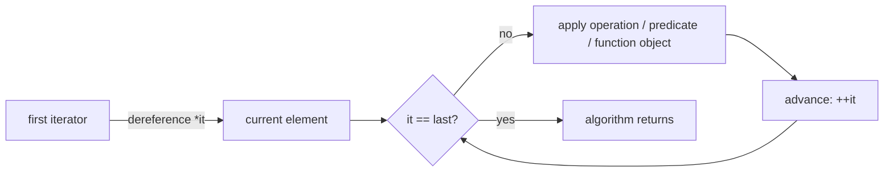

A one-sentence definition: **standard-library algorithms (*Algorithmen der Standardbibliothek*)** are generic, container-independent functions — declared as free (global) functions in `<algorithm>`, not as member functions — that operate on sequences delimited by a pair of [[concepts/iterators|iterators]].

## Core idea / invariant

STL algorithms (e.g. `copy`, `sort`, `find`, `min_element`, `for_each`, `transform`) are decoupled from the containers they work on: they only require [[concepts/iterators|iterator]] types with the right category/operations ([[concepts/iterator-traits]]), obtained via `begin()`/`end()`. This is a deliberate departure from the object-oriented model — algorithms are **not** member functions of the containers — which is what lets one `sort` or `copy` function work across `vector`, `list`, `deque`, arrays, and custom container classes alike, as long as those provide the required iterator classes.

### 0.5.9.1 Properties of standard-library algorithms

- Algorithms use iterators for the source sequence and for the destination (target) sequence.
- They operate on **half-open source sequences** (*halboffene Quellsequenzen*): `[begin, end)` — `begin` inclusive, `end` exclusive.
- They can work on self-defined (custom) container classes, provided those classes supply the necessary iterator classes.
- Example usage:

```cpp
vector<int> vec;
vector<int> vec2;
vector<int>::iterator pos;

/* ... */
/*Elemente in vec eingefuegen*/

//Suchen von Minimum und Maximum
pos =
  min_element(vec.begin(); vec.end());

//Suchen eines Wertes
pos = find(vec.begin(), vec.end(), 2);

//Sortieren
sort(vec.begin(), vec.end());

// Kopieren
copy(vec.begin(), vec.end(), vec2.begin())
```

`sort` sorts all elements of the half-open interval `[vec.begin(), vec.end())` in ascending order (*aufsteigende Reihenfolge*).

## Numbered pseudocode

### `min_element`

```
1. function min_element(first, last):
2.     best = first
3.     while first != last:
4.         if *first < *best:
5.             best = first
6.         first = first + 1
7.     return best
```

### `copy`

```
1. function copy(first, last, dest):
2.     while first != last:
3.         *dest = *first
4.         first = first + 1
5.         dest = dest + 1
6.     return dest
```

### `for_each` (generic implementation, §0.5.9.4)

```
1. function for_each(anf, end, obj):
2.     while anf != end:
3.         obj(*anf)
4.         anf = anf + 1
5.     return obj
```

```cpp
template<typename T, typename F> F for_each (T anf, T end, F obj)
{
  while (anf != end) obj(*anf++);
  return obj;
}
```

- `T` is a template parameter for an iterator type; `F` is a template parameter for a function-object type ([[concepts/function-objects]]).
- `for_each` calls `obj(*anf)` and then increments.
- The function object `obj` is passed as a copy (*by value*, see [[concepts/parameter-passing]]).
- The return value of `for_each` is the internal (possibly mutated) copy of `obj` — this matters for stateful functors, see [[concepts/function-objects]].

### `transform` (generic shape, §0.5.9.5)

```
1. function transform(src_first, src_last, dest_first, fn):
2.     while src_first != src_last:
3.         *dest_first = fn(*src_first)
4.         src_first = src_first + 1
5.         dest_first = dest_first + 1
6.     return dest_first
```

`transform()` applies a function to the elements of a source sequence and stores the result in a destination sequence:

```cpp
int square(int value)
{
  return value * value;
}

vector <int> vec1, vec2;
/* vec1 zunächst mit Werten fuellen (hier weggelassen) */
transform(vec1.begin(), vec1.end(),//Quellsequenz
          back_inserter(vec2),    //Daten an vec2 hinten anfuegen
          square);                //Funktion
```

Result: `vec2[0] = square(vec1[0])`, `vec2[1] = square(vec1[1])`, ... Note the use of `back_inserter` (an [[concepts/iterator-adapters|insert iterator]]) so that `vec2` grows instead of overwriting out-of-bounds memory.

`for_each` itself is demonstrated applying a plain function to every element:

```cpp
void print(int value)
{
  cout << value << endl;
}

vector<int> vec;
/* ... */
for_each(vec.begin(),vec.end(),   // Sequenz
         print);                 // Funktion als Parameter
```

`print(value)` is called for every element: `print(vec[0])`, `print(vec[1])`, ...

## 0.5.9.2 Sequences / ranges

- Every algorithm works over **half-open sequences** (*halb-offene Sequenzen*): the beginning and end of the sequence are passed explicitly so the algorithm is not forced to operate on the entire container.
- The programmer is responsible for the **validity** (*Gültigkeit*) of the memory region spanned by the sequence.

```cpp
#include <vector>
#include <algorithm>

int main()
{
  vector<int> vec1;
  vector<int> vec2;
  /* ... */

  sort(vec1.begin(), vec1.end());//Gueltige Sequenz
  sort(vec1.begin(), vec2.end());
  //Undefiniertes Verhalten, aber kein Compilerfehler!
}
```

> [!warning] Pitfall
> Mixing `begin()`/`end()` iterators from two different containers (`vec1.begin()` with `vec2.end()`) is syntactically valid — it compiles — but yields **undefined behavior**. The compiler cannot detect this.

## 0.5.9.3 Multiple sequences

Some algorithms operate over more than one sequence at a time, e.g. `copy`:

```cpp
copy(vec1.begin(), vec1.end(), //Quellsequenz, erste Sequenz
     vec2.begin());            //Zielsequenz, zweite Sequenz
```

- Beginning **and** end of the *first* sequence must be passed as iterators.
- For every other sequence, only the **beginning** must be passed; its length follows from the length of the first sequence.
- **Important**: the second and subsequent sequences must have at least as many elements as the first one, otherwise the algorithm accesses invalid memory.
- To avoid this: ensure the destination has enough elements, or use an [[concepts/iterator-adapters|insert iterator]] such as `back_inserter`:

```cpp
#include <list>
#include <vector>
#include <algorithm>
using namespace std;
int main()
{
  list<int> lst;
  for(int i = 1; i <=5; ++i)
  {
    lst.push_back(i); // Kein Algorithmus, daher Aufruf der
  }                    // Memberfunktion direkt moeglich
  vector<int> vec;

  copy(lst.begin(), lst.end(), //Quellsequenz
       back_inserter(vec));    //Daten an vec hinten anfuegen
                   // Algorithmus copy benoetigt 3 Iteratoren
}
```

All elements from `lst` are copied to `vec`, inserted at the end via `back_inserter` rather than overwriting.

## Complexity table

| Algorithm | Typical complexity | Notes |
|---|---|---|
| `min_element` / `max_element` | O(n) | one linear pass |
| `find` | O(n) | linear search, stops at first match |
| `find_if` | O(n) | linear search with [[concepts/predicates\|predicate]] |
| `copy` | O(n) | one assignment per element |
| `for_each` | O(n) | one call to `obj` per element |
| `transform` | O(n) | one call to `fn` per element, plus one write |
| `sort` | O(n log n) | comparison-based; container must support random-access iterators |

(All bounds are per-call over a sequence of `n` elements between the half-open iterator pair `[first, last)`; they assume the user-supplied function/predicate itself runs in O(1).)

## Mermaid: how an algorithm consumes a range



## Trade-offs: when to use, when not to

- Use standard algorithms over hand-written loops: they are well-tested, composable with [[concepts/iterator-adapters|iterator adapters]] and [[concepts/function-objects|function objects]]/[[concepts/lambda-expressions|lambdas]], and communicate intent (`sort`, `find_if`, ...).
- Because algorithms are free functions decoupled from containers, they violate the "pure" OO model of bundling data and behavior — but this buys genericity across all [[concepts/stl-containers|STL containers]] that expose conforming iterators.
- Multiple-sequence algorithms are a common source of out-of-bounds bugs; always check destination capacity or use insert iterators.

## Common pitfalls & gotchas

- Mixing iterators from different containers/ranges (syntax-valid, UB at runtime).
- Passing a destination sequence too short for a multiple-sequence algorithm like `copy`/`transform`.
- Forgetting that `for_each`'s function object is passed and returned **by value** — mutating captured state inside the stateful functor is only visible via the returned copy, not the original argument (see [[concepts/function-objects]]).

## Related

- [[concepts/iterators]]
- [[concepts/iterator-traits]]
- [[concepts/iterator-adapters]]
- [[concepts/predicates]]
- [[concepts/function-objects]]
- [[concepts/stl-containers]]
- [[concepts/templates]]
- [[concepts/standard-library]]

## Sources

- [[sources/grigat-cpp-concepts-generic]] §0.5.9.1, §0.5.9.2, §0.5.9.3, §0.5.9.4, §0.5.9.5
