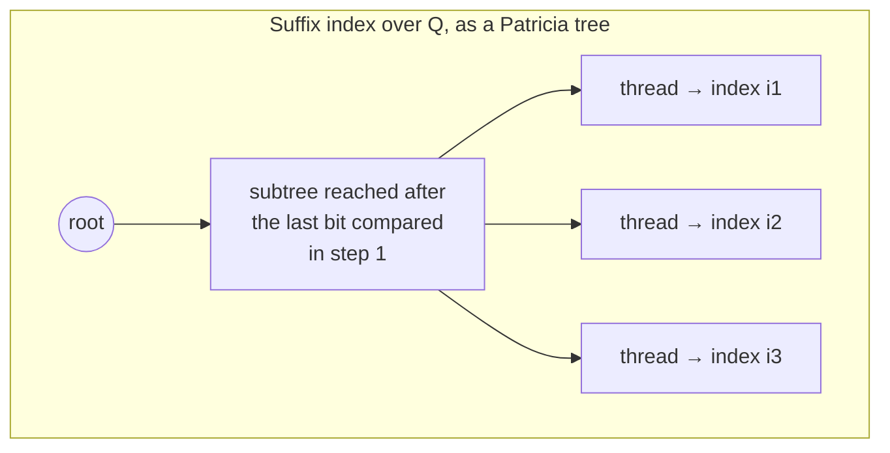

## One-sentence definition

String matching (substring search) is the problem of finding all positions
in a long source sequence at which a given, usually much shorter, search
sequence occurs (§0.12.5.5).

## Problem definition (§0.12.5.5)

**Given:**
- a (usually very long) **source sequence** (*Quellfolge*)
  `Q = ⟨a₀,...,a_{q-1}⟩` of `q ∈ ℕ` characters `aᵢ`, `0 ≤ i ≤ q-1`;
- a (usually short) **search sequence** (*Suchfolge*) `S = ⟨b₀,...,b_{s-1}⟩`
  of `s ≤ q` characters `bⱼ`, `0 ≤ j ≤ s-1`, typically `s ≪ q`.

**Sought:** all index values `i` with `0 ≤ i ≤ q-s` at which `S` occurs in
`Q`:
```
⟨a_i,...,a_{i+s-1}⟩ = ⟨b₀,...,b_{s-1}⟩
```

*Example applications*: searching for words in text, searching for specific
patterns in DNA sequences.

## Naive / brute-force matcher (§0.12.5.6)

**Naiver Algorithmus**: for every index `i` in the source sequence `Q` with
`0 ≤ i ≤ q-s`, check whether the search sequence `S` occurs there.

**Numbered pseudocode (verbatim structure from the source):**
```
1. for i = 0 to q - s:
2.     match = true
3.     for j = 0 to s - 1:
4.         if a[i+j] != b[j]:
5.             match = false; break
6.     if match:
7.         report i as an occurrence
```

**Complexity:** the source states the time complexity of the search as
`O(q)`, referring to the number of outer-loop starting positions checked;
each of those checks itself costs up to `O(s)` character comparisons in the
worst case, giving an overall worst case of `O(q · s)`. See
[[concepts/big-o-notation]] and [[concepts/complexity-classes]] for the
general notation used here.

## Speeding up the search with an index (§0.12.5.6–0.12.5.7)

**Beschleunigung der Suche** (speeding up the search): use a search index
(*Suchindex*) instead of re-scanning `Q` from every position.

**Idea (§0.12.5.7):** treat every suffix `⟨a_i,...,a_{q-1}⟩` of `Q`, for
`0 ≤ i < q`, as a key of length `q-i`, and build a [[structures/trie]] or a
[[structures/patricia-tree]] over all `q` such suffix keys. Because these
keys are, with `O(q)`, mostly very long, the Patricia-tree variant avoids
storing full keys: it stores only the index value `i` in each node, plus the
entire bit representation of `⟨a₀,...,a_{q-1}⟩` stored **once**, separately
from the tree.

## Index search using a Patricia tree (§0.12.5.8)

**Numbered pseudocode (verbatim structure):**
```
1. Search for the search sequence S as a prefix of the keys associated
   with the stored indices, in time O(log q).
2. For the first found key candidate, compare the search sequence S with
   the prefix of length s, in O(s).
3. If the prefix and search sequence S match, then all threads of the
   corresponding subtree below the last bit comparison performed in
   step 1 point to indices i where S occurs in Q. Otherwise S is not
   contained in Q.
```

This is exactly the suffix-index search procedure documented in full, with
its worked Patricia-tree searching/insertion/deletion traces, on
[[structures/patricia-tree]].

### Why a single Patricia-tree search finds every occurrence at once


Every suffix of `Q` that shares the prefix `S` lives in the same subtree
below the point where the tree's bit comparisons exhaust `S`; all threads
hanging off that subtree are therefore occurrences of `S` in `Q`.

## Result: complexity (§0.12.5.8)

- Time complexity **per hit** (*pro Treffer*): `O(s + log q)`.
- Time complexity for `O(q)` hits: `O(s + q log q)`.

Compare this to the naive matcher's `O(q · s)` worst case above — the index
amortizes the `log q`/`s` cost of locating candidate occurrences across
however many hits actually exist, rather than rescanning all of `Q` from
every starting position.

## Reference implementation

The source gives numbered pseudocode only — for both the naive matcher and
the Patricia-tree index search — no verbatim C++ appears in these pages.
Pointer/thread handling needed for a real implementation would use
[[concepts/pointers-and-references]]; the suffix-indexing structure itself
is described in full under [[structures/patricia-tree]].

## Trade-offs: when to use, when not to

- The naive matcher needs no preprocessing and is simplest to implement, but
  degrades to `O(q · s)` on adversarial inputs (e.g. many partial matches).
- The suffix-index approach (Trie or Patricia tree) pays an upfront `O(q)`
  (or more, see [[structures/trie]]'s node-count bounds) cost to build the
  index over all suffixes, but then answers repeated or multi-hit queries in
  `O(s + log q)` per hit — worthwhile when many searches are run against the
  same fixed source sequence `Q` (e.g. a genome, a large corpus).

## Related
- [[structures/patricia-tree]]
- [[structures/trie]]
- [[structures/ternary-search-trie]]
- [[concepts/big-o-notation]]
- [[concepts/complexity-classes]]
- [[concepts/strings-cpp-vs-c]]

## Open questions

- The source's own worked examples stop at the naive matcher plus
  suffix-index search; algorithms such as Boyer–Moore or Knuth–Morris–Pratt
  are not covered in these pages (noted explicitly as a gap in
  [[sources/grigat-trees-sorting]]).

## Sources
- [[sources/grigat-trees-sorting]] §0.12.5.5, §0.12.5.6, §0.12.5.7, §0.12.5.8
