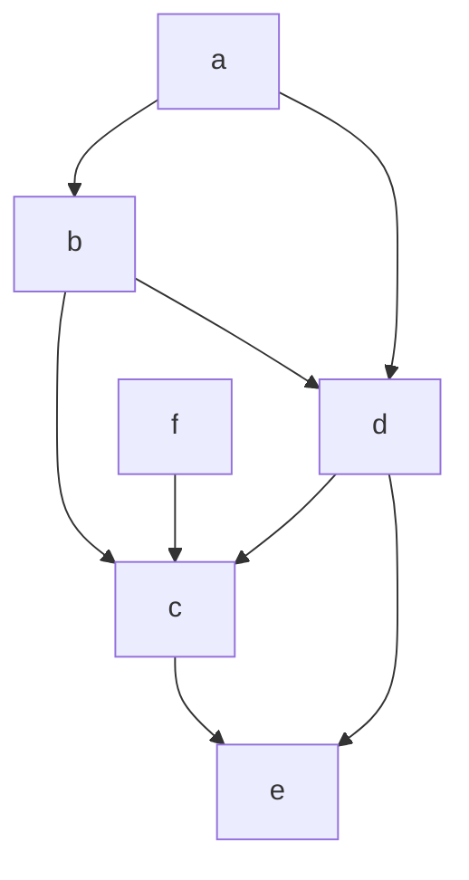
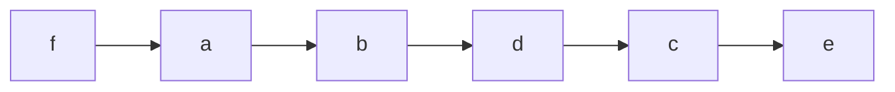

## One-sentence definition

Topological sorting (*Topologisches Sortieren*) orders the nodes of a
cycle-free digraph ([[structures/dag|DAG]]) so that every edge (v,w) ∈ E
satisfies Ordnung(v) < Ordnung(w)
[[sources/grigat-graphs-dynamic-programming]] §0.14.3.15.

## Core idea / invariant

- **Definition — topologische Ordnung für zyklenfreien Digraphen:**
  Kante (v,w) ∈ E ⇒ Ordnung(v) < Ordnung(w).
- The algorithm transcribed by the source repeatedly removes a node whose
  **in-degree is 0** (no remaining predecessors) and appends it to the sorted
  list; removing a node decrements the in-degree of its successors.
- **The algorithm fails on cycles** (*Der Algorithmus versagt bei Zyklen*):
  before topological sorting, back edges (*Rückwärtskanten*) must be removed
  first, i.e. the input must be a [[structures/dag|DAG]] §0.14.3.15.
- The resulting order is **not unique** (*Die topologische Ordnung ist jedoch
  nicht eindeutig*): whenever more than one node has in-degree 0 at a given
  step, any of them may be picked next, yielding a different but equally
  valid ordering §0.14.3.16.

## Numbered pseudocode

Verbatim pseudocode from the source §0.14.3.15:

```
while(Knotenmenge nicht leer)
{
  entferne Knoten mit Eingangsgrad 0 aus Knotenmenge;
  füge diesen Knoten ans Ende der sortierten Knotenliste;
}
```

Numbered translation (Kahn's-algorithm style, as given by the source):

```
1. while node_set is not empty:
2.     remove a node v with in-degree 0 from node_set
3.     append v to the end of the sorted node list
       (removing v also decrements the in-degree of its successors)
```

## Worked example (§0.14.3.16, Abbildung 123)

Starting DAG (the acyclic digraph of §0.14.3.14, nodes a,b,c,d,e,f):



Step-by-step removal, as printed (node annotated with (in-degree, out-degree)
at that step):

| Step | Node removed | Remaining in-degree-0 candidates |
|---|---|---|
| (a) | — (start) | a(0,2), f(0,1) both already at in-degree 0 |
| (b) | f | a still 0 |
| (c) | a | b becomes 0 |
| (d) | b | d becomes 0 |
| (e) | d | c becomes 0 |
| (f) | c | e becomes 0 |
| (g) | e | node set empty |

**Resulting topological ordering (as printed):**

> Topologische Ordnung: **f, a, b, d, c, e**



## Complexity

| Representation | Time | Assumption |
|---|---|---|
| Adjacency matrix | O(\|V\|²) | each of the \|V\| removal steps scans the matrix (O(\|V\|) per row/column) to find a node with in-degree 0 and to update successors' in-degrees, per [[structures/graph-representations]] §0.14.2.4 |
| Adjacency list | O(\|V\| + \|E\|) | maintaining a queue/set of current in-degree-0 nodes and decrementing in-degrees while scanning each node's list once, per [[structures/graph-representations]] §0.14.2.5 |

As with [[algorithms/depth-first-search]] and
[[algorithms/breadth-first-search]], these bounds follow from combining the
representation costs the source states explicitly with the "process each
node, inspect each edge once" structure of the removal loop; the source
itself states only the algorithm, not this complexity breakdown. See
[[concepts/big-o-notation]] and [[concepts/complexity-classes]].

## Related
- [[structures/dag]]
- [[structures/graph]]
- [[structures/graph-representations]]
- [[algorithms/depth-first-search]]
- [[algorithms/breadth-first-search]]
- [[structures/spanning-tree]]

## Sources
- [[sources/grigat-graphs-dynamic-programming]] §0.14.3.14, §0.14.3.15, §0.14.3.16
