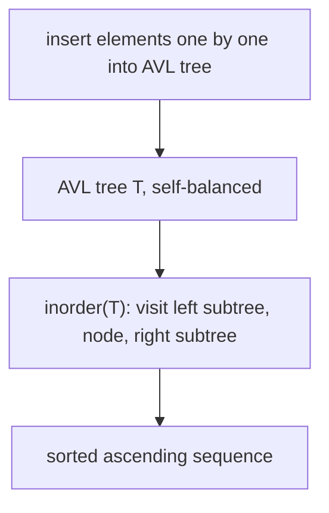

**Tree sort (*Baumsortieren*)** sorts a sequence by inserting every element into an [[structures/avl-tree|AVL tree]] and then reading the elements back out via an in-order traversal of the tree, which visits nodes in ascending key order.

## Idea

The idea is stated in two steps (§0.13.4.3):
- Insert the elements into an AVL tree `T` (*Einfügen der Elemente in AVL-Baum T*).
- `inorder(T)` liefert sortierte Folge — an [[algorithms/tree-traversal|in-order traversal]] of `T` yields the sorted sequence.

The drawback noted explicitly by the source: this requires a complex dynamic data structure (*Nachteil: komplexe dynamische Datenstruktur erforderlich*) — i.e. a full self-balancing [[structures/binary-search-tree|binary search tree]] implementation, unlike the simple array-in-place methods.

## Algorithm

```
1. function treeSort(elements):
2.     T = empty AVL tree
3.     for each e in elements:
4.         insert(T, e)            // AVL insertion, rebalancing as needed
5.     return inorder(T)           // in-order traversal yields ascending sorted sequence
```

## Worked example

The source gives no separate numeric worked trace for tree sort beyond the two-line idea description (§0.13.4.3) — it reuses the general mechanism of AVL insertion and in-order traversal described elsewhere in the script. Conceptually, inserting `<2,8,1,6,7,3,4,5>` one at a time into an (initially empty) AVL tree and then performing an in-order walk reproduces the ascending sequence `1,2,3,4,5,6,7,8`, exactly as for [[algorithms/heapsort]]'s worked example input, by the `inorder(T)` guarantee stated above.



## Implementation

The source gives tree sort only as a two-line prose idea (§0.13.4.3); **no C++ code for tree sort itself is given** in this part of the script. The AVL insertion and in-order traversal it relies on are implemented on [[structures/avl-tree]] and [[algorithms/tree-traversal]] respectively (owned by other pages — link only, not reproduced here).

## Complexity

| | Best | Average | Worst | Extra space | Stable | In-place |
|---|---|---|---|---|---|---|
| Total | — | O(n log n)* | — | O(n) (tree nodes + pointers) | not addressed in source | no |

*The source gives no explicit complexity formula for tree sort itself in §0.13.4.3 — only the qualitative drawback of needing a complex dynamic structure. The `O(n log n)` figure above is inferred from `n` AVL insertions at `O(log n)` each plus an `O(n)` in-order traversal, consistent with AVL-tree complexity stated on [[structures/avl-tree]], but is **not** a bound the source states verbatim for tree sort — flagged below.

## Related

- [[structures/avl-tree]] — the tree structure used (owned elsewhere; link only).
- [[structures/binary-search-tree]] — the unbalanced base structure (owned elsewhere; link only).
- [[algorithms/tree-traversal]] — in-order traversal mechanics (owned elsewhere; link only).
- [[algorithms/heapsort]] — the other tree-based sort in this source.
- [[algorithms/sorting-overview]]
- [[algorithms/sorting-comparison]]
- [[concepts/big-o-notation]]
- [[concepts/complexity-classes]]
- [[structures/vector]]
- [[algorithms/stl-algorithms]]

## Sources

- [[sources/grigat-trees-sorting]] §0.13.4.3

## Open questions

- The source does not give a numeric complexity bound for tree sort; the `O(n log n)` estimate above is derived, not quoted, and should be reconciled once [[structures/avl-tree]] states its own insertion complexity explicitly.
- No worked numeric trace or C++ code is given for tree sort in this part of the script — only the two-line idea and its drawback.
