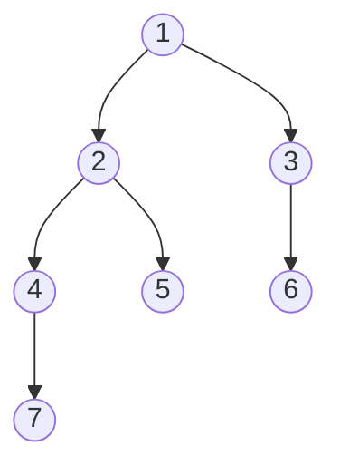

## One-sentence definition

Tree traversal maps a [[structures/binary-tree]] onto a
[[structures/linked-list|list]] by visiting all of its elements in one of
three standard orders — **inorder**, **preorder**, **postorder** — each
defined recursively in terms of the tree's left subtree, root, and right
subtree (§0.10.4.6).

## Core idea / invariant

**Invariant (shared by all three):** traversing the empty tree yields the
empty list `◇`; traversing a non-empty tree `(L,x,R)` yields a list built
from the recursive traversal of `L`, the recursive traversal of `R`, and the
root `x` itself — only the **order** in which these three pieces are
concatenated differs between the three traversals.

## Recursive definitions (§0.10.4.6)

`∘` denotes list concatenation (see [[structures/linked-list]] §0.10.1.1).

```
inorder:    tree → list
inorder(◇)       = ◇
inorder((L,x,R)) = inorder(L) ∘ ⟨x⟩ ∘ inorder(R)

preorder:   tree → list
preorder(◇)       = ◇
preorder((L,x,R)) = ⟨x⟩ ∘ preorder(L) ∘ preorder(R)

postorder:  tree → list
postorder(◇)       = ◇
postorder((L,x,R)) = postorder(L) ∘ postorder(R) ∘ ⟨x⟩
```

## Numbered pseudocode

```
1. function inorder(T):
2.     if isempty(T): return empty_list
3.     return concat(inorder(left(T)), <root(T)>, inorder(right(T)))
```

```
1. function preorder(T):
2.     if isempty(T): return empty_list
3.     return concat(<root(T)>, preorder(left(T)), preorder(right(T)))
```

```
1. function postorder(T):
2.     if isempty(T): return empty_list
3.     return concat(postorder(left(T)), postorder(right(T)), <root(T)>)
```

`left`, `right`, `root`, `isempty` are the [[structures/binary-tree]] ADT
functions (§0.10.4.2).

## Worked example (§0.10.4.6, Abbildung 68)

Example tree `T`: root 1, with children 2 (left) and 3 (right); node 2 has
children 4 (left) and 5 (right); node 3 has left child 6 (no right child);
node 4 has left child 7.



Resulting traversal sequences, as given verbatim in the notes:

```
inorder(T)   = <7,4,2,5,1,6,3>
preorder(T)  = <1,2,4,7,5,3,6>
postorder(T) = <7,4,5,2,6,3,1>
```

**Trace** (expanding the recursive definitions by hand):
- `inorder(T) = inorder(T2) ∘ <1> ∘ inorder(T3)`, where `T2` is the subtree
  rooted at 2 and `T3` the subtree rooted at 3.
  - `inorder(T2) = inorder(T4) ∘ <2> ∘ inorder(T5) = (inorder(T7) ∘ <4> ∘ ◇) ∘ <2> ∘ <5> = <7,4> ∘ <2> ∘ <5> = <7,4,2,5>`
  - `inorder(T3) = ◇ ∘ <3> ∘ inorder(T6)`... using the left-child-only shape
    of node 3 (child 6 is node 3's *left* child, right is empty): `inorder(T3) = inorder(T6) ∘ <3> ∘ ◇ = <6,3>`
  - Combining: `<7,4,2,5> ∘ <1> ∘ <6,3> = <7,4,2,5,1,6,3>` — matches the
    notes exactly.

## Complexity

| Operation | Complexity | Note |
|---|---|---|
| inorder / preorder / postorder traversal | O(n) | each of the n nodes is visited exactly once; each visit does O(1) work (one concatenation step) plus the recursive calls — see [[concepts/big-o-notation]] |
| space (call stack) | O(h) | h = height of the tree, for the recursion depth; see [[structures/binary-tree]] §0.10.4.4/§0.10.4.5 for the minimum/maximum height bounds, O(log n) to O(n) |

See [[concepts/complexity-classes]].

## Reference implementation

The notes give the recursive mathematical definitions and the pseudocode
above but no C++ listing for traversal in this excerpt. A direct,
non-inventive C++ transcription of the inorder pseudocode (following the
pointer-based `TreeNode<T>` layout given in [[structures/binary-tree]]
§0.10.4.8, which the notes do provide) would look like:

```cpp
template <class T>
void inorder(TreeNode<T>* node, std::list<T>& out)
{
    if (node == nullptr) return;
    inorder(node->left, out);
    out.push_back(node->data);
    inorder(node->right, out);
}
```

This is not verbatim from the source (the source gives only the mathematical
pseudocode), but is a direct, unembellished translation of the `inorder`
definition above onto the pointer node type the notes already specify.

## Trade-offs: when to use, when not to

- **Inorder** on a sorted binary search tree (see
  [[structures/binary-search-tree]], owned elsewhere) yields elements in
  sorted order — the canonical reason to pick inorder.
- **Preorder** is used when the root must be processed before its subtrees,
  e.g. copying/serializing a tree, or producing prefix notation for an
  [[structures/expression-tree]].
- **Postorder** is used when subtrees must be fully processed before the
  root, e.g. deleting a tree bottom-up (freeing children before the parent),
  or producing postfix notation for an [[structures/expression-tree]]
  (consumed directly by [[algorithms/postfix-evaluation]]).

## Common pitfalls & gotchas

- Mixing up which traversal corresponds to which notation on an
  [[structures/expression-tree]]: inorder → infix, preorder → prefix,
  postorder → postfix — easy to get backwards since the names "pre/in/post"
  refer to the position of the *root* relative to the subtrees, not to the
  position of the *operator* in the output notation (though for operator
  trees they coincide, since the root of an operator (sub)tree is the
  operator).
- Forgetting that the three definitions differ **only** in where `<x>` is
  concatenated — a correct implementation of one gives the other two "for
  free" by moving a single line.

## Related
- [[structures/binary-tree]]
- [[structures/general-tree]]
- [[structures/expression-tree]]
- [[algorithms/postfix-evaluation]]
- [[structures/linked-list]]
- [[concepts/big-o-notation]]
- [[concepts/complexity-classes]]

## Sources
- [[sources/grigat-algorithms-data-structures]] §0.10.4.6
