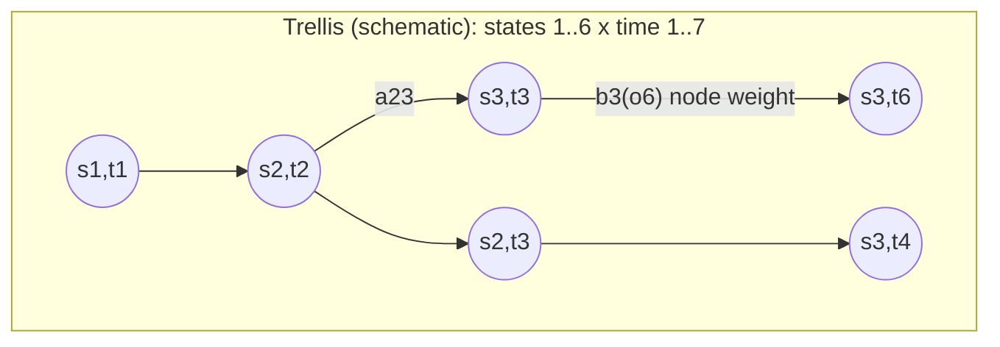

The **Viterbi algorithm (*Viterbi-Algorithmus*)** is a [[concepts/dynamic-programming|dynamic-programming]] procedure that finds the most probable state sequence through a [[concepts/hidden-markov-model|Hidden Markov Model]] given an observation sequence, by exploiting the same optimal-substructure/overlapping-subproblems argument used throughout this source, instead of enumerating all O(N_M^{N_T}) possible state sequences.

## Framing as a shortest/longest-path problem on a DAG (§0.16.3.10)

Decoding reduces to finding the optimal path through a **trellis**: a directed graph whose vertical axis is the HMM's states *j* and whose horizontal axis is the observation index *t* (speech-vector time axis). Node weights correspond to the log-probabilities log b_j(o_t) that a given speech vector was observed at that time; edge weights correspond to the log transition probabilities log a_{ij}. The log-probability of a path is the sum of its edge weights (transitions) and node weights (emissions) — this reduces HMM decoding to a **longest-path problem in a weighted [[structures/dag|DAG]]** (equivalently a shortest-path problem if costs are negated), solved with exactly the same forward-relaxation-in-topological-order technique as [[algorithms/assembly-line-scheduling]].



## Optimal substructure (§0.16.3.9)

The probabilities Φ_j(t) of all states *j* of model *M* at time *t* are determined using only: the current observation o_t, and the probabilities Φ_i(t−1) of all states *i* of model *M* at the preceding time point t−1. The optimal substructure of the preceding step also contains the information needed for later reconstruction of the optimal state sequence X.

## Recurrence (probability domain)

```
Initialisierung:  Φ_1(0) = 1                                              (38)
                  Φ_j(1) = a_{1j} b_j(o_1)  ∀ 1 < j < N                    (39)
Induktion:        Φ_j(t) = max_i { Φ_i(t-1) a_{ij} } b_j(o_t)              (40)
                  ∀ 1 < j < N,  1 < t < T+1
Terminierung:     Φ_N(T+1) = max_i { Φ_i(T) a_{iN} }                      (41)
```

The largest probability P̂(O|M) is:

```
P̂(O|M) = Φ_N(T+1) = max_i { Φ_i(T) a_{iN} }     (42)
```

## Log-domain recurrence

Log-probabilities are used to prevent multiplying very small numbers:

```
Ψ_j(t) = log Φ_j(t) = max_i { Ψ_i(t-1) + log(a_{ij}) } + log(b_j(o_t))    (43)
```

## Numbered pseudocode

```
1. Psi[1][0] = 0                                     // log(Phi_1(0)) = log(1)
2. for j = 2 to N-1:
3.     Psi[j][1] = log(a[1][j]) + log(b_j(o_1))
4. for t = 2 to T:
5.     for j = 2 to N-1:
6.         Psi[j][t] = max_i ( Psi[i][t-1] + log(a[i][j]) ) + log(b_j(o_t))
7.         backpointer[j][t] = argmax_i ( Psi[i][t-1] + log(a[i][j]) )
8. Psi[N][T+1] = max_i ( Psi[i][T] + log(a[i][N]) )   // = log P_hat(O|M)
9. // Optional: follow backpointer[][] from (N,T+1) back to (1,0) to reconstruct
10.// the optimal state sequence X (step 4 of the general DP recipe).
```

This follows the general four-step [[concepts/dynamic-programming|DP recipe]] directly: step 1 is the trellis/DAG model above; step 2 is recurrence (43); step 3 is the bottom-up fill of the Ψ table over increasing *t* in the loop above; step 4 (optional) is the `backpointer[][]` backtrack in line 9–10.

## DP table (Ψ, log-domain)

| state j \ time t | 0 | 1 | 2 | … | T | T+1 |
|---|---|---|---|---|---|---|
| 1 | 0 | — | — | | — | — |
| 2..N-1 | — | log(a_{1j})+log(b_j(o_1)) | max_i(Ψ_i(1)+log a_{ij})+log b_j(o_2) | … | … | — |
| N | — | — | — | | — | max_i(Ψ_i(T)+log a_{iN}) |

Each cell Ψ_j(t) is filled once, in increasing-*t* order, from the previous column only (step 3 of the DP recipe) — this is the same tabulation principle as the f1[]/f2[] tables in [[algorithms/assembly-line-scheduling]].

## Backtracking (path reconstruction)

For word recognition the source notes that only the optimal (largest) probability is needed, so the optimal path need not be constructed (§0.16.3.9/0.16.3.10, consistent with the "step 4 is optional" remark in [[concepts/dynamic-programming]]). When the actual most probable state sequence X is required, it is recovered by following `backpointer[j][t]` from (N, T+1) back to (1, 0), exactly as in line 9–10 of the pseudocode above.

## Complexity

- Naive enumeration of all state sequences: **O(N_T · N_M^{N_T})** (see [[concepts/hidden-markov-model]]).
- Viterbi (DP): filling the Ψ table takes O(N_M) work per (state, time) cell to take the `max_i` over all N_M predecessor states, for N_M states and T time points ⇒ **O(N_M² · T)**.

See [[concepts/big-o-notation]] and [[concepts/complexity-classes]].

## Trade-offs: when to use, when not to

- Use Viterbi whenever only the value (or the path) of the single most probable state sequence is needed; if the *total* probability over all paths P(O|M) (eq. 35) is needed instead, the structurally similar **forward algorithm** (sum instead of max at each step) is required instead — not covered in this source.
- The log-domain recurrence (43) is required in practice (not merely an optimization) once T grows, since raw probability products underflow floating-point representations.

## Common pitfalls & gotchas

- Forgetting to carry the `backpointer[][]` array when the actual path (not just its probability) is needed — the max-only recurrence (40/43) alone discards which predecessor state won.
- Confusing Viterbi's `max` recurrence (most probable single path) with the forward algorithm's `sum` recurrence (total probability over all paths, eq. 35) — they solve different quantities with the same table shape.

## Related

- [[concepts/hidden-markov-model]] — the model being decoded.
- [[concepts/dynamic-programming]] — the general recipe this instantiates.
- [[algorithms/assembly-line-scheduling]] — the sibling DP-on-a-DAG worked example in this source.
- [[structures/dag]]
- [[concepts/big-o-notation]]
- [[concepts/complexity-classes]]

## Sources

- [[sources/grigat-graphs-dynamic-programming]] §0.16.3.9–§0.16.3.10
