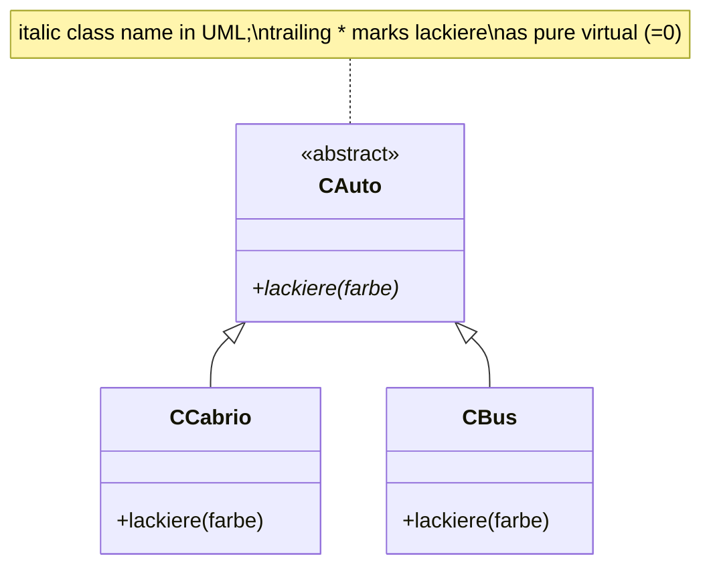
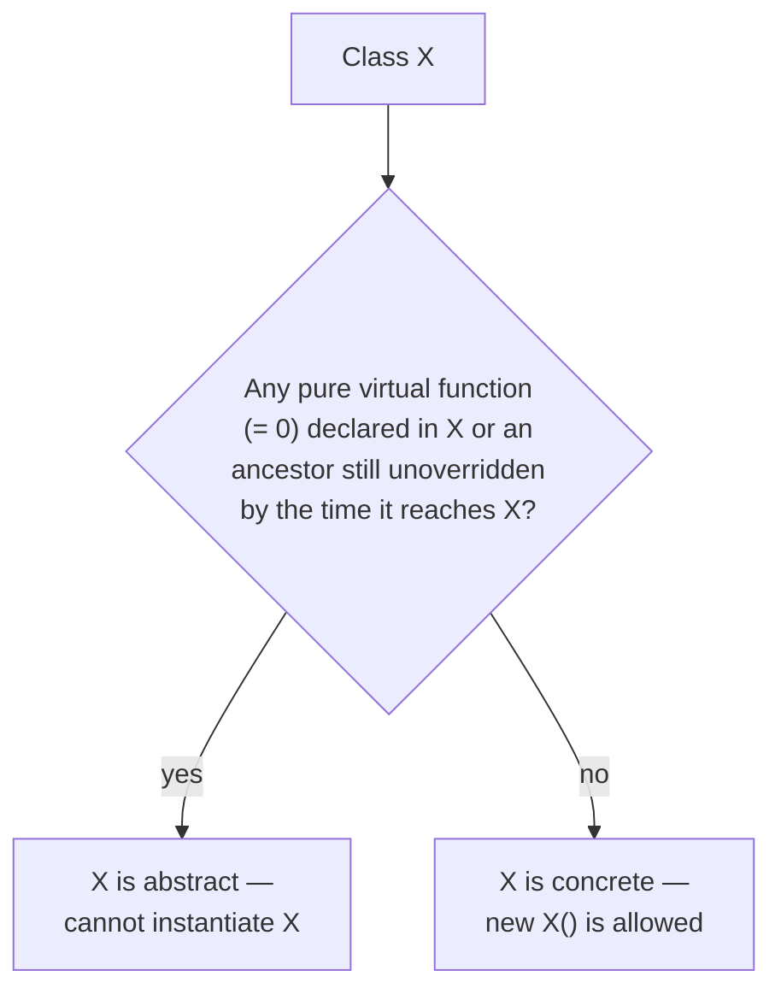

An abstract class (*abstrakte Klasse*) declares an interface without
necessarily providing full implementations: it cannot be instantiated
directly, and in C++ it becomes abstract through the presence of a **pure
virtual member function**.

## Definition

1. An abstract class serves to declare an interface.
2. Instances (objects) of abstract classes are not allowed.
3. Member functions of an abstract class *may* nonetheless be defined.
4. In C++, a class becomes abstract through a pure virtual member function.

In UML, an abstract class is drawn with its class name in *italics*:

```
UML-Diagramm: abstrakte Klasse (Klassenname kursiv)
```

## Pure virtual functions

Writing `=0` after a virtual member function's declaration turns it into a
**pure virtual function**. A class with at least one pure virtual function is
abstract. If a derived class does not override that pure virtual function, the
derived class remains abstract too — this is what allows an interface to be
implemented piecewise across several levels of derivation.

```cpp
virtual void lackiere (std::string farbe) = 0;
```

The compiler rejects any attempt to create an instance of an abstract class:

```cpp
CAuto* automobil = new CAuto(); // FEHLER!
```



### Procedure: can I instantiate this class?

1. Collect every pure virtual function declared anywhere in the class's base-class hierarchy.
2. For each one, check whether some class on the path from that declaration down to this class provides an overriding definition.
3. If any pure virtual function remains without an override reaching this class, the class is abstract: instantiation (`new Class()`, a plain local variable, etc.) is a compile error.
4. If every pure virtual function has been overridden somewhere along the path, the class is concrete and may be instantiated.
5. Re-run this check at every derivation level — a class can remain abstract for several levels before the first fully-concrete override appears.



## A pure virtual function may still have a definition

Counter-intuitively, a pure virtual function may still be *defined* in the
base class — declaration (`= 0`) and definition must simply be given
separately:

```cpp
void CAuto::lackiere(){cout << "lackiere..." << endl;} // erlaubt
```

That base-class definition is reachable from a derived class via the scope
operator `::`, exactly as with regular overriding (see
[[concepts/overriding-vs-overloading]]):

```cpp
class CCabrio : public CAuto
{
public:
    void lackiere(){CAuto::lackiere();}
};
```

### Rules for virtual functions, pure and otherwise

- A (non-pure) `virtual` function **must** be defined in the class that first
  declared it as `virtual`.
- A pure virtual function **may, but need not,** be defined in the base
  class.
- A pure virtual function that is not defined (overridden) in a derived class
  remains pure virtual in that derived class — hence that derived class is
  also abstract.

## Interfaces

Because an abstract class can consist entirely of pure virtual functions with
no state and no implementation, it serves as C++'s equivalent of an
"interface" in the sense used by [[concepts/abstract-data-type]]: it specifies
*what* operations exist without committing to *how* they behave, leaving that
to concrete derived classes. Combined with [[concepts/polymorphism]], callers
can work exclusively through pointers/references to the abstract interface
type and never need to know which concrete class they're really talking to.

[[concepts/templates]] offer a different, compile-time route to the same
"specify an interface, let the implementation vary" goal: a template function
calling `t.lackiere(farbe)` on a parameter `t` of template type `T` requires
no common abstract base at all — any `T` that happens to provide a matching
`lackiere` compiles ("duck typing" resolved at compile time, with no vtable
indirection). The trade-off is that templates buy this at compile time with
code generated per instantiation, instead of a single shared implementation
selected at runtime — see the comparison in
[[synthesis/oop-core-concepts]].

## Related

- [[concepts/polymorphism]]
- [[concepts/overriding-vs-overloading]]
- [[concepts/inheritance]]
- [[concepts/abstract-data-type]]
- [[concepts/vtable]]
- [[concepts/templates]]

## Sources

- [[sources/grigat-oop-teil1]] §0.3.5.16
- [[sources/grigat-oop-teil1]] §0.3.5.17
- [[sources/grigat-oop-teil1]] §0.3.5.18
- [[sources/grigat-oop-teil1]] §0.3.5.19
