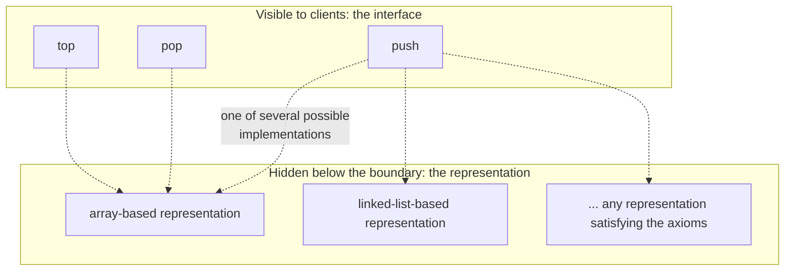

## Definition

An abstract data type (ADT, *Abstrakter Datentyp*) specifies the interface
(*Schnittstelle*) to a data structure using a mathematical description, without
making any statement about its concrete implementation (§0.3.1.1).

## Problem it solves

Characteristics of a data structure (data type): it consists of a set
(*Menge*) of data and operations (*Operationen*). Describing a data type only
through example implementations ties users to implementation details. An ADT
instead describes *only the behavior* of the data type via **(data-type)
axioms**:

- Axioms describe only the behavior of the data type.
- Axioms make no statement about the concrete implementation.
- These axioms should not be confused with axioms of predicate logic — they
  are behavioral equations about the type's operations, not logical axioms.

## Interface and encapsulation context (§0.3.1)

The ADT concept sits inside the broader idea of an object's interface
(*Schnittstelle*): a program consists of objects, each with data and methods
that can modify that data; communication between objects happens via methods.
Objects are instances of classes (*Klassen*). **Encapsulation** (*Kapselung*)
— separating interface from content, so data can only be accessed through
precisely defined interfaces — is described as a fundamental principle of
object-oriented programming. See [[concepts/encapsulation]] and
[[concepts/class-and-object]] for how C++ classes realize this.

## The interface/implementation boundary

Clients program against the operations above the boundary and the axioms that
relate them; everything below the boundary can change (array to linked list,
or any other representation) without clients noticing, as long as the axioms
still hold.

## Specification by axioms vs. implementation

The lecture's running example is the ADT [[structures/stack]]: it is specified
purely by equations relating `push`, `pop`, and `top` (see that page for the
full axioms), with "no statement about what a stack *is*; no hint about
implementation." Any implementation (array-based, linked-list-based, etc.)
that satisfies the axioms is a valid realization of the ADT.

## Consequences / trade-offs

- Specifying behavior via axioms lets multiple implementations coexist and be
  swapped without breaking client code, as long as they satisfy the same
  equations.
- The price is a layer of mathematical abstraction that must be bridged to an
  actual concrete implementation by the programmer.

## Misuse & anti-patterns

- Conflating an ADT's axioms with logical/predicate-logic axioms — the notes
  explicitly warn against this; ADT axioms are equations about operation
  behavior, not statements of formal logic.
- Treating the ADT specification as if it mandated a particular internal
  representation — by definition it does not.

## Related
- [[structures/stack]]
- [[concepts/encapsulation]]
- [[concepts/class-and-object]]
- [[concepts/uml-class-diagram]]
- [[concepts/stl-containers]] — the C++ standard library's ADT
  implementations (`std::vector`, `std::stack`, ...) behind this same
  interface/implementation boundary

## Sources
- [[sources/grigat-oop-teil1]] §0.3.1-0.3.1.1
