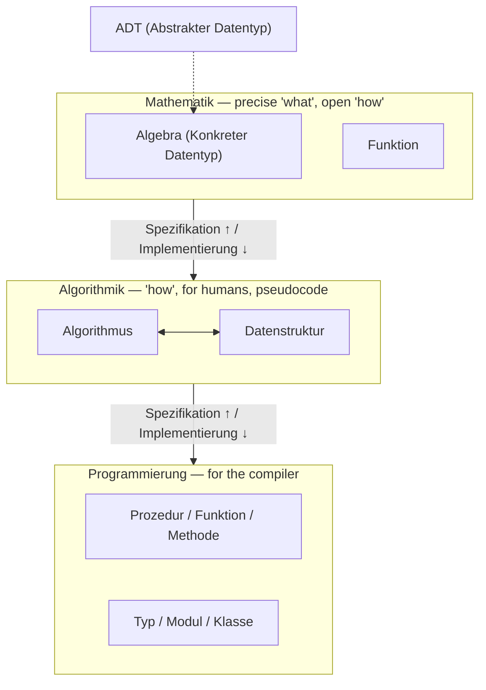

## One-sentence definition

The lecture organizes algorithms and data structures into three abstraction
levels — *Mathematik*, *Algorithmik*, *Programmierung* — each pair of
adjacent levels connected by a *Spezifikation* (going up, towards more
abstraction) / *Implementierung* (going down, towards more concreteness)
relationship (§0.9.2.1, Abbildung 51, after Güting).

## Problem it solves

Separates **what** is computed (math) from **how** it is computed for a human
reader (algorithmics) from **how** it is computed for a compiler
(programming) — so that the same specification can have many different,
independently verifiable implementations, and a data structure's correctness
can be argued about without committing prematurely to representation
details.

## The three levels

**Mathematik (Mathematics)** (§0.9.2.2)
- Precise description of **what** is computed.
- Leaves open **how** it is computed.
- For data: specified either as an **algebra** (concrete type) or an
  **abstract data type (ADT)** — see below.

**Algorithmik (Algorithmics)**
- Description for *humans* of **how** something is computed.
- Not intended for a compiler; pseudocode is the usual notation, at a
  suitable level of abstraction, independent of any particular programming
  language's details.
- For data: the **Datenstruktur** (data structure) — an implementation of an
  algebra or ADT characterized by its signature plus an informal verbal
  description.

**Programmierung (Programming)**
- Description of an algorithm for a *compiler*: a concrete implementation in
  a specific programming language.
- For data: **Typ, Modul, Klasse** (type, module, class) — the
  implementation of an algebra or ADT in a programming language. See
  [[concepts/class-and-object]].

Applied to algorithms specifically (§0.9.2.2):
1. **Mathematische Funktion** — the mathematical specification of an
   algorithm.
2. **Algorithmus** — an algorithmic implementation of the math function, and
   simultaneously the algorithmic specification of a procedure/method.
3. **Prozedur, Funktion, Methode** — the implementation of the algorithm in a
   programming language.

## Specifying a data structure: algebra vs. ADT (§0.9.2.4)

The script gives **two possibilities** for specifying a data structure at the
mathematics level:

1. **As an algebra (konkreter Datentyp)**: define a suitable *Trägermenge*
   (carrier set) for every object set (e.g. `int` ↦ `{M ⊂ ℤ | M endlich}`),
   and give a mathematical function (with domain and codomain) for every
   operation. **Disadvantage**: this may force fixing aspects of the
   structure that one did not actually want to fix.
2. **As an abstract data type (ADT)**: no carrier sets are fixed, operations
   are not given explicitly as functions over a concrete representation —
   instead the *effect* of operations is characterized by laws (axioms).

The script also lists general properties of each level at §0.9.2.2/§0.9.2.3:

- **ADT**: characterizes carrier sets and operations via axioms; only
  aspects of interest are specified; a prototype can in principle be
  generated automatically; proving completeness and consistency is
  difficult, as is building an intuitive understanding of an ADT.
- **Algebra (konkreter Datentyp)**: one or more object classes plus
  operations. A *universal* algebra has a single object class (e.g. natural
  numbers with addition, multiplication); a *mehrsortige* / *heterogene*
  (many-sorted / heterogeneous) algebra has several object classes (e.g.
  vector spaces with vectors and real numbers).
- **Datenstruktur**: an implementation of an algebra or ADT at the
  algorithmic level, characterized by signature plus an informal verbal
  description.
- **Typ, Modul, Klasse**: the implementation of an algebra or ADT in a
  programming language.

Every structure page in this wiki (e.g. [[structures/linked-list]],
[[structures/binary-tree]]) follows exactly this pattern: an ADT or algebra
specification, followed by one or more concrete data-structure
implementations, followed by a C++ type/class.

## Relationship between algorithm and data structure (§0.9.2.3)

The script states the *Algorithmik* level pairs an **Algorithmus** with a
**Datenstruktur** as a single, bidirectional unit — neither is specified
without regard to the other, because the efficiency of an algorithm depends
on which operations its data structure makes cheap.

**Worked example** (§0.9.2.3, continued into §0.9.2.5): "search an element in
a list."
- *Funktion*: search element in list.
- *Algorithmus*: traverse the list until the element is found — [[algorithms/linear-search]],
  O(n). The script's remark: if the list were sorted, [[algorithms/binary-search]]
  could be used instead, O(log n) — "betrachte Datenstruktur und Algorithmus
  als Einheit" (consider data structure and algorithm as a unit): the same
  function admits different algorithms depending on what the data structure
  guarantees (sortedness, in this case).
- *Prozedur*: the C++ implementation, see [[algorithms/linear-search]] for
  the verbatim code.

## Related
- [[concepts/abstract-data-type]]
- [[concepts/class-and-object]]
- [[algorithms/linear-search]]
- [[algorithms/binary-search]]
- [[concepts/big-o-notation]]
- [[concepts/complexity-classes]]

## Sources
- [[sources/grigat-algorithms-data-structures]] §0.9.2.1, §0.9.2.2, §0.9.2.3, §0.9.2.4, §0.9.2.5
