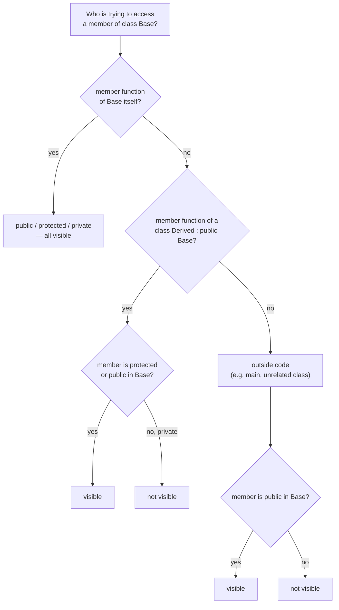
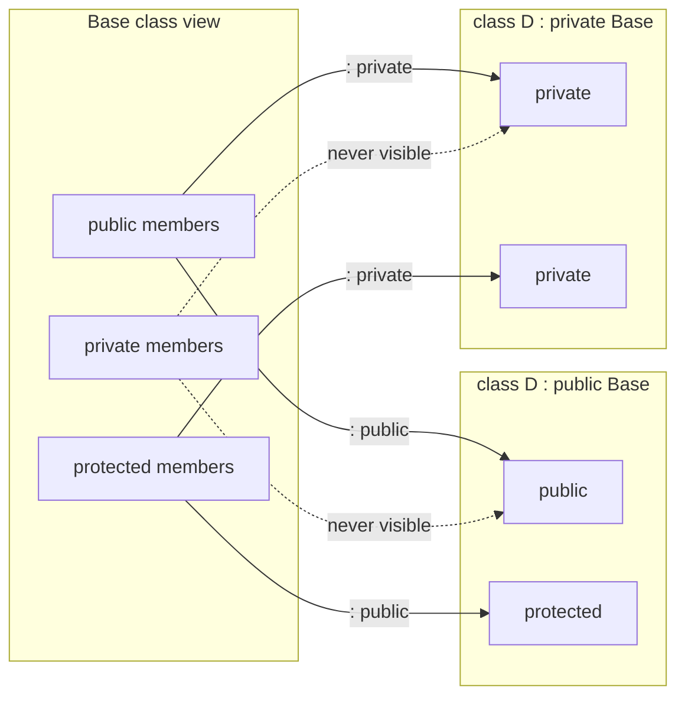

Access modifiers (*Modifikatoren*, *Zugriffsrechte*) — `public`, `private`,
`protected` — control which code may see a class's members, both on the
members themselves and on the base class named in an inheritance declaration.

## Recap: modifiers on members

- `public`: methods and data of the class are visible to all functions,
  including `main`.
- `private`: visible only to methods of the class itself. Recommended for
  data.
- `protected`: visible only to methods of the class itself and methods of
  classes derived from it. Only sensible for methods — see
  [[concepts/encapsulation]] for why `protected` data is discouraged.

```cpp
class CAuto
{
  public:
    CAuto();
    CAuto(std::string farbe);
  private:
    std::string m_farbe;
};
```

Here methods of a derived class `CCabrio` cannot reach `m_farbe` because it is
`private` in `CAuto`. Making it `protected` instead would let `CCabrio`'s own
methods reach it — at the cost described below.



## Effect of modifiers on objects

A `CCabrio` object, through its **own** member functions, can reach `protected`
members of its base class `CAuto`:
- in (other) objects of its own type `CCabrio` — yes;
- in objects of a **sibling class** (*Geschwisterklasse*) of the same base,
  e.g. `CBus` — **no**;
- in objects of the base class `CAuto` itself — **no**.

Exception: through member functions **inherited** from `CAuto` (i.e. functions
whose code actually belongs to `CAuto`), a `CCabrio` object *can* reach
`protected` and `private` members of `CAuto` in all three cases above —
because that code is executing with `CAuto`'s own access rights, not
`CCabrio`'s. Which version of a function actually runs (base vs. overridden)
is exactly the question that [[concepts/polymorphism]] answers, and it is the
crux of the worked exercise below.

## Modifiers on the base class in an inheritance declaration

The modifier written on the base class name,

```cpp
class CCabrio : public CAuto { /* ... */ };
```

transforms the visibility of inherited members for code in the derived
class and beyond:

| base-class modifier | base `public` becomes | base `protected` becomes | base `private` |
|---|---|---|---|
| `: public`    | `public`    | `protected` | never visible |
| `: protected` | `protected` | `protected` | never visible |
| `: private` (default) | `private` | `private` | never visible |

`private` members of the base class are **never** visible in a derived class,
regardless of the inheritance modifier.



### Procedure: checking whether an access is legal

1. Identify the member's **declared** access level in the class where it is declared (`public`, `protected`, or `private`).
2. Identify the **relationship** of the accessing code to that class: (a) a member function of the class itself, (b) a member function of a class derived from it, or (c) unrelated/outside code.
3. If the member is `private`: only (a) is allowed; (b) and (c) are rejected.
4. If the member is `protected`: (a) and (b) are allowed, (c) is rejected — but for (b), the access must go through an object of the *executing* class's own type or a further-derived type, not through a sibling or the plain base type (see the worked exercise below).
5. If the member is `public`: (a), (b), and (c) are all allowed.
6. If step 2's code is reached through **inherited** code (i.e. the executing function's body actually belongs to the base class, because the call wasn't resolved to an override), re-evaluate steps 3–5 using the *base* class's access rights, not the derived object's declared type — this is the trap in the worked exercise below.

## Effect on upcasting

The same base-class modifier also restricts which code may **upcast** a
derived pointer/reference to the base type — important for
[[concepts/polymorphism]]:

```cpp
CAuto* myAuto = new CCabrio;
```

- `: public` inheritance — **any** function can convert `CCabrio*` to `CAuto*`.
- `: protected` inheritance — only member functions of `CCabrio` and classes
  further derived from it may do the conversion.
- `: private` inheritance (default) — only member functions of `CCabrio`
  itself may do the conversion.

## Pitfalls

> [!warning] `protected` member variables are a design flaw
> Declaring member **variables** `protected` is normally a design flaw
> (*Designfehler*): it causes long-term software-maintenance problems because
> every usage site in every derived class must be found whenever the data's
> representation changes. The recommendation is binary: either encapsulate
> fully (`private`) or expose fully (`public`); `protected` should be reserved
> for methods, types, and constants in an interface meant for derived classes
> — never for data.
>
> The problem compounds with polymorphism: if the base-class method that
> touches a `protected` variable is **not** `virtual`, the compiler has no
> vtable entry telling it a derived class has overridden anything, so the
> base-class code — with the base class's own access rights — runs instead.
> That code can then reach `protected` members of *any* object derived from
> the same base, including sibling classes that have nothing to do with the
> object actually being acted on. See the worked exercise below and
> [[concepts/vtable]].

## Worked exercise: CKfz / CPkw / CMotorrad

```cpp
class CKfz
{
public:
        virtual void beschleunige(CKfz& kfz)=0;
        virtual void meldeBewegung(CKfz& kfz);
protected:
        int geschwindigkeit_;
        bool inBewegung_;
};

class CPkw : public CKfz
{
public:
        void beschleunige(CKfz& kfz){kfz.geschwindigkeit_ = 80;};
};
class CMotorrad : public CKfz
{
public:
        void beschleunige(CKfz& kfz){kfz.geschwindigkeit_ = 120;};
};

void CKfz::meldeBewegung(CKfz& kfz)
{
        kfz.inBewegung_ = true;
}

int main(int argc, char *argv[])
{
        CKfz* trabbi = new CPkw;
        CKfz* chevi  = new CPkw;
        CKfz* harley = new CMotorrad;

        trabbi->inBewegung_ = true;      // (line 33)
        chevi->beschleunige(*trabbi);    // (line 34)
        trabbi->beschleunige(*harley);   // (line 35)
        harley->meldeBewegung(*chevi);   // (line 36)
}
```

Questions and answers from the script:

- **a)** `protected` member variables and `protected` member functions are
  visible only in methods of the class itself and in methods of classes
  derived from it.
- **b)** With `: protected` derivation, both `public` and `protected`
  members of the base class become `protected` in the derived class;
  `private` base-class members are never visible in the derived class or
  outside it. A cast to the base class type is only allowed inside
  `protected`-derived classes, not e.g. in `main`.
- **d) line 33** (`trabbi->inBewegung_ = true;`): `main` is not a member
  function, so this is access "from outside". It requires `inBewegung_` AND
  the inheritance to be `public`. The variable is `protected` — **not
  satisfied, line 33 is illegal.**
- **e) line 34** (`chevi->beschleunige(*trabbi)`): `chevi` is a `CKfz*`
  holding a `CPkw` object. Because `beschleunige` is **virtual**, a vtable
  exists, so the overridden `CPkw` version runs — with `CPkw`'s access
  rights. A `CPkw` method may access non-private base-class elements of
  *its own* base-class portion, but `*trabbi` is passed in as `CKfz&`, i.e.
  as a different object of the base class, not as a `CPkw`. `CPkw`'s method
  has no special right to `protected`/`private` members of a `CKfz` (or
  `CMotorrad`) object that isn't itself a `CPkw`. So `geschwindigkeit_`
  would need to be `public` to be accessed this way — it is `protected` —
  **line 34 is not allowed** (the derivation being `public` is satisfied,
  but that alone isn't enough).
  - *Additional question*: why can't a `CPkw` method reach the base-class
    portion of a `CKfz` or `CMotorrad` object even with `protected`
    inheritance? Because an object of type `CKfz` (or of `CMotorrad`) is a
    genuinely different object from the `CPkw` object whose method is
    executing — its base-class portion belongs to *that* object, not to any
    `CPkw`.
- **f) / line 36** (`harley->meldeBewegung(*chevi)`): `meldeBewegung` is
  **not** overridden, so the base-class (`CKfz`) version always runs,
  with `CKfz`'s own access rights. `chevi`'s argument is passed as
  `CKfz&`, so `(*chevi).inBewegung_` is visible to this code because it is
  base-class code accessing a base-class member — **line 36 is allowed.**
- **g)** If `class CPkw : private CKfz` instead: lines 33–35 remain
  forbidden as before; line 36 remains allowed, since only `CPkw`'s
  inheritance changed, and the access in line 36 goes through `CKfz`'s own
  (base-class) code, unaffected by `CPkw`'s private derivation.

This exercise is the clearest illustration in the script of why `protected`
data, combined with polymorphism and non-obvious vtable behavior, becomes a
maintenance trap — see [[concepts/polymorphism]] and [[concepts/vtable]].

## Related

- [[concepts/encapsulation]]
- [[concepts/inheritance]]
- [[concepts/polymorphism]]
- [[concepts/vtable]]
- [[concepts/overriding-vs-overloading]]

## Sources

- [[sources/grigat-oop-teil1]] §0.3.5.6
- [[sources/grigat-oop-teil1]] §0.3.5.7
- [[sources/grigat-oop-teil1]] §0.3.5.8
- [[sources/grigat-oop-teil1]] §0.3.5.9
- [[sources/grigat-oop-teil1]] §0.3.5.10
- [[sources/grigat-oop-teil1]] §0.3.7.7
- [[sources/grigat-oop-teil1]] §0.3.7.8
- [[sources/grigat-oop-teil1]] §0.3.7.11 (exercise and solution)
