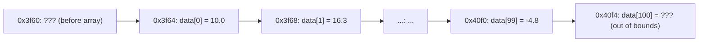
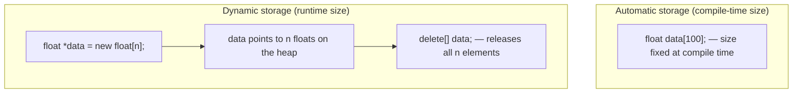

## One-sentence definition

An array (*Feld*, *Vektor*) is a structure for storing a fixed number of
elements of the same type in contiguous memory; C++ exposes this memory
directly via pointer arithmetic, and arrays either live in automatic storage
with a compile-time-fixed size, or in dynamic storage allocated at runtime
with `new[]`/`delete[]` (§0.4.3).

## Problem it solves

Programs need to store (nearly) any number of elements of equal data type
(§0.4.3) — e.g. a field `a` of size `n` holding elements `a_0 ... a_{n-1}` —
and sometimes that number is only known once the program is already running,
which a fixed-size compile-time array cannot express.

## Example in C++

```cpp
//main.cpp

// Feld fuer Temperaturdaten von 100 Messungen
float data[100];

data[0]  = 10.0;   // Zugriff auf den ersten Wert
data[3]  = 20.3;   // Zugriff auf den vierten Wert
data[99] = -4.8;   // Zugriff auf den letzten Wert
```

(Comments: "field for temperature data of 100 measurements"; "access to the
first/fourth/last value".)

## Storage of arrays in memory (§0.4.3.1)

For `float data[100];`:

- `data` = address of the first element
- `data+n` = address of the (n+1)-th element
- `*(data+n)` = content of the (n+1)-th element
- `data[n] ≡ *(data+n)` (index notation and pointer-dereference notation are
  equivalent)

**Tabelle 4: Speicheraufbau bei Feldern (memory layout for arrays):**

| Adresse (Address) | Name | Inhalt (Content) |
|---|---|---|
| 0x3f60 | ??? | ??? |
| 0x3f64 | data[0] | 10.0 |
| 0x3f68 | data[1] | 16.3 |
| ... | ... | ... |
| 0x40f0 | data[99] | -4.8 |
| 0x40f4 | data[100] | ??? |



**Achtung (warning):**
- `data+99+n` = address n elements behind (past) the last element.
- There is **no error message from the compiler** for this.
- The result of dereferencing such an address is unpredictable
  (*nicht vorhersagbar*) — undefined behavior with no compile-time guard.

## Signature of the main function (§0.4.3.2)

```cpp
int main(int argc, char * argv[]){
....// Funktionsblock
}
```

Parameters of `main` (names `argc`, `argv` are freely choosable but
conventional):

- `argc`: number of arguments, at least 1
- `argv`: an array of pointers to `char`
- `argv[0]` points to the program name including path
- `argv[1]` points to the first actual argument
- `argv[argc-1]` points to the last argument
- `argv[argc]` is `nullptr`, the null pointer

## Arrays in automatic storage (§0.4.3.3)

**Problem of arrays in automatic storage:**
- The size of the array must be fixed at compile time.
- The required memory must already be known at that point.
- Question: what to do when the array size is known only at runtime?

**Nicht erlaubt (not allowed):**

```cpp
int n=10;
float data[n]; // Fehler: n nicht const!
```

(Error: `n` not const!)

**Lösung (solution):**
- Create the array in dynamic memory instead.
- Recommendation: use STL containers (see [[structures/vector]], §0.5.6).
- As an alternative covered here: create the array manually in dynamic
  storage.

## Arrays in dynamic storage (§0.4.3.4)

- Reservation of the required memory for `n` elements with `new[n]` happens
  **at runtime** (*zur Laufzeit*).
- Must be deleted with `delete[]` (including the brackets):
  - `delete` without `[]` deletes only the first element.
  - This is a cause of memory leaks (*Speicherlecks*).

```cpp
int n=100;

// Dynamische Reservierung eines Feldes
float *data = new float[n];
data[10] = -4.5;
// Freigabe des Speicherplatzes
delete[] data;
```

(Comments: "Dynamic reservation of a field"; "Release of the memory space".)



## Consequences / trade-offs

- Automatic-storage arrays are simple and fast but their size must be known
  at compile time — a runtime-determined size (`float data[n];` with
  non-`const` `n`) is a compile error.
- Dynamic-storage arrays (`new[]`/`delete[]`) solve the runtime-size problem
  but shift responsibility for deallocation to the programmer; every `new[]`
  must be paired with exactly one `delete[]` (never plain `delete`).
- The notes explicitly recommend using STL containers (see
  [[structures/vector]]) over manual `new[]`/`delete[]` management where
  possible.

## Misuse & anti-patterns

- Reading or writing past the last valid index (`data[100]` for a
  100-element array) compiles without warning and produces unpredictable
  behavior — there is no bounds checking.
- Calling plain `delete` on a pointer obtained from `new[]` deletes only the
  first element and leaks the rest.
- Forgetting `delete[]` entirely leaks the whole array.

## Related
- [[structures/vector]]
- [[concepts/memory-model]]
- [[concepts/pointers-and-references]]
- [[concepts/parameter-passing]]

## Sources
- [[sources/grigat-cpp-concepts-generic]] §0.4.3.1, §0.4.3.2, §0.4.3.3, §0.4.3.4
