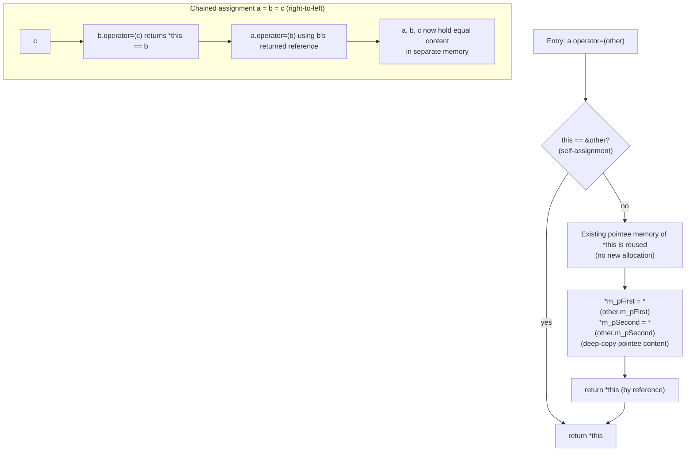

## Definition

The assignment operator (*Zuweisungsoperator*) `operator=` is the function invoked for `a = b;` once `a` already exists. Overloading it (*Überladen des Zuweisungsoperators*) lets a class define what "copying into an existing object" means — essential whenever the class owns pointer members (*deep members via pointers*) that must not simply be aliased.

## Problem it solves

Without a user-defined `operator=`, the compiler generates a *Default-Zuweisungsoperator* that performs a member-wise (shallow) copy. For a class holding raw pointers to owned dynamic data, that shallow copy makes two objects point at the same memory — a dangling/double-free hazard once either object is destroyed. A hand-written `operator=` instead performs a **deep assignment**: it copies the *pointee's* content via the already-allocated memory of the target, rather than allocating new memory.

## Example

```cpp
//ccomplexpair.hpp
class CComplexPair{
public:
  CComplexPair & operator=
      (const CComplexPair & other);
/* ... */
private:
  CComplex *m_pFirst;
  CComplex *m_pSecond;
};
```

```cpp
//ccomplexpair.cpp
CComplexPair & CComplexPair::operator=
    (const CComplexPair & other)
{
  *m_pFirst  = *(other.m_pFirst);
  *m_pSecond = *(other.m_pSecond);
  return *this;
}
```

Two points are essential here:

1. **Return `*this` by reference.** This is what makes chained assignment work:
   `a=b=c;` executes as `a=(b=c);`, i.e. as the function-call chain `a.operator=(b.operator=(c))`. All three objects end up with the same content but in *separate* memory, because the body assigns through the dereferenced pointers (`*m_pFirst = ...`) rather than reassigning the pointers themselves.
2. **No allocation.** `operator=` reuses the memory that `*this` already owns; it must not call `new`.

```
1. operator= receives `other` by const L-value reference (see [[concepts/value-categories]]).
2. For each owned pointer member: dereference both pointers and assign the
   pointee's value (deep assignment), without allocating new memory.
3. Return *this by reference, enabling chained assignment a = b = c.
```



### Copy constructor vs. assignment operator (§0.4.4.9)

The two special member functions look similar but differ fundamentally:

| | Copy constructor | Assignment operator |
|---|---|---|
| Called when | object is being created | object already exists |
| Memory | reserves memory with `new` | reserves **no** additional memory |
| Member variables | must initialize **all** of them | performs **no** initializations, only overwrites |
| Return value | none (constructors never return a value) | returns `CComplexPair&` (`*this`) |

```cpp
CComplexPair::CComplexPair
    (const CComplexPair & other)
{
  m_pFirst  =
      new CComplex(*(other.m_pFirst ));
  m_pSecond =
      new CComplex(*(other.m_pSecond));
}
```

```cpp
CComplexPair & CComplexPair::operator=
    (const CComplexPair & other)
{
  *m_pFirst
      = *(other.m_pFirst);
  *m_pSecond
      = *(other.m_pSecond);
  return *this;
}
```

A related subtlety from the line-by-line walkthrough of constructor/assignment calls: whether a statement like `Testclass e = a;` invokes the copy constructor (initialization) or `operator=` (assignment of an already-existing object) depends entirely on whether the left-hand object is being *created* at that point or already exists — only the latter calls `operator=`. If the class defines a matching `operator=(const int&)` overload, assignment from an `int` literal calls that overload directly and skips constructing a temporary object altogether.

## Consequences / trade-offs

- Omitting a user-defined `operator=` for a class with owned pointers silently falls back to the shallow, compiler-generated default — a classic source of double-free bugs.
- Writing `operator=` correctly also means guarding against self-assignment (`a = a;`) in general, though the shown deep-assignment form is naturally safe here since it assigns through pointers that already point to valid, separate memory.
- See [[concepts/move-semantics]] for the R-value-reference counterpart (`operator=(T&&)`), which avoids even the deep assignment by stealing pointers instead.

## Misuse & anti-patterns

- Allocating new memory inside `operator=` (that is the copy constructor's job) wastes cycles and breaks the "reuse existing storage" contract.
- Forgetting to return `*this` by reference breaks chained assignment and usually also breaks any code which expects `operator=` to behave like the built-in types' assignment.

## Related

- [[concepts/copy-constructor]]
- [[concepts/move-semantics]]
- [[concepts/value-categories]]
- [[concepts/constructor]]
- [[concepts/this-pointer]]
- [[synthesis/special-member-functions]]

## Sources

- [[sources/grigat-cpp-concepts-generic]] §0.4.4.7 (continuation), §0.4.4.8, §0.4.4.9
