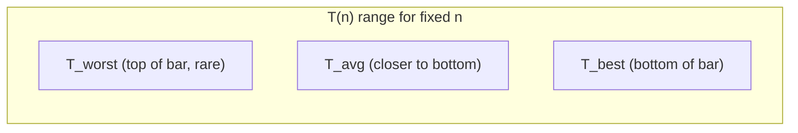
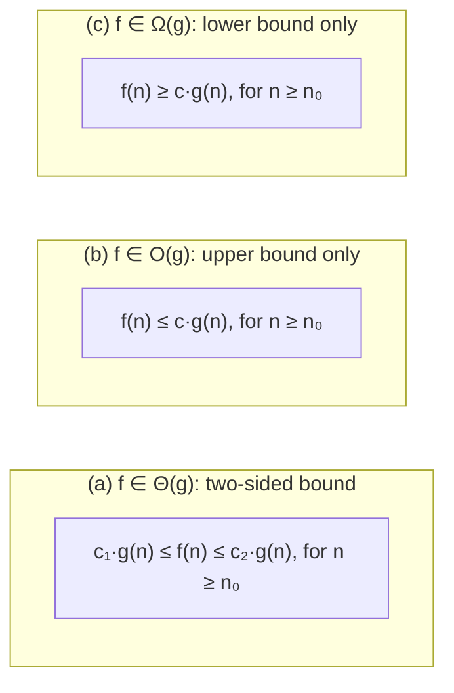
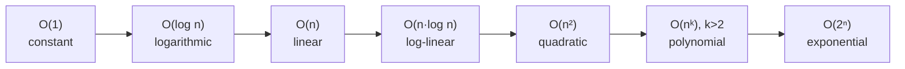

## Definition

The **complexity** (*Komplexität*) of an algorithm is its maximal requirement
for **computation time** (*Rechenzeit*) and **memory space**
(*Speicherplatz*), expressed as a function of the size `n` of the input data
set. This lecture considers only computation-time complexities `T(n)`: time
requirement is generally the critical resource; memory requirement is mostly
critical only for hardware implementations.

## Analysis of computation time (§0.5.5.2)

The time requirement `T(n)`[^1] generally depends on the input size `n`. Three
cases are distinguished:

- **best case** `T_best` — the most favorable input of size `n`.
- **worst case** `T_worst` — the least favorable input of size `n`.
- **average case** `T_avg` — weighted mean over inputs of size `n`, taking into
  account the frequency or probability of each input.

[^1]: Footnote in the source: "Nicht verwechseln mit Templateparameter T" — not
to be confused with the template parameter `T` of [[concepts/templates]].

## Worked example (§0.5.5.3)

For a fixed input size `n`, the possible running times of an algorithm spread
across a range; a given run falls somewhere between `T_best` and `T_worst`,
with `T_avg` lying wherever the distribution of actual inputs weights it — in
the source's example, `T_worst` occurs comparatively rarely and `T_avg` sits
closer to `T_best`.



*(Abbildung 13 in the source is a vertical bar/spread chart against axis T(n);
the diagram above approximates the vertical ordering `T_worst > T_avg >
T_best` rather than a control-flow graph.)*

## Determining complexities — the formal O-notation definition (§0.5.5.4–0.5.5.5)

To avoid tracking exact running times, an algorithm's time requirement `f(n)`
is estimated by a simpler function `g(n)`, dropping additive and multiplicative
constants.

**Definition (O-notation).** Let `f: ℕ→ℝ⁺`, `g: ℕ→ℝ⁺`.

```
f ∈ O(g) :⇔ ∃ n₀, c ∈ ℝ, c>0 : ∀ n≥n₀  f(n) ≤ c·g(n)
```

Read: *"f grows at most as fast as g."* Equivalently, as a set:

```
O(g) = { f: ℕ→ℝ⁺ | ∃ n₀∈ℕ, c∈ℝ⁺ : ∀n≥n₀  f(n) ≤ c·g(n) }
```

The notation `f = O(g)` ("f is O(g)") is common but imprecise; `f ∈ O(g)` is
the precise form, since `O(g)` denotes a **set of functions**.

**Example.** For `f(n) ≡ T₁(n) = n+5`, choosing `g(n) = n` gives `T₁ ∈ O(n)`:
solving `n₀+5 ≤ c·n₀` gives `n₀ ≥ 5/(c−1)` for any `c>1`.

**Complexity via limit.** For complexities with `f(n)>0` and `g(n)>0`:

```
lim_{n→∞} f(n)/g(n) exists and is finite  ⇔  f ∈ O(g)
```

**Example.** For `f(n) ≡ T₂(n) = 2n²+100n+10000`, with `g(n) = n²`:

```
lim_{n→∞} (2n²+100n+10000)/n² = 2   ⇒  T₂ ∈ O(n²)
```

### Pseudocode: determining the complexity class of `f`

```
1. Identify the candidate bounding function g(n) (e.g. the dominant term of f,
   stripped of its constant factor).
2. Compute L = lim_{n→∞} f(n)/g(n).
3. If L is finite (including 0):
4.     f ∈ O(g)                      // f grows at most as fast as g
5. If L > 0 (finite, nonzero):
6.     f ∈ Θ(g) as well              // f and g grow equally fast
7. If L = 0:
8.     f ∈ o(g)                      // f grows strictly slower than g
9. If L = ∞:
10.    f ∈ ω(g), and g ∈ o(f)        // f grows strictly faster than g
```

## Example of O-notation and lower-order terms (§0.5.5.6)

```
T₃(n) = 2·n+100     ∈ O(n)
T₄(n) = 2n²+10·n+4  ∈ O(n²)
```

For small `n`, the **lower-order terms decide the actual ranking**: in the
source's example (Abbildung 14), for `n ≤ 6`, `T₄(n) < T₃(n)` even though `T₄`
is asymptotically the faster-growing function. Asymptotic class membership
(`O(n²)` vs. `O(n)`) says nothing about which function is smaller for any
*particular* small `n` — only about the limiting trend.

## Properties of O-notation (§0.5.5.7)

- **Elimination of constants:** `O(n) = O(n/2) = O(2n) = O(3n+5)` — one simply
  writes `O(n)` for all of these equivalent sets.
- **Forming upper bounds — strict ordering of complexity classes:**

```
O(1) ⊂ O(log n) ⊂ O(n) ⊂ O(n²) ⊂ O(2ⁿ)
```

## Calculation rules of O-notation (§0.5.5.8)

The chained "equation" `f = O(g)` is **only ever read left to right**; the
statement `O(g) = f` is meaningless, and a chain like

```
O(1) = O(n) = O(n²) = O(2ⁿ)
```

does **not** mean these sets are equal — it is sloppy shorthand for a sequence
of one-directional containments/estimates, never symmetric.

**Addition of functions:**

```
O(g₁(n)) ∪ O(g₂(n)) = O(g₁(n)+g₂(n))
                     = O(g₁(n))  if g₂ ∈ O(g₁)
                     = O(g₂(n))  if g₁ ∈ O(g₂)
```

I.e. the union of two O-classes equals the O-class of the sum of their
representative functions — the dominant term's class wins.

> The detailed table of named complexity classes (constant, logarithmic,
> linear, log-linear, quadratic, polynomial, exponential, with worked examples
> such as binary search and fast/primitive sorting) is covered in
> [[concepts/complexity-classes]] (§0.5.5.9) — refer there rather than
> duplicating it here.

## General O-notation: the o / O / Θ / Ω / ω family (§0.5.5.10–0.5.5.11)

| precise | holds iff | "short" | mnemonic |
|---|---|---|---|
| f ∈ o(g) | lim_{n→∞} f(n)/g(n) = 0 | "f < g" | f grows slower than g |
| f ∈ O(g) | lim_{n→∞} f(n)/g(n) < ∞ | "f ≤ g" | f grows at most as fast as g |
| f ∈ Θ(g) | f ∈ O(g) and g ∈ O(f) | "f = g" | f and g grow equally fast (same order of magnitude) |
| f ∈ Ω(g) | g ∈ O(f) | "f ≥ g" | f grows at least as fast as g |
| f ∈ ω(g) | g ∈ o(f) | "f > g" | f grows faster than g |

The source's Abbildung 15 shows three sandwiching diagrams against axes `n`
and function value, each with a threshold `n₀` beyond which the bound holds:



## Diagram: growth-class ordering



See [[concepts/complexity-classes]] for the full named-class table with
worked examples (binary search, sorting algorithms) that fill in this chain.

## Consequences / trade-offs

- O-notation discards constant factors and lower-order terms, which is exactly
  right for comparing *asymptotic* behaviour but can be misleading for small
  `n` (§0.5.5.6) — always state which regime a complexity claim applies to.
- The `o`/`O`/`Θ`/`Ω`/`ω` family lets you make precise claims about strict vs.
  non-strict, one-sided vs. two-sided growth comparisons, rather than
  overloading `O` for everything.

## Misuse & anti-patterns

- Writing `f = O(g)` and reasoning about it as a true equation (e.g. deriving
  `O(g) = f`) — it is a one-directional membership/estimate statement only.
- Quoting a worst-case `O(·)` bound as if it described average-case behaviour,
  or vice versa, without stating which of `T_best`/`T_avg`/`T_worst` is meant.
- Using `O(g)` when `Θ(g)` is actually meant (i.e. implying a tight bound when
  only an upper bound has been shown).

## Related

- [[concepts/complexity-classes]]
- [[concepts/templates]]
- [[concepts/standard-library]]
- [[structures/stack]]

## Sources

[[sources/grigat-cpp-concepts-generic]] §0.5.5.1, §0.5.5.2, §0.5.5.3, §0.5.5.4,
§0.5.5.5, §0.5.5.6, §0.5.5.7, §0.5.5.8, §0.5.5.10, §0.5.5.11
