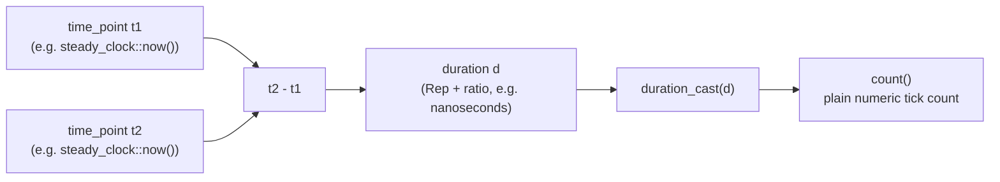

# Time Measurement with `<chrono>`

Times, durations and time points live in `<chrono>`, namespace `std::chrono`.
This is the tool for empirically measuring the runtime of an algorithm.

## The three abstractions

- **Time point** (*Zeitpunkt*) — `std::chrono::time_point`, corresponding to the
  tick count of a chosen clock.
- **Duration** (*Zeitintervall*) — `std::chrono::duration`, with a tick count of
  type `Rep` (representation), a time unit of type `std::ratio` (step size), and
  a getter `count()` for the number of ticks.
- **Clock** (*Uhr*) — three are available:

| Clock | Meaning |
|---|---|
| `system_clock` | system real-time clock |
| `steady_clock` | monotonic clock, no adjustment |
| `high_resolution_clock` | shortest possible ticks |

> For benchmarking prefer `steady_clock`: `system_clock` can be adjusted
> backwards mid-measurement.

## Units are part of the type

```cpp
duration<long long,milli> d1 {7};        // 7 Millisekunden
duration<double,pico> d2 {3.33};         // 3,33 Pikosekunden
duration<int,ratio<1,1>> d3 {};          // 0 Sekunden
```

Assignment works only with consistent units — the type system refuses to guess:

```cpp
duration<long long,milli> d1 {7}; // 7 Millisekunden
d1 += 5; // Fehler, Einheit von 5 undefiniert
duration<int,ratio<1,1>> d2 {7};  // 7 Sekunden
d1 += duration<long long,milli>{5}; // OK: Millisekunden
d2 += decltype(d2){5};               // OK: Sekunden
d2 = duration_cast<milli>(d2);       // Umrechnung in Millisekunden
```

## Predefined units

`siN` denotes an implementation-dependent signed integer type with at least N bits.

```cpp
using nanoseconds = duration<si64,nano>;
using microseconds = duration<si55,micro>;
using milliseconds = duration<si45,milli>;
using seconds = duration<si35>;
using minutes = duration<si29,ratio<60>>;
using hours = duration<si23,ratio<3600>>;
```

Date and time can also be handled C-style with `<ctime>` — `std::time_t`,
`std::difftime`, `CLOCKS_PER_SEC`.

## Measuring

```cpp
auto t = steady_clock::now();
// ... etwas tun ...
auto d = steady_clock::now()-t; // d Zeiteinheiten verbraucht
// ausgeben als Millisekunden:
cout << "Rechenzeit " << duration_cast<milliseconds>(d).count() << "ms";
```

Subtracting two `time_point`s yields a `duration` — the types compose correctly
by construction.



```text
PROCEDURE benchmark(work):
1. start := clock::now()      // prefer steady_clock for benchmarking
2. execute(work)
3. end := clock::now()
4. elapsed := end - start               // yields a duration
5. scaled := duration_cast<Unit>(elapsed) // convert to desired unit
6. report scaled.count()                 // plain number of ticks in Unit
```

### Full example: timing a recursive Fibonacci

```cpp
#include <iostream>
#include <chrono>
#include <ctime>

int fibonacci(int n){
    if (n < 3) return 1;
    return fibonacci(n-1) + fibonacci(n-2);
}
int main(){
    std::chrono::time_point<std::chrono::system_clock> start, end;
    start = std::chrono::system_clock::now();
    int result = fibonacci(42);
    end = std::chrono::system_clock::now();
    // ... Differenz als duration_cast<seconds> ausgeben ...
}
```

> [!note] Why this example is chosen
> Naive recursive Fibonacci runs in exponential time — O(φⁿ) calls, assuming no
> memoisation — which is precisely why it is measurable at n = 42. The
> transcription of the final output lines was cut off in the scan; the structure
> above is faithful but the last statement is reconstructed from context.

## Related

- [[concepts/type-aliases]]
- [[concepts/initialization-and-assignment]]
- [[concepts/function-declarations]]
- [[concepts/big-o-notation]] (empirical measurement vs. asymptotic analysis)

## Sources

- [[sources/grigat-oop-teil1]] §0.2.1.10 (Zeitmessung), §0.2.1.11 (Zeiteinheiten),
  §0.2.1.12 (Vordefinierte Zeiteinheiten), §0.2.1.13 (Einfaches Beispiel für chrono),
  §0.2.1.14 (Beispiel Zeitmessung)
