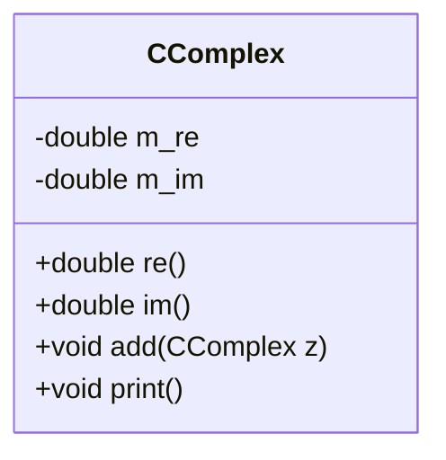
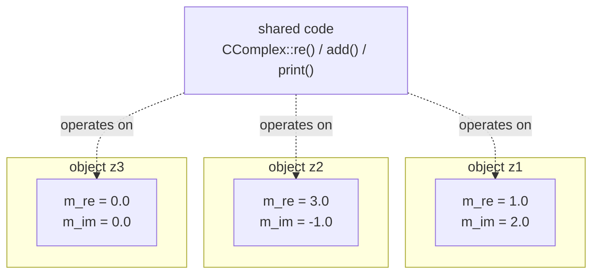

One class, `CComplex`, produces many objects (`z1`, `z2`, `z3`, ...), each
with its own private memory for `m_re`/`m_im`, while all instances share the
same compiled member-function code (§0.3.2.1).

## Definition

A class (*Klasse*) in C++ bundles data (member variables, *Membervariablen*)
and functions that operate on that data (member functions, *Memberfunktionen*
or *Elementfunktionen*). An object (*Objekt*) is an individual instance of a
class, with its own private region of memory for its data (§0.3.2.1).

## Problem it solves

A program consists of objects; each object consists of data and methods that
can modify that data; communication between objects happens via methods.
**Encapsulation** (*Kapselung*) — separating interface from content, so data
is reachable only via precisely defined interfaces — is named as a fundamental
principle of object-oriented programming (§0.3.1, shared with
[[concepts/encapsulation]] and [[concepts/abstract-data-type]]). Each object is
an individual instance of its class, has its own memory region for its data,
and methods are always associated with an object.

## Classes in C++ (§0.3.2.1)

The `CAuto` example:

```cpp
class CAuto
{
  public: // Modifikator "fuer alle Funktionen sichtbar"
    std::string getFarbe(); //Methode (in C++: "Memberfunktion")
    void lackiere(std::string farbe); // Memberfunktion
  private: // Modifikator "nur für Memberfunktionen dieser Klasse sichtbar"
          std::string m_farbe; // Daten (in C++: "Membervariablen")
};
```

- `public` modifier: "visible for all functions" — the public interface;
  methods and data declared here are visible everywhere, e.g. callable from
  `main()`. `getFarbe()` is meant to return the content of `m_farbe`;
  `lackiere(std::string farbe)` is meant to change the content of `m_farbe`.
- `private` modifier: methods and data are invisible outside the class (e.g.
  not callable from `main()`) — and this is the **default** access level for
  members if no modifier is given.

## `class` vs. `struct` (§0.3.2.2)

```cpp
class CAuto
{
    int a;     // Default: private
  private:
    int m_b;   // private
  public:
    int c;     // public
};
```

```cpp
struct CAuto
{
    int a;     // Default: public
  private:
    int m_b;   // private
  public:
    int c;     // public
};
```

- In a `struct`, members default to **public**.
- In a `class`, members default to **private**.
- Otherwise `struct` and `class` are *identical* in C++ — both can have
  constructors, member functions, access modifiers, etc. (More on access
  rights is pointed forward to §0.3.5.6 in the source, not covered in this
  excerpt.)

## Declaration vs. definition split (§0.3.2.4)

A class definition (e.g. in a header) contains **only the declaration** of its
member functions; the member functions themselves are defined separately,
typically in a corresponding `.cpp` file, qualified with the scope resolution
operator `::` (see also [[concepts/namespaces]] for `::` in the namespace
context):

```cpp
//ccomplex.hpp
class CComplex
{
public:
  double re();
  double im();
  void add(const CComplex& z);
  void print();
private:
  double m_re;
  double m_im;
};
```

```cpp
//ccomplex.cpp
double CComplex::re()
{
  return m_re;
}
double CComplex::im()
{
  return m_im;
}
void CComplex::add(const CComplex& z)
{
  m_re += z.re();
  m_im += z.im();
}
void CComplex::print()
{
  cout << m_re <<"+"<< m_im <<"j"<< endl;
}
```

This split mirrors the general declaration/definition separation used for
separate compilation (see
[[concepts/modularization-and-build-pipeline]]): the header declares the
public interface so other translation units can compile against `CComplex`
without recompiling its implementation; `add` takes its argument `z` by
`const CComplex&` reference (see [[concepts/parameter-passing]]) and mutates
the object's own `m_re`/`m_im` using the accessors `z.re()`/`z.im()`. A named
method like `add` can later be expressed as an overloaded `operator+` instead
— see [[concepts/operator-overloading]].

## Consequences / trade-offs

- Separating public interface (header) from implementation (`.cpp`) supports
  separate compilation and lets client code depend only on the interface.
- Choosing `struct` for plain data aggregates and `class` for encapsulated
  types with a deliberate public/private boundary is a common convention
  following from their differing defaults, even though the language treats
  them identically otherwise.

## Misuse & anti-patterns

- Assuming `struct` members are private by default, or `class` members public
  by default — the defaults are the opposite in each case, as shown above.
- Defining member functions inline in the header for every class regardless of
  size, losing the separate-compilation benefit the declaration/definition
  split provides.

## Related
- [[concepts/encapsulation]]
- [[concepts/abstract-data-type]]
- [[concepts/uml-class-diagram]]
- [[concepts/modularization-and-build-pipeline]]
- [[concepts/operator-overloading]]
- [[structures/stack]]

## Sources
- [[sources/grigat-oop-teil1]] §0.3.2.1-0.3.2.4
