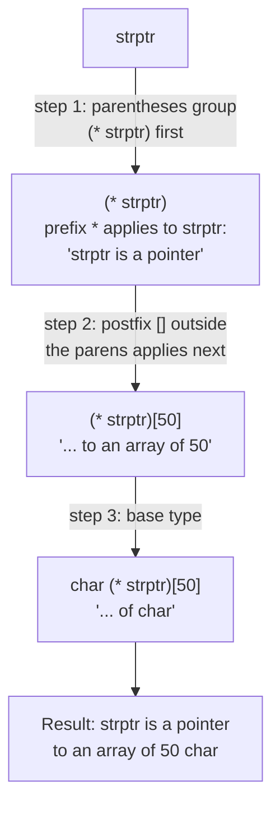

# Complex Declarations

A declaration is **complex** when it carries more than one operator from the set
index `[]`, function `()`, pointer `*`, reference `&`.

## Structural rules

- Elements of an array cannot be functions.
- A function cannot return a function or an array — but it can return **pointers**
  to them.
- Parenthesisation is allowed.
- The right-hand operators `()` and `[]` bind **more strongly** than the left-hand
  `*` and `&`.

## Parsing procedure

1. Start at the identifier being declared.
2. If `()` or `[]` is to the right, interpret it first.
3. If nothing or `)` is to the right, interpret the `*` to the left, if present.
4. Repeat steps 2–3 until all operators are resolved.
5. Finally apply the base type.

In short: **right, then left, outward**.

```text
PROCEDURE parse_declarator(declaration):
1. Locate the identifier (the name being declared).
2. current_position := identifier
3. WHILE unresolved operators remain:
4.     IF a postfix operator ([] or ()) is adjacent on the right:
5.         interpret it ("array of ..." / "function returning ...")
6.         advance current_position past it
7.     ELSE IF a prefix operator (*, &, &&) is adjacent on the left:
8.         interpret it ("pointer to ..." / "reference to ...")
9.         advance current_position past it
10.    ELSE IF a '(' groups a sub-expression:
11.        recurse into the parenthesised group first, then continue outward
12. Apply the base type to whatever remains innermost.
13. Read the composed meaning from the identifier outward.
```

Applied to `char (* strptr)[50];` step by step:



## Worked examples

```cpp
char (* strptr)[50];
```
`strptr` is a pointer to an array of 50 elements of type `char`.

```cpp
long * (* func ()) [];
```
`func` is a function with return value of type pointer to array with elements of
type pointer to `long`.

```cpp
char * (* (* funcptr) ()) [];
```
`funcptr` is a pointer to a function with return value of type pointer to array
with elements of type pointer to `char`.

## Contrast cases worth memorising

```cpp
int * feld[3];   // Array aus drei Zeigern
int (*feld)[3];  // Zeiger auf Array aus drei Integers

double(*pf)(int); // Zeiger auf Funktion int -> double
double *pf(int);  // Funktion int -> double*
```

## Practical advice

Introduce a [[concepts/type-aliases|type alias]] rather than writing these out.
`using PTR_TO_FUNC = char*(*)();` says the same thing and can be read at a glance.

## Related

- [[concepts/type-declaration-definition]]
- [[concepts/type-aliases]]
- [[concepts/pointers-and-references]]
- [[concepts/function-declarations]]
- [[concepts/operators-and-precedence]]

## Sources

- [[sources/grigat-oop-teil1]] §0.2.2.5 (Komplexe Deklarationen),
  §0.2.2.6 (Beispiele für komplexe Deklarationen), §0.2.3.5 (Deklaratoroperatoren),
  §0.2.2.3 (Zeiger auf Funktionen)
