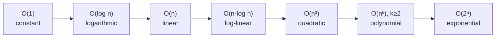

## One-sentence definition

A complexity class (*Komplexitätsklasse*) groups runtime functions
(*Laufzeitfunktionen*) that grow "at most as fast" as a common reference
function, giving algorithms a coarse, constant-and-lower-order-term-free label
such as "linear" or "quadratic" (§0.5.5.9).

## Problem it solves

Comparing exact running-time formulas (e.g. `2n² + 10n + 4` vs. `2n + 100`) is
noisy: additive and multiplicative constants and lower-order terms obscure
which algorithm actually scales better for large `n`. Classifying runtime
functions into a small, strictly ordered set of classes lets you reason about
scalability without carrying this noise. The formal definition of the
underlying O-notation itself is covered in [[concepts/big-o-notation]] — this
page only classifies named runtime functions into named classes (§0.5.5.9) and
does not redefine O(·).

## Classification table (§0.5.5.9, Tabelle 5)

| Sprechweise (name) | Klasse (class) | Beispiel (example) |
|---|---|---|
| konstant (constant) | O(1) | — |
| logarithmisch (logarithmic) | O(log n) | Binäre Suche (binary search) |
| linear | O(n) | — |
| log-linear | O(n·log n) | Schnelle Sortierverfahren (fast sorting algorithms) |
| quadratisch (quadratic) | O(n²) | Primitive Sortierverfahren (primitive sorting algorithms) |
| polynomiell (polynomial) | O(nᵏ), k≥2 | — |
| exponentiell (exponential) | O(2ⁿ) | — |

The notes give no named example for the constant, linear, and polynomial
rows; this page does not invent ones.

## Strict ordering of complexity classes (§0.5.5.7)

The notes state the forming of upper bounds as a chain of strict subset
relations:

```
O(1) ⊂ O(log n) ⊂ O(n) ⊂ O(n²) ⊂ O(2ⁿ)
```

Combined with the classification table above (which additionally places
O(n log n) between O(n) and O(n²), and O(nᵏ) between O(n²) and O(2ⁿ) for
k≥2), the full ordering used on this page is:

```
O(1) ⊂ O(log n) ⊂ O(n) ⊂ O(n log n) ⊂ O(n²) ⊂ O(nᵏ) ⊂ O(2ⁿ)
```



> [!note] Reading direction
> The notes stress that a chained statement like `O(1) = O(n) = O(n²) = O(2ⁿ)`
> is mathematically sloppy shorthand: `f = O(g)` must only be read left to
> right (`f` is *in* `O(g)`), never as a symmetric equation, and `O(g) = f` is
> meaningless (§0.5.5.8). The `⊂` chain above is the correct, strict-subset
> form of the same idea.

## Calculation rule: addition of functions (§0.5.5.8)

```
O(g₁(n)) ∪ O(g₂(n)) = O(g₁(n) + g₂(n))
                     = O(g₁(n))  if g₂ ∈ O(g₁)
                     = O(g₂(n))  if g₁ ∈ O(g₂)
```

The union of two O-classes equals the O-class of the sum of their reference
functions; whichever reference function dominates (is the larger class)
determines the result. This is why the strict ordering above matters in
practice: once you know two sub-routines' classes, the dominant one wins and
the other can be dropped from the overall bound.

## Trade-offs

- Classifying into named classes trades precision (the exact constants) for
  comparability — useful once `n` is large enough that constants stop
  mattering.
- The source's own worked diagram (Abbildung 14, §0.5.5.6: `T₃(n)=2n+100 ∈
  O(n)` vs. `T₄(n)=2n²+10n+4 ∈ O(n²)`) shows that for small `n` (here `n≤6`)
  the asymptotically worse class can still have the smaller actual value —
  classification describes large-`n` behavior only.

## Related
- [[concepts/big-o-notation]]
- [[concepts/stl-containers]]
- [[structures/vector]]
- [[algorithms/stl-algorithms]]

## Sources
- [[sources/grigat-cpp-concepts-generic]] §0.5.5.6, §0.5.5.7, §0.5.5.8, §0.5.5.9
