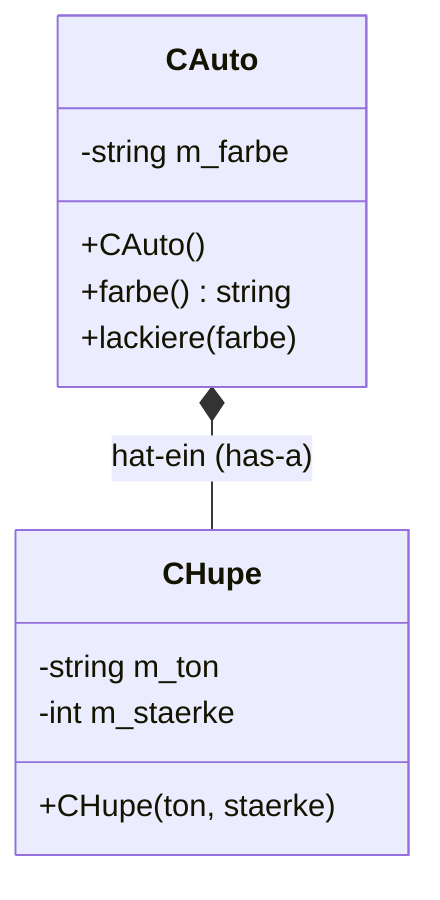
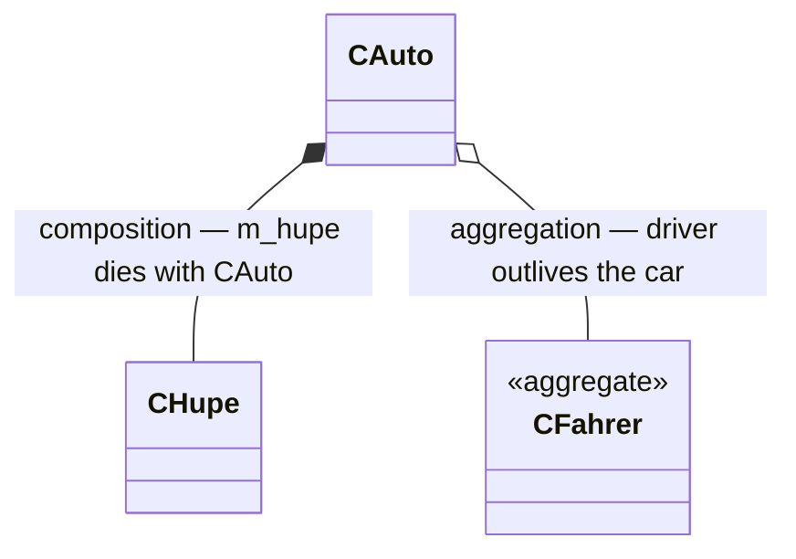
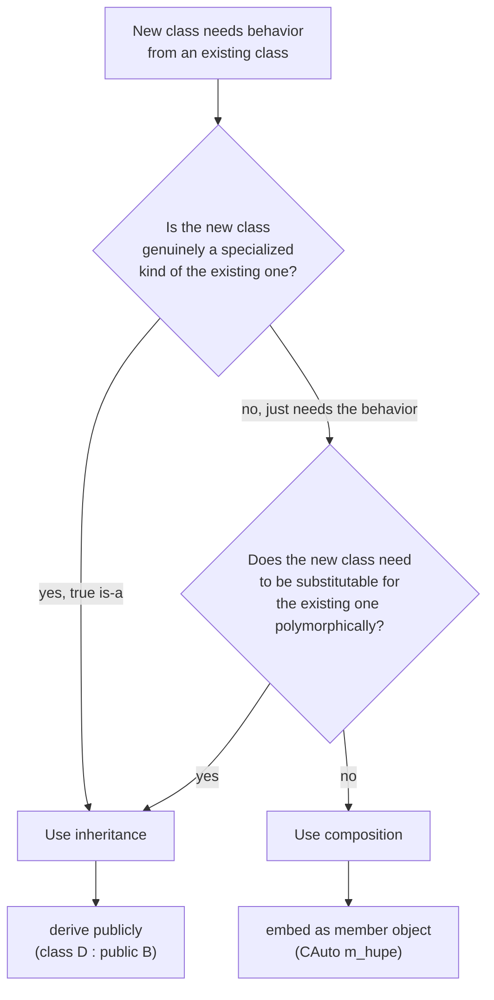

Composition (*Komposition*) is the "has-a" relationship (*hat-ein*): an object contains further objects as class elements, called member objects (*Memberobjekte*) (§0.3.4).

## Problem it solves

Complex objects are naturally built from simpler objects rather than only from primitive data. Composition lets a class reuse another class's full behavior and data by embedding an instance of it, instead of duplicating that logic (§0.3.4).

## The "Auto hat Hupe" example

> Figure 6 ("UML-Diagramm: Komposition: 'Auto hat Hupe'") shows `CAuto` and `CHupe` connected by a line with a filled diamond on the `CAuto` side pointing to `CHupe` — the UML composition symbol, read "Auto has Hupe" (Car has Horn).

```cpp
// chupe.hpp
class CHupe
{
public:
  CHupe(std::string ton, int staerke);
  ~CHupe();
private:
  std::string m_ton;
  int m_staerke;
};

// cauto.hpp
class CAuto
{
public:
  CAuto();
  std::string farbe();
  void lackiere(std::string farbe);
  CHupe m_hupe; // Auto hat Hupe
private:
  std::string m_farbe;
};
```

`CHupe` takes constructor parameters `ton` (tone) and `staerke` (strength/volume). `CAuto` embeds `CHupe m_hupe;` directly as a member, realizing composition (§0.3.4.1).



## Composition vs. aggregation: who owns the lifetime

Composition (`*--`) means the part's lifetime is bound to the whole: `CHupe
m_hupe` is destroyed automatically when its owning `CAuto` is destroyed, and
cannot outlive it or be shared with another `CAuto`. Aggregation (`o--`) is
the weaker UML relative: the "whole" merely holds a reference/pointer to a
part that exists independently and may outlive it or be shared.



## When to choose composition over inheritance



See [[concepts/inheritance]] for the "is-a" side of this decision.

## Initializing member objects

A member object that requires constructor arguments cannot simply be left to a default constructor — it must be initialized explicitly. The solution is to initialize it in the owning class's [[concepts/constructor|constructor]], using a **member initializer list** (*Initialisierungsliste*) introduced after `:` (§0.3.4.2):

```cpp
// cauto.cpp
CAuto::CAuto() :               // Beginn Initialisierungsliste für CAuto
  m_hupe("hohes C", 128),
  m_farbe("Schwarz")
{
  cout << "Auto initialisiert" << endl;
}
```

The initializer list can also be used for plain variables, and it is the *only* place `const` class elements can be initialized — they cannot be assigned later in the constructor body (§0.3.4.3):

```cpp
// ccomplex.hpp
class CComplex
{
public:
  CComplex(double r, double i);
private:
  double m_re;
  double m_im;
  const double PI;
}; // konstantes Klassenelement

// ccomplex.cpp
CComplex::CComplex(double r, double i)
         : // Initialisierungsliste
  m_re(r),
  m_im(i),
  PI(3.14)
{}
```

This is *why* `const` members force the use of an initializer list: a `const` member cannot be assigned to at all after construction, so it must receive its value at the moment it is constructed.

### Procedure: constructing an object with member objects

1. Allocate storage for the object (all member objects live inline inside it).
2. For each member object, in **declaration order** (not initializer-list order): run its constructor — using the arguments given in the initializer list, or its default constructor if omitted.
3. Run the body of the owning class's own constructor.
4. (On destruction, steps 2–3 reverse: the owning destructor's body runs first, then each member object's destructor runs in **reverse** declaration order.)

## OOP nomenclature

> Figure 7 ("Nomenklatur für Klassen in C++") is a tree: `Klasse` branches into `Memberfunktion` and `Membervariable`; `Membervariable` further branches into `Grundtypen` (basic types, e.g. `bool`, `int`, `double`) and `Memberobjekte` (member objects, keyword: composition).

A class in C++ thus contains member functions (synonymous with "methods"/"Elementfunktion") and member variables (synonymous with "data"/"Elementvariable"), where member variables are either basic types or member objects (§0.3.4.4).

## Static member objects

Member objects belong to the member-variable category, so they can also be declared `static`; the same rules as for [[concepts/static-members|static member variables]] apply, and static member functions can access static member objects too (§0.3.4.5).

## Consequences / trade-offs

- Composition reuses behavior without the coupling of [[concepts/inheritance|inheritance]]: `CAuto` can change which kind of horn it has without affecting `CAuto`'s own public interface.
- Member objects with non-trivial constructors add initialization-order obligations: all member objects must be initialized (explicitly or via a default constructor) before the owning constructor's body runs.

## Misuse & anti-patterns

- Trying to assign to a member object or `const` member inside the constructor body — for `const` members this fails to compile; for member objects it wastefully default-constructs first, then reassigns (and is simply impossible if the member type has no default constructor).
- Confusing composition ("has-a") with inheritance ("is-a") — see [[concepts/inheritance]] for when the latter is the better fit.

## Related

- [[concepts/inheritance]]
- [[concepts/constructor]]
- [[concepts/static-members]]
- [[concepts/class-and-object]]
- [[concepts/uml-class-diagram]]

## Sources

[[sources/grigat-oop-teil1]] §0.3.4, §0.3.4.1, §0.3.4.2, §0.3.4.3, §0.3.4.4, §0.3.4.5
