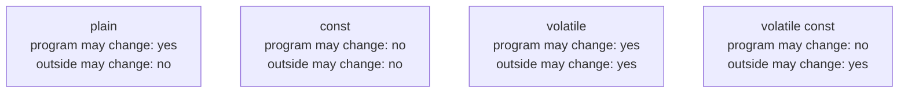
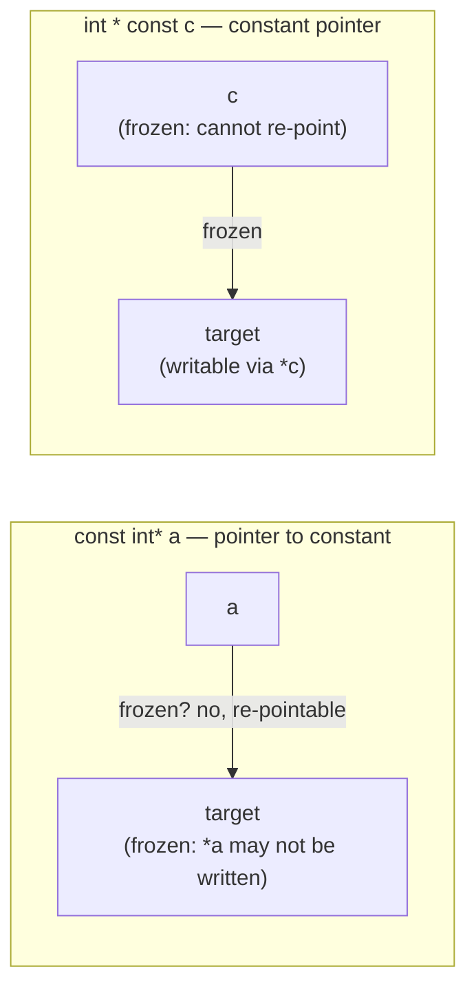

# `const` and `volatile`

Two independent qualifiers about *who* may change a value.

| Qualifier | Meaning |
|---|---|
| `const` | Must be initialized; immutable thereafter **by the program**. |
| `volatile` | May be changed **from outside the program** (e.g. by the system clock). |

They combine. A variable that is both cannot be changed by the program, but can
be changed externally:

```cpp
volatile const unsigned long clock_ticks;
```



## `const` with references and pointers

The motivating problem: pass by reference (fast, no copy) but forbid the function
from modifying the caller's variable. The solution is `const`:

```cpp
int verdoppeln(const int& x)
{ //x ist Referenz, Wert konstant
    x = x * 2; //unzulässig!
    return x;
}

int verdoppeln(const int* x)
{ //x ist Zeiger, Inhalt konstant
    *x = *x * 2; //unzulässig!
    return *x;
}
```

Both bodies produce a **compiler error** (*Compilerfehler*) — the modification is
caught at compile time, not at runtime.

## Pointer to constant vs. constant pointer

The distinction turns on which side of the `*` the `const` sits.

```cpp
int const* a; // a ist Zeiger auf konstanten int, *a stets const
const int* b; // b ist Zeiger auf konstanten int, *b stets const

int      * const c; // c ist konstanter Zeiger auf variablen int
int const * const c; // c ist konstanter Zeiger auf konstanten int
```

- **Pointer to constant** (*Zeiger auf Konstante*): the pointed-to content may not
  be modified through `*a`. The pointer itself may be re-pointed — and after
  re-pointing, the same restriction applies to the new target.
- **Constant pointer** (*konstanter Zeiger*): the address stored in the pointer may
  not be changed.



## `const` member functions

A `const` *after* a member function's parameter list is a different thing again —
it promises the function will not modify the calling object. See
[[concepts/member-functions]].

## Related

- [[concepts/pointers-and-references]]
- [[concepts/parameter-passing]]
- [[concepts/initialization-and-assignment]]
- [[concepts/member-functions]]
- [[concepts/type-conversions]] (`const_cast` removes `const`/`volatile`)

## Sources

- [[sources/grigat-oop-teil1]] §0.2.1.5 (const und volatile),
  §0.2.4.7 (Konstante Referenz und Zeiger auf Konstante),
  §0.2.4.8 (Zeiger auf konstanten Inhalt vs. konstanter Zeiger)
