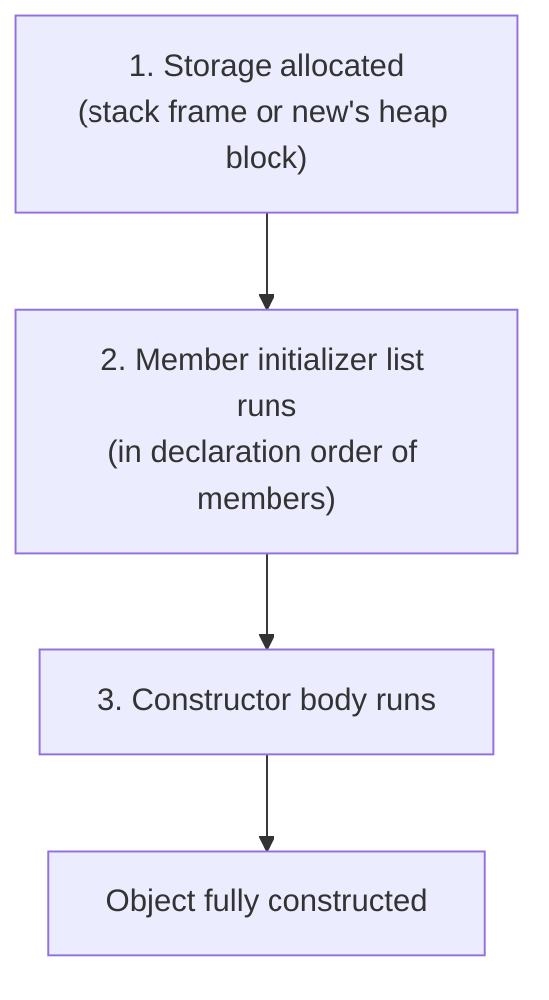
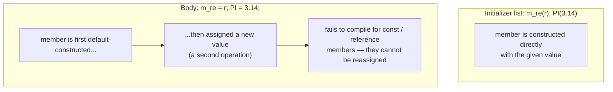
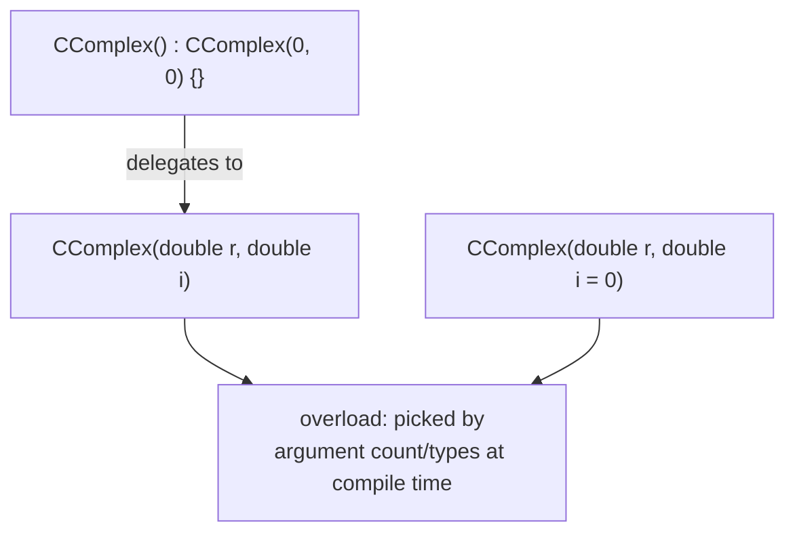

A constructor (*Konstruktor*) is a special member function, named identically to its class and with no return value, that runs to create and initialize an object.





This is why `const` members and member objects without a default constructor
*must* be set in the initializer list (§0.3.4.2-0.3.4.3): the initializer
list constructs the member once with its final value, while an assignment in
the body requires the member to already exist (default-constructed) before
it can be reassigned — impossible for `const` data and wasteful for objects.



**Numbered construction sequence** for `CComplex mycomplex(3.0, 4.0);`:

```
1. Reserve storage for the object (stack frame, or the block returned by `new`).
2. Evaluate the member initializer list, in the order members are
   DECLARED in the class (not the order written in the list):
   2.1. m_re is direct-initialized with 3.0
   2.2. m_im is direct-initialized with 4.0
3. Execute the constructor body (e.g. any `cout` logging, extra checks).
4. The object is now fully constructed and usable.
```

## Problem it solves

The compiler does **not** automatically initialize member variables: an uninitialized variable has random/garbage content, and the compiler gives neither a warning nor an error (§0.3.2.10). Constructors give the programmer a guaranteed place to set up valid initial state.

## Declaration and definition

```cpp
// ccomplex.hpp
class CComplex
{
public:
  CComplex(double r, double i); // Deklaration des Konstruktors
  /* ... */
};

// ccomplex.cpp
CComplex::CComplex(double r, double i) // Definition des Konstruktors
{
  m_re = r;
  m_im = i;
}

// main.cpp
CComplex mycomplex(3.0, 4.0);
```

A constructor has no return type (not even `void`) and its name is identical to the class name (§0.3.2.11-0.3.2.12).

> [!warning] Most vexing parse
> `CAuto erstwagen();` does **not** create an object — it is parsed as a *function declaration*. Use `CAuto erstwagen;` to invoke the parameterless constructor (§0.3.3.3).

## Default constructor

As long as no custom constructor is defined, the compiler automatically provides a parameterless **default constructor** (§0.3.2.12). Defining any constructor of your own suppresses this automatic generation.

## Default arguments

C++ allows default arguments on function parameters, including constructor parameters; only *trailing* parameters may have defaults, and substitution happens right-to-left. The alternative is to overload the constructor instead (§0.3.2.13):

```cpp
// ccomplex.hpp
CComplex::CComplex(double r, double i = 0); // Konstruktor-Deklaration

// main.cpp
CComplex mycomplex(3.0); // Initialisierung i = 0
```

## Constructor delegation

Since C++11, a constructor may call another constructor of the same class, avoiding duplicated initialization logic (§0.3.2.11).

## Member initializer lists

Members with constructor-required arguments — such as [[concepts/composition|member objects]] or `const` members — must be initialized in the **member initializer list** (*Initialisierungsliste*), introduced after `:` and separated by `,`, rather than assigned in the constructor body (§0.3.4.2-0.3.4.3):

```cpp
// cauto.cpp
CAuto::CAuto() :               // Beginn Initialisierungsliste für CAuto
  m_hupe("hohes C", 128),
  m_farbe("Schwarz")
{
  cout << "Auto initialisiert" << endl;
}
```

A `const` class element *must* be initialized here — it cannot be assigned later in the constructor body:

```cpp
// ccomplex.hpp
class CComplex
{
public:
  CComplex(double r, double i);
private:
  double m_re;
  double m_im;
  const double PI;
}; // konstantes Klassenelement

// ccomplex.cpp
CComplex::CComplex(double r, double i)
         : // Initialisierungsliste
  m_re(r),
  m_im(i),
  PI(3.14)
{}
```

## `=delete` and `=default`

`=delete` disables (locks) a member function's definition — commonly used to forbid the compiler-generated copy/move special members (§0.3.2.14):

```cpp
// ccomplex.hpp
CComplex (const CComplex&) = delete;            // Kopierkonstruktor sperren
operator=(const CComplex&) = delete;            // Kopierzuweisung sperren
CComplex(CComplex&&) = delete;                  // Movekonstruktor sperren
CComplex& operator=(CComplex&&) = delete;       // Movezuweisung sperren
```

`=default` restores the compiler-generated variant, even if other custom constructors were defined:

```cpp
CComplex (const CComplex&) = default;           // Kopierkonstruktor aktivieren
operator=(const CComplex&) = default;           // Kopierzuweisung aktivieren
CComplex(CComplex&&) = default;                 // Movekonstruktor aktivieren
CComplex& operator=(CComplex&&) = default;      // Movezuweisung aktivieren
```

The copy constructor (`CComplex(const CComplex&)`) and move constructor
(`CComplex(CComplex&&)`) shown above as `=delete`/`=default` candidates are
themselves special constructors with their own initialization concerns and
pitfalls, covered in depth on their own pages: see
[[concepts/copy-constructor]] and [[concepts/move-semantics]]. Together with
the destructor, assignment operator, and copy/move assignment, they make up
the full set of **special member functions** a class may need — see
[[synthesis/special-member-functions]] for how the rules of three/five tie
them together.

## Consequences / trade-offs

- Since C++11, member variables can also get a default initializer directly in the class definition; if both a constructor assignment and a direct default initializer are given, the constructor takes precedence (§0.3.2.11).
- Defining even one custom constructor suppresses the compiler's automatic default constructor — a frequent surprise when later adding a parameterized constructor to a previously default-constructible class.

## Misuse & anti-patterns

- Assigning member objects or `const` members inside the constructor *body* instead of the initializer list — for `const` members this is a compile error, and for member objects it means they are first default-constructed, then reassigned (wasteful, and impossible if no default constructor exists).
- Writing `CAuto erstwagen();` expecting object creation (see warning above).

## Related

- [[concepts/this-pointer]]
- [[concepts/destructor]]
- [[concepts/composition]]
- [[concepts/class-and-object]]
- [[concepts/member-functions]]
- [[concepts/copy-constructor]]
- [[concepts/move-semantics]]
- [[synthesis/special-member-functions]]

## Sources

[[sources/grigat-oop-teil1]] §0.3.2.10, §0.3.2.11, §0.3.2.12, §0.3.2.13, §0.3.2.14, §0.3.3.3, §0.3.4.2, §0.3.4.3
