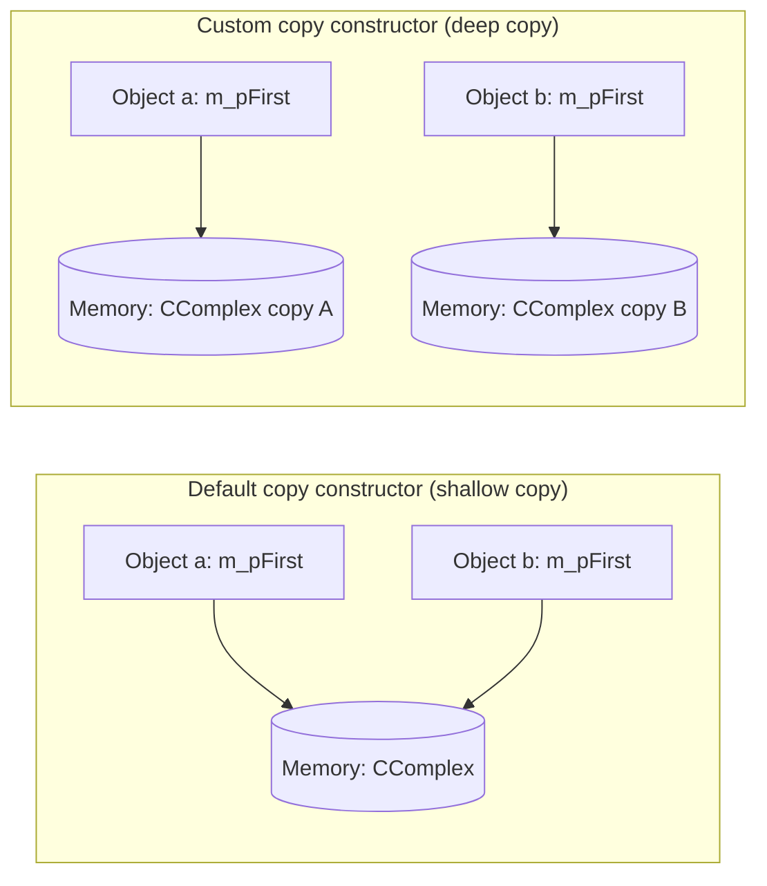

## One-sentence definition

The copy constructor (*Kopierkonstruktor*) is a [[concepts/constructor]]
whose parameter is a reference to its own class's type, used to initialize a
new object with the values of an already-existing object of the same class
(§0.4.4.2).

## Problem it solves

Classes that own raw pointer members need a way to control what "copying an
object" actually means — whether the pointed-to memory is shared (shallow
copy) or duplicated (deep copy) — because the compiler's default behavior is
not always correct.

## Review: constructors (§0.4.4.1)

- Constructors are called when creating object instances (cf. 0.3.2.11).
- A class can have multiple constructors with different signatures — this is
  an application of [[concepts/function-overloading]] (cf. 0.2.4.9).

```cpp
//ccomplex.hpp
class CComplex
{
public:
  CComplex();
      // parameterloser Konstruktor
  CComplex(double re, double im);
      // Konstruktor mit 2 Parametern
private:
  double m_re;
  double m_im;
};
```

(Comments: "parameterless constructor"; "constructor with 2 parameters".)

## Copy constructor: characteristics (§0.4.4.2)

- A constructor with the class's own type as parameter.
- Initializes a new object with the values of an already existing object of
  the same class.
- The compiler provides a **default copy constructor** that:
  - copies all member variables — each member variable of the copy is
    initialized with the value of the corresponding member variable of the
    original object; the copy constructor of every individual member object
    (*Memberobjekt*) is called in turn;
  - excepts static variables (*statische Variable*), since these exist only
    once in memory regardless of how many instances exist;
  - exists only if **no** own copy constructor is defined.

## Example: reconstructing the default copy constructor (§0.4.4.3 context, p15)

```cpp
//ccomplex.hpp
class CComplex
{
public:
  CComplex();
  //parameterloser Konstruktor
  CComplex(const CComplex & other);
  //Deklaration des Kopierkonstruktors
/* ... */
private:
  double m_re;
  double m_im;
  static bool polar;
}
```

```cpp
//ccomplex.cpp
//Definition des Kopierkonstruktors
CComplex::CComplex
    (const CComplex & other):
m_re(other.m_re), //Initialisierung der
m_im(other.m_im)  //Membervariablen
{
}
```

```cpp
// main.cpp

CComplex a;     // parameterloser Konstruktor
CComplex b(a);  // Kopierkonstruktor
```

## Necessity of a copy constructor (§0.4.4.3)

A hand-written copy constructor (*eigener Kopierkonstruktor*) is necessary
for:

- objects with pointers as member variables, when the memory region the
  pointer points to must also be duplicated;
- specially desired behavior, e.g. modifying static member variables on
  every copy.

## Example of a copy constructor: `CComplexPair` (§0.4.4.4)

```cpp
//ccomplexpair.hpp

class CComplexPair{
public:
  CComplexPair(const CComplexPair & other);
  //[..]
private:
  CComplex *m_pFirst;
  CComplex *m_pSecond;
};

CComplexPair::CComplexPair(const CComplexPair & other):
  m_pFirst ( new CComplex(*(other.m_pFirst )) ),
  m_pSecond( new CComplex(*(other.m_pSecond)) )
{}
//Kopierkonstruktor von CComplex, jeweils mit new aufgerufen
//Achtung: delete in Destruktor nicht vergessen!
```

```cpp
//main.cpp
CComplexPair b(a); // b als Kopie von a erzeugt
```

(Comments: "Copy constructor of CComplex, each called with new"; "Attention:
don't forget delete in the destructor!"; "b created as a copy of a".) Each
pointer member is duplicated by allocating a **new** `CComplex` initialized
from the pointee — this is a deep copy, and pairs with an explicit
[[concepts/destructor]] that must `delete` both pointers.

## Copy constructor and pointers: shallow vs. deep copy (§0.4.4.5)

**Behavior *without* an own copy constructor:**
- Uses the default (compiler-generated) copy constructor.
- Pointers of different instances then point to the **same** memory region.
- Modifying object `a` directly affects object `b`.
- This is the cause of many bugs (*Ursache von vielen Fehlern*).



In the shallow-copy case, both `a.m_pFirst` and `b.m_pFirst` alias the same
`CComplex` instance; in the deep-copy case (as implemented for
`CComplexPair` above), each object owns its own independent `CComplex`
instance.

## Implementing special behavior in the copy constructor: `Schaf` (§0.4.4.6)

```cpp
//schaf.hpp

class Schaf{
public:
  Schaf();
  Schaf(const Schaf & other);
private:
  double m_gewicht;
  static int m_anzahlSchafe;
};
```

```cpp
//schaf.cpp

Schaf::Schaf(const Schaf & other):
m_gewicht(other.m_gewicht)
{
  ++m_anzahlSchafe;
  //Motivation für speziellen
  //Kopierkonstruktor
}
```

(`Schaf` = sheep, `m_gewicht` = weight, `m_anzahlSchafe` = number of sheep.)
`m_anzahlSchafe` stores the total count of all existing sheep, is a static
variable (see [[concepts/static-members]]), and must be incremented whenever
a copy is created — this is the motivation (*Motivation*) for writing a
special copy constructor instead of relying on the default one.

## Examples of initialization and assignment: `Testclass` (§0.4.4.7)

```cpp
//Testclass.hpp
class Testclass
{
  public:
    Testclass();
    Testclass(const Testclass& other);
    Testclass(const int value);
    ~Testclass();
    Testclass& operator=
        (const Testclass& other);
};
```

```cpp
//main.cpp
Testclass a;
Testclass b(a);
Testclass c = 3;           //Initialisierung
Testclass d = Testclass(3);
Testclass(3);
Testclass e = Testclass(a);
a = 3;                     //nur hier Zuweisung!
```

(Comments: `Testclass c = 3;` is marked "Initialisierung" = initialization;
`a = 3;` is marked "nur hier Zuweisung!" = "assignment only here!")

**Walkthrough (Erläuterungen main.cpp):**

| Line | Code | Meaning |
|---|---|---|
| 1 | `Testclass a;` | parameterless constructor |
| 2 | `Testclass b(a);` | copy constructor |
| 3 | `Testclass c = 3;` | **initialization** via the constructor taking an `int` parameter; identical to `Testclass c(3);` |
| 4 | `Testclass d = Testclass(3);` | initialization via call of the constructor with `int` parameter (explanation in the notes continues beyond the transcribed page and is truncated there) |
| 5 | `Testclass(3);` | (not further annotated beyond page content) |
| 6 | `Testclass e = Testclass(a);` | (not further annotated beyond page content) |
| 7 | `a = 3;` | **assignment** — "nur hier Zuweisung!" (assignment only here!) |

Key rule stated explicitly in the notes:

- The symbol `=` means, depending on context, either **Initialisierung**
  (initialization — lines 3, 4, 6) or **Zuweisung** (assignment — line 7).
- Overloading `operator=` affects **only** assignment, hence it only has an
  effect on line 7.
- The initialization operator `=` **cannot** be overloaded — it is not a
  true overloadable operator in the sense of
  [[concepts/operator-overloading]], but rather notation for invoking a
  constructor.

> [!note] Truncation in source
> The notes state the walkthrough for line 4 ("Zeile 5" in the original page
> numbering) is cut off at the bottom of printed page 100; the explanation
> for lines 5–6 is not present in this transcription chunk. Treat the table
> rows for lines 4–6 above as faithful to what survives, not as a complete
> account of the lecturer's full explanation.

```mermaid
stateDiagram-v2
    [*] --> Declaring: "Testclass x = ..." or "Testclass x(...)"
    Declaring --> Initialization: object does not yet exist
    Initialization --> Constructed: constructor or copy constructor runs
    Constructed --> Assignment: "x = y;" on an existing object
    Assignment --> Constructed: operator= runs, object already existed
```



## Consequences / trade-offs

- A hand-rolled deep-copy constructor is required whenever a class owns
  pointer members that represent exclusive ownership of a resource;
  otherwise copies silently alias and corrupt each other's state.
- Writing a custom copy constructor obligates a matching custom
  [[concepts/destructor]] (to `delete` the owned memory) — this pairing is
  exactly the motivation behind the "rule of three" convention referenced
  implicitly in [[synthesis/special-member-functions]].

## Misuse & anti-patterns

- Relying on the compiler-generated copy constructor for a class with raw
  pointer members, then being surprised that modifying one copy mutates
  another (the shallow-copy bug shown above).
- Forgetting to increment custom bookkeeping state (like `Schaf`'s
  `m_anzahlSchafe`) in a hand-written copy constructor, silently
  under-counting copies.
- Confusing initialization (`Testclass c = 3;`, which calls a constructor)
  with assignment (`a = 3;`, which calls `operator=`) — only the latter is
  affected by overloading `operator=`.

## Related
- [[concepts/constructor]]
- [[concepts/destructor]]
- [[concepts/initialization-and-assignment]]
- [[concepts/static-members]]
- [[concepts/operator-overloading]]
- [[synthesis/special-member-functions]]

## Sources
- [[sources/grigat-cpp-concepts-generic]] §0.4.4.1, §0.4.4.2, §0.4.4.3, §0.4.4.4, §0.4.4.5, §0.4.4.6, §0.4.4.7
