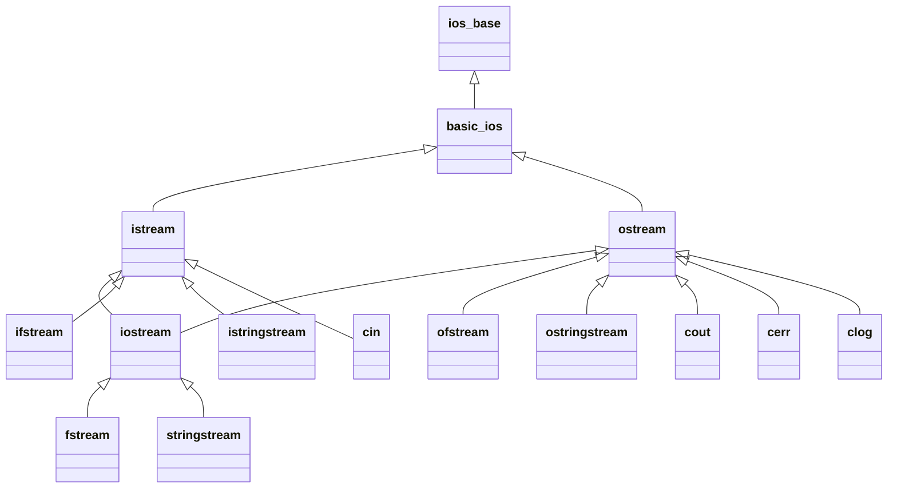

## One-sentence definition

A C++ stream (*Stream*) is an abstraction of a "data channel"
(*Datenkanal*) — to a file, a network connection, a printer, or the
screen/keyboard — through which data is written or read with the `<<` and
`>>` operators (§0.4.2.1).

## Problem it solves

Programs need a uniform way to read and write data regardless of the
underlying device (disk, console, string buffer, network). Streams provide
one operator-based interface (`<<`/`>>`) that works the same way across all
of these targets.

## Introduction (§0.4.2.1)

- In C++, data channels are described using **Streams**.
- Examples of data channels: to a file on the hard disk, to a second
  computer over an internet connection, to a printer, for screen output /
  keyboard input.
- Programmers can define their own streams.
- The C++ standard provides predefined streams for file I/O and for user
  I/O (screen output / keyboard input).

## Input and output with streams (§0.4.2.2)

**Ausgabe mit Streams (output with streams):**

```cpp
//main.cpp
#include<iostream>
using namespace std;
/* ... */
int max_kmph = 50;

cout << "Innerhalb geschlossener Ortschaften darf"
     << max_kmph << " km/h gefahren werden." << endl;
```

(Translated: "Within built-up areas a maximum of ... km/h may be driven.")

**Eingabe mit Streams (input with streams):**

```cpp
//main.cpp
#include<iostream>
using namespace std;
/* ... */
int alter;

cout << "Bitte geben Sie Ihr Alter ein: ";
cin  >> alter;
```

(Translated: "Please enter your age: "; reads into `alter` = age.)

## Predefined streams in C++ (§0.4.2.3)

Three predefined stream **instances** for user I/O:

| Stream | Role |
|---|---|
| `cout` | standard output — written to the screen |
| `cin` | standard input — read from the keyboard |
| `cerr`, `clog` | standard error output — for error messages; written to the screen, but can also be redirected, e.g. into log files |

Predefined stream **classes**:

| Class | Role |
|---|---|
| `fstream` | file stream; instantiated with a file name; the file is opened in the constructor |
| `stringstream` | allows output of data into a character string |



> [!note]
> The class hierarchy above reflects the well-known standard-library
> relationships among `cin`/`cout`/`cerr`/`clog`, `fstream`, and
> `stringstream` implied by the notes' description of "predefined stream
> instances" vs. "predefined stream classes"; the notes themselves do not
> draw this diagram, so treat the exact inheritance edges as standard C++
> library knowledge supplementing the transcribed bullet points.

## Manipulators and methods for formatting (§0.4.2.4)

- With streams, **formatted** output of data is possible.
- Formatting is achieved via: manipulators inserted into the stream, member
  functions of the stream objects, header `<iomanip>`.

**Beispiel:**

```cpp
double pi=3.14159264;

cout << "1. Pi = " << pi << endl; // 1. Pi = 3.14159

cout.precision(2); // alternativ cout << setprecision(2)
cout << "2. Pi = " << fixed << pi << endl; // 2. Pi = 3.14

cout << "3. Pi = " << scientific << pi << endl;
// Ausgabe: 3. Pi = 3.14e+000
```

## Relevant manipulators (§0.4.2.5)

| Manipulator | Aufgabe (Task) |
|---|---|
| `std::oct` | Oktale Ausgabe (octal output) |
| `std::hex` | Hexadezimale Ausgabe (hexadecimal output) |
| `std::dec` | Dezimale Ausgabe (Standard) (decimal output, default) |
| `std::showpos` | Positive Zahlen mit Vorzeichen (positive numbers with sign) |
| `std::noshowpos` | Positive Zahlen ohne Vorzeichen (positive numbers without sign) |
| `std::fixed` | Festkommadarstellung (fixed-point representation) |
| `std::scientific` | Gleitkommadarstellung (scientific/floating-point representation) |
| `std::setprecision(int n)` | n Nachkommastellen (n decimal places) |
| `std::setw(int n)` | Feldbreite n Zeichen (field width n characters) |
| `std::setfill(int ch)` | Füllzeichen ch (fill character ch) |
| `std::left` | linksbündig (left-aligned) |
| `std::right` | rechtsbündig (right-aligned) |
| `std::internal` | Vorzeichen links, Wert rechts (sign on left, value on right) |

## Copying a text file in C++ (§0.4.2.6)

```cpp
#include <string>
#include <fstream>
#include <cstdlib>
using namespace std;

int main()
{
  ifstream in("main.cpp");
  ofstream out("copy.cpp");
  string s;
  while(getline(in, s))
  {
    out << s << "\n";
  }
  return EXIT_SUCCESS;
}
```

Numbered pseudocode for this procedure:

```
1. open input stream `in` on the source file
2. open output stream `out` on the destination file
3. while getline(in, s) succeeds (reads one line into s, excluding the line terminator):
4.     write s followed by "\n" to out
5. (loop ends when getline returns false, i.e. end of file)
6. return success
```

Explanatory notes:
- `ifstream` opens a file for reading.
- `ofstream` opens a file for writing.
- `getline` reads a string up to (and including) the end of line; the
  returned string **excludes** the line ending, so the `\n` must be
  explicitly reinserted when writing the copy.
- `getline` returns **false** at end of file, which terminates the `while`
  loop.

## Consequences / trade-offs

- The uniform `<<`/`>>` operator interface lets the same formatted-output
  code target the console, a file, or an in-memory string merely by changing
  which stream object is used.
- Manipulators like `fixed`/`scientific`/`setprecision` persist on the stream
  object until changed again (they are *sticky* state, not one-shot
  arguments), which can surprise callers who expect formatting to reset
  automatically between statements.

## Misuse & anti-patterns

- Forgetting that `getline` strips the line terminator (as shown in the
  file-copy example) and omitting the explicit `"\n"` when re-emitting lines
  silently collapses a multi-line file into one line.

## Related
- [[concepts/memory-model]]
- [[concepts/strings-cpp-vs-c]]
- [[concepts/class-and-object]]
- [[concepts/function-overloading]]

## Sources
- [[sources/grigat-cpp-concepts-generic]] §0.4.2.1, §0.4.2.2, §0.4.2.3, §0.4.2.4, §0.4.2.5, §0.4.2.6
