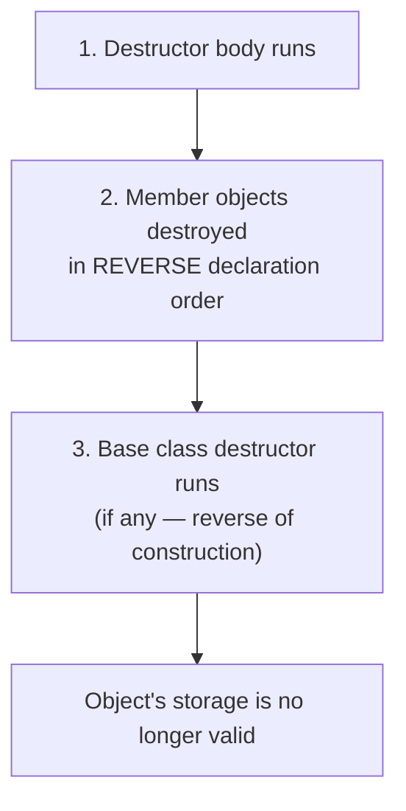
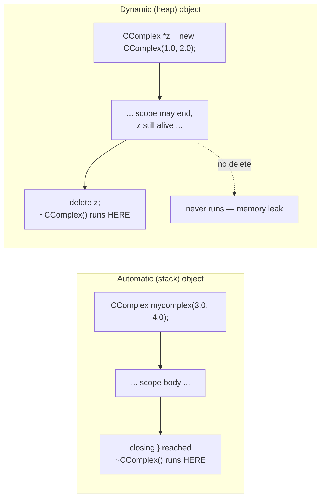
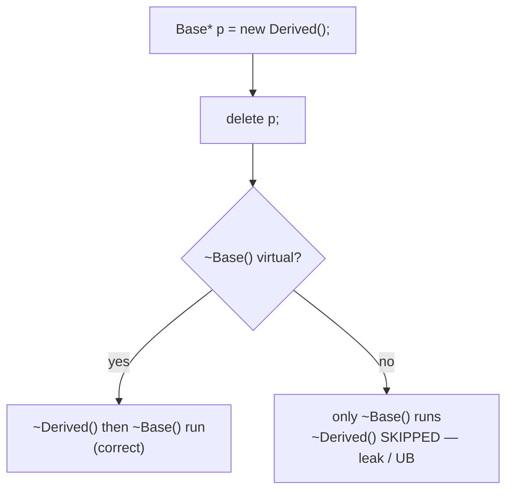

A destructor (*Destruktor*), named `~ClassName()`, is a special member function invoked automatically when an object is destroyed, giving it a chance to clean up.





**Numbered destruction sequence** when an object's lifetime ends:

```
1. The destructor body executes (e.g. releasing an owned resource).
2. Each member object is destroyed, in the REVERSE of the order the
   members were declared in the class.
3. If the class has a base class, the base class destructor runs last.
4. The storage the object occupied is now invalid
   (reclaimed by the stack frame, or returned to the heap by `delete`).
```

> [!warning] Virtual-destructor failure mode
> Deleting a derived object through a `Base*` pointer whose destructor is
> **not** `virtual` only runs `~Base()`, skipping `~Derived()` entirely —
> any resources the derived part owns are leaked, and this is undefined
> behavior per the standard.



## Problem it solves

An object may acquire resources during its lifetime — dynamically allocated memory, open file handles, and so on. The destructor provides a single, guaranteed place to release such resources when the object goes out of scope or is explicitly deleted (§0.3.2.15).

## Declaration, definition, and rules

- A destructor has no return value.
- Its name is identical to `~ClassName`.
- It is always parameterless (no overloading of destructors is possible).
- The compiler provides a default destructor automatically if none is defined (§0.3.2.15, §0.3.3.1).

```cpp
// ccomplex.hpp
class CComplex
{
public:
  ~CComplex(); // Deklaration eines Destruktors
  /* ... */
};

// ccomplex.cpp
CComplex::~CComplex() // Definition eines Destruktors
{} // hier ohne Funktionalitaet
   // default-Destruktor auch moeglich
```

## When it runs

The destructor runs automatically depending on where the object lives in [[concepts/memory-model|memory]]:

- **Automatic memory (stack):** the destructor runs as soon as execution reaches the closing `}` of the object's scope (§0.3.3.2):

```cpp
{ // lokales Objekt
  CComplex mycomplex(3.0, 4.0);
  /* ... */
} // mycomplex wird hier wieder zerstoert
```

  After `}`, the object no longer exists.

- **Dynamic memory (heap):** an object created with `new` is *not* automatically destroyed when its scope ends; the destructor only runs when the program explicitly calls `delete` on the pointer (§0.3.3.4):

```cpp
CComplex *z = new CComplex(1.0, 2.0);
z->print();
delete z; // destructor runs here
```

  Forgetting `delete` means the destructor never runs and the memory is never reclaimed — a **memory leak** (*Speicherleck*).

## Consequences / trade-offs

- Because destructors run deterministically at scope exit for stack objects, resource cleanup (closing files, releasing memory) can be tied reliably to object lifetime.
- For heap objects the programmer is fully responsible for calling `delete`; there is no compiler warning if it is omitted.

## Misuse & anti-patterns

- Forgetting `delete` for a `new`-allocated object — causes a memory leak (§0.3.3.4).
- Relying on a compiler-generated default destructor when the class manages a raw resource (e.g. a pointer obtained from `new` elsewhere) that it alone owns — the default destructor does nothing beyond destroying members, so an explicitly defined destructor is needed to actually release such resources.

The destructor is one of the class's special member functions, alongside the
constructor and copy/move operations — see
[[synthesis/special-member-functions]] for how they relate as a group.
Writing a manual destructor to call `delete` on an owned resource is exactly
the problem [[concepts/smart-pointers]] exist to eliminate: a smart pointer's
own destructor releases the resource automatically, so the owning class often
does not need to write a destructor at all.

## Related

- [[concepts/constructor]]
- [[concepts/memory-model]]
- [[concepts/class-and-object]]
- [[synthesis/special-member-functions]]
- [[concepts/smart-pointers]]

## Sources

[[sources/grigat-oop-teil1]] §0.3.2.15, §0.3.3.1, §0.3.3.2, §0.3.3.4
