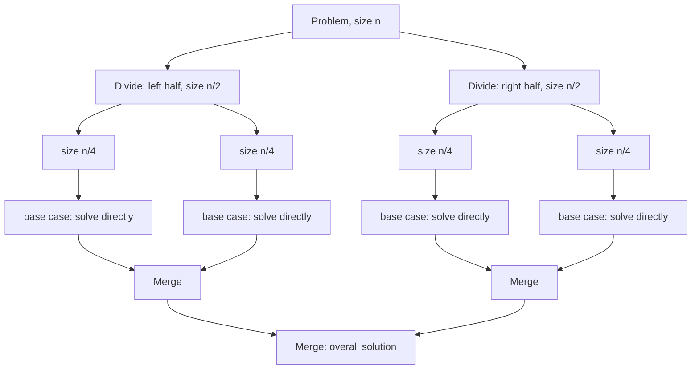

A one-sentence definition: **divide-and-conquer (*Teile-und-Herrsche*)** is an algorithm-design pattern that solves a problem by splitting it into smaller subproblems of the same kind, solving each recursively, and combining the sub-solutions into the overall solution.

## Problem it solves

Many problems (sorting, searching, numerical computation) become trivial on a small enough instance but are expensive to solve directly at full size. Divide-and-conquer recursively shrinks the instance until it hits the trivial base case, then reassembles the answer — typically trading a direct `O(n²)` approach for `O(n log n)`.

## The general pattern

The source gives the pattern as three named steps, with a generic template:

```cpp
if (Objektmenge klein genug)
{
    löse Problem direkt;
}
else
{
    Divide();
    Conquer();
    Merge();
}
```

```cpp
Divide()
{
    Zerlege Menge in mehrere Teilmengen
    (wenn möglich, gleicher Größe);
}
```

```cpp
Conquer()
{
    Löse Problem rekursiv
    für jede Teilmenge;
}
```

```cpp
Merge()
{
    Berechne aus Lösungen
    für die Teilmengen
    die Gesamtlösung;
}
```

**Numbered pseudocode — generic Divide-and-Conquer:**
```
1. if object set is small enough:
2.     solve problem directly
3. else:
4.     Divide: split set into subsets (equal size if possible)
5.     Conquer: recursively solve the problem for each subset
6.     Merge: combine subset solutions into overall solution
```

## Mermaid: recursion tree

A generic divide-and-conquer recursion tree, splitting a size-`n` problem into two halves at each level until the base case:



Each level halves the problem size, giving `log n` levels; if `Divide` + `Merge` cost `O(n)` per level, the total cost resolves to `O(n log n)` — the recurrence used in [[algorithms/merge-sort]]'s complexity analysis.

## The two instances in this source

- [[algorithms/merge-sort]]: `Divide` splits the array at the midpoint, `Conquer` recursively sorts each half, `Merge` performs the actual combining work (the `merge` operation) — cost is dominated by `Merge`.
- [[algorithms/quicksort]]: `Divide` is the `partition` operation that rearranges the array around a pivot so that the two halves are already mutually ordered; `Conquer` recursively sorts each half; no `Merge` step is needed afterwards ("Merge nicht erforderlich").

## Consequences / trade-offs

- Recursion requires call-stack space (`O(log n)` extra for balanced splits); pathological splits (e.g. quicksort's worst case) can degrade this to `O(n)` stack depth and `O(n²)` time.
- Whether the pattern needs an explicit `Merge` step depends on whether the `Divide` step already does the ordering work (quicksort) or defers it (merge sort).

## Misuse & anti-patterns

- Applying divide-and-conquer when subproblems are not independent, or when the `Merge` step costs more than `O(n)` per level, erodes the `O(n log n)` benefit.
- Choosing an unbalanced split (e.g. a bad quicksort pivot) collapses the recursion depth benefit entirely — see [[algorithms/quicksort]] Komplexität.

## Related

- [[algorithms/merge-sort]]
- [[algorithms/quicksort]]
- [[algorithms/sorting-overview]]
- [[algorithms/sorting-comparison]]
- [[concepts/big-o-notation]]
- [[concepts/complexity-classes]]
- [[algorithms/external-merge-sort]] — an external-storage divide-and-conquer sort built on the same merge operation.

## Sources

- [[sources/grigat-trees-sorting]] §0.13.3.1
