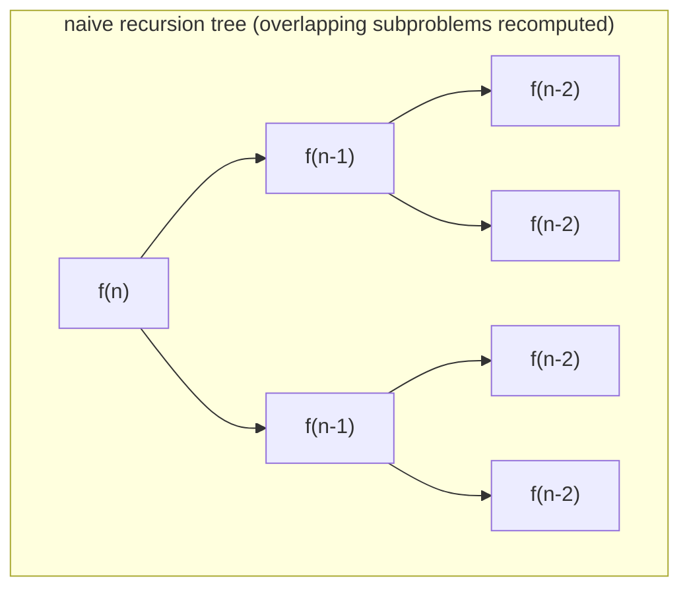
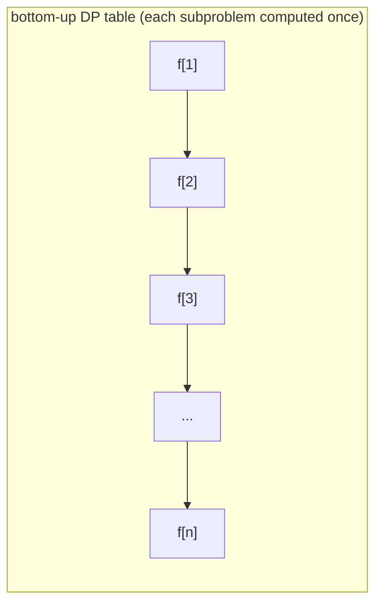

**Dynamic programming (*Dynamische Programmierung*, DP)** is an algorithm-design technique that solves a problem by combining optimal solutions of overlapping subproblems, storing each subproblem's solution once so it is computed only a single time rather than recomputed exponentially often.

## The four-step DP recipe (§0.16.1.3)

The script states this as a fixed four-step recipe for developing a dynamic program:

1. **Charakterisierung der Struktur** einer optimalen Lösung (z.B. als Graph) — characterize the structure of an optimal solution (e.g. as a graph).
2. **Optimale Teilstruktur**: recursive formulation of the algorithm on the basis of already-optimally-solved subproblems (e.g. for shortest paths in a graph).
3. **Iterative Berechnung bottom-up** des Wertes aller optimalen Teillösungen (e.g. shortest path length).
4. **Konstruktion** der zugehörigen optimalen Lösung aus den berechneten Daten (e.g. the shortest path itself).

> Anmerkung (remark): for some problems only the *value* of an optimal solution is needed, and step 4 can be omitted. [[algorithms/viterbi|Viterbi]] decoding for word recognition is exactly this case (§0.16.3.6/0.16.3.9): only the maximum-likelihood *value* is used for classification, the optimal state path itself is not reconstructed.

```
// General dynamic-programming development template
1. Characterize the structure of an optimal solution (e.g. model as a graph).
2. Define a recursive formula for the optimal value, expressed via optimal
   solutions of subproblems (optimal substructure + overlapping subproblems).
3. Compute the value of the optimal solution bottom-up (iteratively), storing
   intermediate results in a table.
4. (Optional) Reconstruct the actual optimal solution from the stored table.
```

## Optimal substructure and overlapping subproblems

The script identifies exactly two properties as *die beiden wichtigsten Kriterien* (the two most important criteria) for the applicability of dynamic programming:

- **Optimale Teilstruktur** (optimal substructure): the optimal solution to a problem is built from optimal solutions to its subproblems. In [[algorithms/assembly-line-scheduling|assembly-line scheduling]], the fastest path to station S_{1,j} is built from the fastest paths to S_{1,j-1} and S_{2,j-1}.
- **Überlappende Teilprobleme** (overlapping subproblems): the same subproblem recurs many times inside the naive recursion tree. In assembly-line scheduling, naive recursive evaluation of f_i[j] shows f_i[1] alone would be recomputed 2^{n-1} times without memoization (see below).

### Recursion tree vs. memo/DP table





## Worked example: why naive recursion blows up (§0.16.2.4)

For the assembly-line problem (see [[algorithms/assembly-line-scheduling]]), let r_i(j) be how often f_i[j] is accessed when computing f* by naive recursion:

```
r_1(n) = r_2(n) = 1                                                 (32)
r_1(j) = r_2(j) = r_1(j+1) + r_2(j+1)   ∀ 1 ≤ j < n                  (33)
```

⇒ r_i(j) = 2^{n−j}; e.g. f1[1] must be recomputed 2^{n-1} times under naive recursion, versus computing it once if the result is stored (memoized) and reused. Plain recursive evaluation of this recurrence costs **Θ(2^n)**; iterative bottom-up tabulation of the same recurrence costs **O(n)**. This is the general DP payoff: memoization/tabulation turns an exponential-time recursion into a polynomial-time one whenever the two criteria above hold.

## Contrast with divide-and-conquer and greedy methods

The source frames DP's four-step recipe as structurally the same shape as [[concepts/divide-and-conquer]] (also: characterize structure → recursive formulation → combine subproblem results), but with one crucial difference:

- [[concepts/divide-and-conquer]] (e.g. [[algorithms/merge-sort]]) splits a problem into **disjoint** subproblems that are each solved independently and never recur — so no subproblem is ever solved twice, and no table of subproblem solutions is needed.
- **Dynamic programming** splits a problem into subproblems that **overlap** — the same subproblem instance is needed in the solution of several different larger subproblems (e.g. f1[j-1] is needed both for f1[j] and for f2[j] in assembly-line scheduling) — so solutions must be stored in a table and reused, which is exactly what step 3 of the recipe (bottom-up tabulation) accomplishes.
- A **greedy method**, by contrast, commits to one locally-optimal choice at each step without weighing alternatives or revisiting them; DP instead evaluates all relevant alternatives at each subproblem (e.g. the `min(...)` in the assembly-line recurrence chooses between two predecessor stations) and only reuses the stored optimal value, never a locally-greedy guess. DP is needed precisely when a greedy local choice is not guaranteed to be globally optimal, but the problem still factors into reusable, overlapping subproblems.

## Worked examples in this source

This script develops two full DP worked examples, matching the general recipe step-for-step:

| Example | Step 1: structure | Step 2: recurrence | Step 3: table | Step 4: reconstruction |
|---|---|---|---|---|
| [[algorithms/assembly-line-scheduling]] | 2-track DAG of stations, modeled as [[structures/dag]] | f1[j], f2[j] via min() over predecessors (eqs. 25–31) | f1[], f2[] filled left to right | path reconstruction (printed pp. 440–443 missing from scans, see below) |
| [[algorithms/viterbi]] (HMM decoding, see [[concepts/hidden-markov-model]]) | trellis/digraph over (state, time) pairs | Φ_j(t) via max() over predecessor states (eqs. 38–41) | Φ (or log-domain Ψ) table filled left to right in *t* | backpointer-based path reconstruction (optional — skipped for word recognition, §0.16.3.9/0.16.3.10) |

The other DP example used elsewhere in this course is [[algorithms/optimal-binary-search-tree]], which applies the same recipe to minimizing expected search cost over a static key set.

## Trade-offs: when to use, when not to

- Use DP when both optimal substructure and overlapping subproblems hold; if subproblems don't overlap, use plain [[concepts/divide-and-conquer]] instead (no table needed, less memory).
- Use a greedy method instead of DP only when a proof exists that locally-optimal choices compose into a globally-optimal solution; otherwise DP's exhaustive-but-memoized evaluation is required for correctness.
- DP trades time for space: the table of subproblem solutions (step 3) is what converts exponential-time recursion into polynomial time, but it must be allocated and kept, unlike divide-and-conquer's typically O(log n)-deep call stack.

## Common pitfalls & gotchas

- Forgetting step 4 is optional: many real tasks (e.g. word-recognition classification via [[algorithms/viterbi]]) only need the *value* of the optimal solution, not the solution itself — skip the backpointer/path reconstruction when it is not needed, to save memory and time.
- Writing the recursive formulation (step 2) without ever tabulating it (step 3): this preserves the Θ(2^n) blow-up from overlapping subproblems and defeats the purpose of DP entirely.
- Mistaking a DP recurrence with a `min`/`max` over a constant number of predecessors (here always 2) for something that scales — the recurrence's branching factor, not just its table size, must stay bounded for the O(n)-per-subproblem claim to hold.

## Open questions

- Printed pages 440–443 of the source script are **missing from the available scans**. These pages likely contain: Step 4/4 (reconstruction of the optimal path) for the assembly-line-scheduling example, its complexity summary, and the start of §0.16.3 Worterkennung (word recognition). The reconstruction procedure for assembly-line scheduling in [[algorithms/assembly-line-scheduling]] is therefore described only at the level of "follow which predecessor achieved the min at each step," inferred from the general DP recipe rather than transcribed verbatim — flagged there explicitly. A future session should source these pages to confirm/complete the reconstruction pseudocode.

## Related

- [[algorithms/assembly-line-scheduling]] — this source's primary worked DP example.
- [[algorithms/optimal-binary-search-tree]] — this course's other DP example.
- [[algorithms/viterbi]] — DP applied to most-probable-path decoding in an HMM.
- [[concepts/hidden-markov-model]] — the model Viterbi decodes.
- [[concepts/divide-and-conquer]] — the disjoint-subproblems sibling technique DP is contrasted with.
- [[structures/dag]] — the graph structure underlying both worked DP examples here.
- [[concepts/big-o-notation]]
- [[concepts/complexity-classes]]

## Sources

- [[sources/grigat-graphs-dynamic-programming]] §0.16.1–§0.16.2.4
