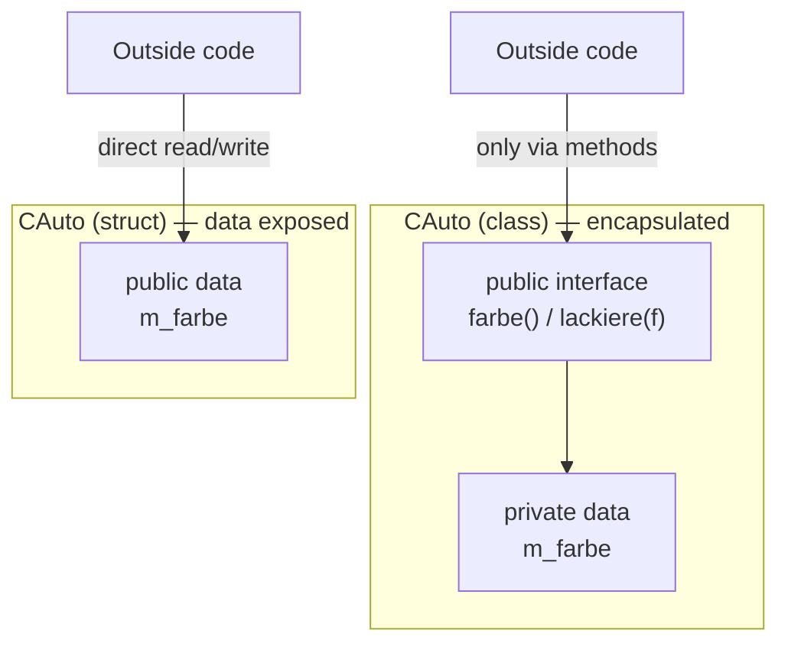

The capsule on the left matches the lecture's two-layer picture: messages
only ever cross the outer `public` layer of methods; the inner `private`
layer holding `m_farbe` is never touched directly. The `struct`-with-public-data
sketch on the right is the contrasting anti-pattern: any caller can reach
and mutate the representation directly, with no interface in between.

Encapsulation (*Kapselung*) is the separation of a class's **interface**
(*Schnittstelle*) from its **implementation**: outside code may only reach an
object's data through a precisely defined set of public methods, never by
touching its internal data directly.

## Problem it solves

An object bundles data and the methods that operate on it. Communication
between objects happens exclusively via methods ("messages", *Botschaften*
flowing in and out). If any other piece of code could reach into an object's
data directly, a change to that data's internal representation would force
changes everywhere it is touched — the central motivation of encapsulation is
to avoid this maintenance burden by hiding data behind an interface.

The lecture illustrates this with a two-layer picture of an object: an outer
`public` layer of methods that messages pass through, wrapping an inner
`private` layer holding the private methods and the data itself. A program is
built from such objects, each an instance of a class (*Klasse*), each with its
own memory for its data.

## Minimal code example

```cpp
class CAuto
{
public:
    CAuto();
    CAuto(std::string farbe);
    std::string farbe();          // interface: read access via a method
    void lackiere(std::string f); // interface: write access via a method
private:
    std::string m_farbe;          // hidden: not reachable from outside
};
```

Code outside `CAuto` (including `main`) can only reach `m_farbe` through
`farbe()` and `lackiere()`. It can never read or write `m_farbe` directly.

## Consequences / trade-offs

- Member *variables* should (almost) always be `private`. This is the recommended
  choice for data, as reiterated across the whole chapter.
- `protected` is appropriate for methods meant to be used from derived classes,
  but **not** for data — see [[concepts/access-modifiers]] for why `protected`
  member variables are considered a design flaw.
- Encapsulation can be deliberately, narrowly broken with `friend` when one
  specific other class legitimately needs private access — see
  [[concepts/friend]].
- Encapsulation underlies the abstract-data-type idea: an ADT specifies only
  the *behavior* of a data type via axioms, never its concrete representation
  — see [[concepts/abstract-data-type]].

## Misuse & anti-patterns

- Exposing member variables as `public` (or effectively public via `protected`)
  defeats encapsulation: every usage site across every derived class becomes a
  dependency that must be found and fixed whenever the representation changes.
- Relying on callers to "just not touch" private-looking data instead of
  actually declaring it `private` provides no real protection.

## Related

- [[concepts/access-modifiers]]
- [[concepts/abstract-data-type]]
- [[concepts/class-and-object]]
- [[concepts/friend]]

## Sources

- [[sources/grigat-oop-teil1]] §0.3.1
- [[sources/grigat-oop-teil1]] §0.3.5.8
