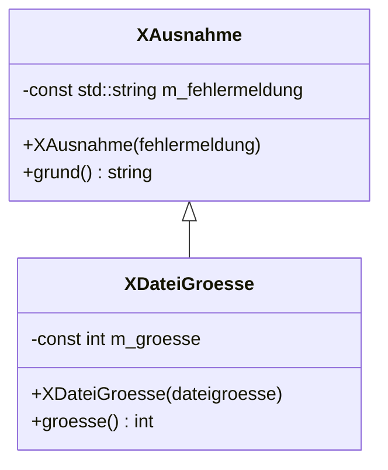
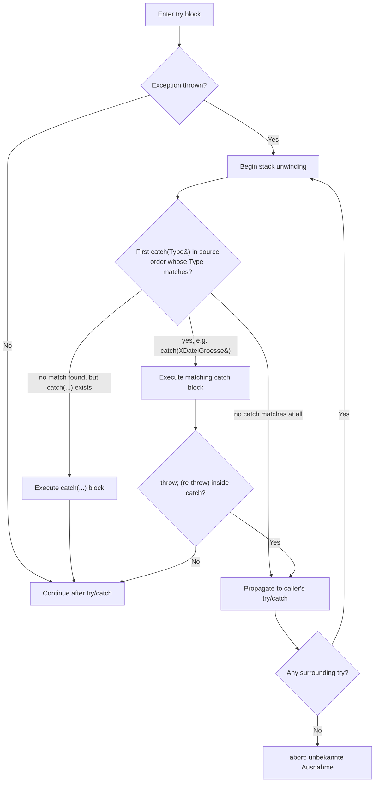

## Definition

**Exceptions** (*Ausnahmen*) are a C++ mechanism for leaving the normal program flow when an error occurs, similar to [[concepts/assertions]], but — unlike `assert()` — they allow a dedicated error-handling routine to run instead of simply aborting. An exception is created by **throwing** it (*Werfen einer Ausnahme*, `throw`) and may be **caught** (*Fangen*, `catch`) by another part of the program, carrying information about the cause of the error (§0.4.6.1).

## Problem it solves

A hard abort (as `assert()` effectively causes) is often too blunt: it offers no chance to correct the error (e.g. re-prompt for invalid input), inform the user meaningfully, or avoid terminating the whole program. Exceptions let the error travel up the call stack, carrying structured data, until some caller is prepared to handle that specific kind of problem.

## Throwing an exception (§0.4.6.2)

`throw` takes as its parameter an arbitrary class containing error information. A minimal exception class:

```cpp
//xausnahme.hpp
class XAusnahme
{
public:
  XAusnahme
    (const std::string fehlermeldung);
  const std::string grund();
private:
  const std::string m_fehlermeldung;
};
```

```cpp
//xausnahme.cpp
XAusnahme::XAusnahme
    (const std::string fehlermeldung):
  m_fehlermeldung(fehlermeldung)
  {}
const std::string XAusnahme::grund()
  {
    return m_fehlermeldung;
  }
```

```cpp
//cdatei.cpp, Definition von oeffnen
void CDatei::oeffnen()
{
  bool dateiexistiertnicht=false;
  //[..]
  if (dateiexistiertnicht)
  {
    // Hier wird eine Instanz von XAusnahme geworfen
    throw XAusnahme("Datei existiert nicht");
  }
  /* ... */
}
```

## Catching an exception (§0.4.6.3)

If an exception is thrown inside `try{Codeblock}`, it can (only) be caught directly after that block, with `catch`:

```cpp
try {
  dateioeffnen(); //wirft evtl. XAusnahme
  /* ... */
}
catch (XAusnahme &fehler) {
  cerr << "Ausnahme ist aufgetreten: "
       << fehler.grund() << endl;
  throw; // Dieselbe Ausnahme kann erneut geworfen werden
}
```

- All exceptions thrown anywhere inside the `try` block are eligible to be caught by its `catch` clauses.
- Execution jumps straight to the matching `catch` when an exception is thrown; otherwise it continues normally after the `try/catch` construct.
- If no `try`/`catch` is present anywhere and an exception is thrown regardless, the program aborts reporting an "unknown exception" (*unbekannte Ausnahme*) — because the whole program is implicitly wrapped in a `try{Codeblock}`.
- No new exception should be triggered while another is still being handled.
- At the start of a `catch()` block, the exception counts as fully handled; the same exception object can still be re-thrown with the bare `throw;` statement, but that should then happen inside a surrounding (*übergeordneter*) `try` block.

## Using different exception data types (§0.4.6.4) and derived exception types (§0.4.6.5)

A single string message is not always enough error information. The solution is to throw **different exception data types**, optionally as a class hierarchy derived from a common base:

```cpp
//xausnahme.hpp
class XAusnahme {
public:
  XAusnahme
    (const std::string fehlermeldung);
  const std::string grund();
private:
  const std::string m_fehlermeldung;
};
```

```cpp
//cdatei.hpp
class XDateiGroesse: public XAusnahme
{
public:
  XDateiGroesse(int dateigroesse);
  const int groesse();
private:
  const int m_groesse;
};
```

```cpp
//datei.cpp, Definition von oeffnen
void CDatei::oeffnen()
{
/* ... */
// try-Block siehe main.cpp
  if (dateiexistiertnicht)
  {     //Fehlertyp XAusnahme werfen
    throw XAusnahme
      ("Datei existiert nicht");
  }
  if (dateizugross)
  {     //Fehlertyp XDateiGroesse werfen
    throw XDateiGroesse(dateigroesse);
  }
}
```



This mirrors ordinary [[concepts/inheritance]]: `XDateiGroesse` *is-a* `XAusnahme` plus an extra `m_groesse` field and accessor, so a handler written for the base type still catches the derived exception, while a handler written for the derived type gets the extra information.

## Catching different exception data types (§0.4.6.6)

A `try` block may throw any kind of exception, independent of a particular `catch` clause's declared parameter type. **Only the first `catch` block whose parameter type matches the thrown exception's dynamic type is executed** — `catch` clauses are tried in source order. `catch(...)` catches every data type and is typically placed last as a catch-all.

```cpp
//main.cpp
try
{
  dateioeffnen(); // Enthaelt throw-Befehle
}
catch (XDateiGroesse &fehler)
{
  cerr << fehler.grund() << endl;
  cerr << "Dateigroesse: "
       << fehler.groesse() << endl;
}
catch (XAusnahme &fehler)
{
  cerr << "Ausnahme ist aufgetreten: "
       << fehler.grund() << endl;
}
catch (...)
{
  cerr << "Nicht speziell behandelte Ausnahme "
       << "ist aufgetreten" << endl;
}
```

(Example reference in the source material: `KP28_1_tryCatch`.)

```
Catch-dispatch algorithm:
1. Execute try block; if an exception E is thrown, go to 2, else continue normally.
2. For each catch(Type &p) block, in source order:
     a. If Type matches (or is a base of) the dynamic type of E, bind p to E,
        execute this catch block, and stop checking further catch blocks.
3. If no specific catch matched, and a catch(...) exists, execute it.
4. If nothing matched, propagate the exception to the caller (and if no
   surrounding try, abort as "unbekannte Ausnahme").
```

> [!warning] Ordering rule
> Because matching stops at the first applicable `catch`, a base-class handler (`catch(XAusnahme&)`) placed *before* a derived-class handler (`catch(XDateiGroesse&)`) would silently steal all derived-type exceptions too, since the derived type is-a base type. Order `catch` clauses from most-derived to least-derived (and `catch(...)` last), exactly as in the example above.



## `noexcept` (§0.4.6.7)

If a function in principle throws no exceptions, this can be made explicit with `noexcept`:

```cpp
double compute(double) noexcept; // darf keine Ausnahme auslösen
```

(Example reference: `KP28_2_noexcept`.)

Benefits of declaring `noexcept`:

- Easier for the programmer to understand program behavior.
- Helpful for compiler optimization.
- If an exception is nevertheless thrown out of a `noexcept` function, the program stops via `std::terminate()`.
- A **conditional** form exists: `noexcept(const bool)`, taking a predicate as its argument — `noexcept(false)` permits an exception to be triggered, `noexcept(true)` does not.

## Consequences / trade-offs

- Exceptions trade a small runtime cost (when actually thrown) and some control-flow complexity for the ability to recover from, or meaningfully report, error conditions rather than aborting outright — complementary to [[concepts/assertions]], which can only assert presence of a bug, not handle it gracefully.
- Deriving exception types mirrors ordinary class [[concepts/inheritance]] and lets handler code be written at whatever granularity is appropriate (catch the specific `XDateiGroesse`, or fall back to the general `XAusnahme`).

## Misuse & anti-patterns

- Placing a base-class `catch` before a derived-class `catch` — the derived handler becomes unreachable dead code (see the ordering rule above).
- Throwing a new exception from inside active exception handling (while a previous exception is still "in flight") — the notes explicitly flag this as something that should not happen.
- Marking a function `noexcept` while its implementation can actually throw — this converts a recoverable error into an unconditional `std::terminate()` call.

## Related

- [[concepts/assertions]]
- [[concepts/inheritance]]
- [[concepts/polymorphism]]
- [[concepts/type-conversions]]
- [[concepts/class-and-object]]

## Sources

- [[sources/grigat-cpp-concepts-generic]] §0.4.6.1, §0.4.6.2, §0.4.6.3, §0.4.6.4, §0.4.6.5, §0.4.6.6, §0.4.6.7
