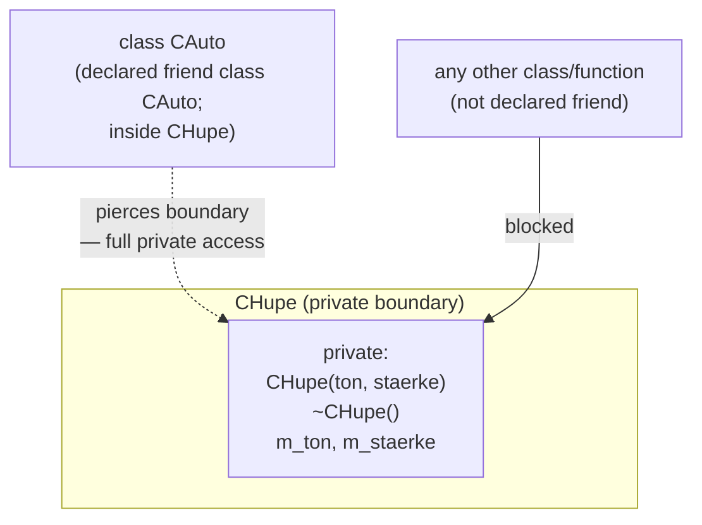
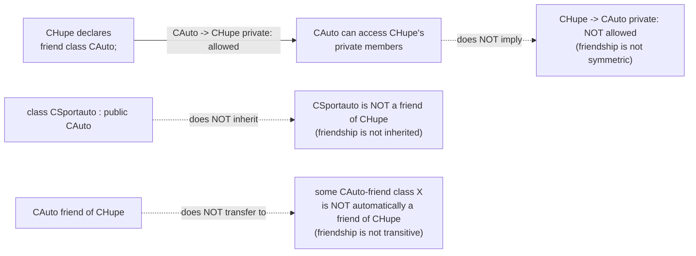

A `friend` declaration deliberately grants one specific external function or
class access to another class's `private` members — a controlled,
explicit escape hatch from [[concepts/encapsulation]].





Friendship is granted one-directionally and does not propagate: `CAuto`
being a friend of `CHupe` gives `CAuto` access to `CHupe`'s private members,
but not the reverse; a class derived from `CAuto` does not inherit `CAuto`'s
friendship with `CHupe`; and a class that is itself a friend of `CAuto` gains
no friendship with `CHupe` through that chain.

## Problem

Normally access to `private` elements from outside a class is not allowed.
Sometimes, though, exactly one other class legitimately needs that access.

## Solution

Declare that other class (or function) as `friend` inside the class whose
private members should be exposed. The friend then has access to the
declaring class's private objects.

> [!warning] Caution
> `friend` breaks the encapsulation principle (*Kapselung*) — use with care!
> Granting friendship is a deliberate, explicit exception, not a general
> workaround for bad interface design.

## Example: Auto mit Hupe (car with horn)

```cpp
//chupe.hpp
class CHupe
{
    friend class CAuto; //CAuto Zugriff
private:              //ermoeglichen
    CHupe(std::string ton,
          int staerke); //Konstruktor
    ~CHupe();            //private!
    std::string m_ton;
    int m_staerke;
};

//cauto.hpp
class CAuto
{
public:
    CAuto();
    std::string farbe();
    void lackiere(std::string farbe);
    CHupe m_hupe;
      //nur wegen friend erlaubt
private:
    std::string m_farbe;
};
```

`CHupe`'s constructor and destructor are `private`, so normally no code
outside `CHupe` itself could create or destroy a `CHupe` object. By declaring
`friend class CAuto;` inside `CHupe`, only `CAuto` is granted the right to
call `CHupe`'s private constructor/destructor and to hold a `CHupe` member
(`m_hupe`). This enforces, at the type-system level, the rule "no horn
without car" (*keine Hupe ohne Auto*): a `CHupe` can only ever exist as part
of a `CAuto`, since nothing else is able to construct one. This is a
deliberate ownership/composition constraint — compare with the more usual,
encapsulation-preserving form of object composition at
[[concepts/composition]]. The classic other use of `friend` not shown here
is granting a non-member function access to print an object's private data,
most commonly `operator<<` — see [[concepts/operator-overloading]].

## Related

- [[concepts/encapsulation]]
- [[concepts/access-modifiers]]
- [[concepts/composition]]
- [[concepts/class-and-object]]
- [[concepts/operator-overloading]]

## Sources

- [[sources/grigat-oop-teil1]] §0.3.6
- [[sources/grigat-oop-teil1]] §0.3.6.1
