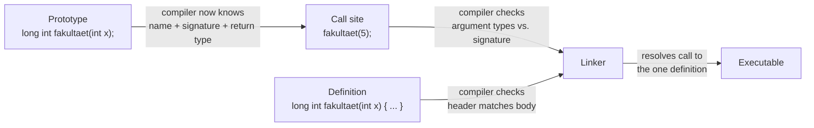

# Function Declarations and Prototypes

## Prototype, call site, and definition



The compiler checks the **call** against whichever of prototype/definition it
has already seen (types, argument count); it checks the **definition** against
its own prototype if one preceded it. The linker's job (see
[[concepts/modularization-and-build-pipeline]]) is only to resolve the call to
the single definition — it does no type checking itself.

## Subprograms

The solution approach for complex problems is decomposition into sub-problems —
in software engineering, **top-down design** (*Top-Down-Entwurf*). Imperative
languages realise this decomposition through **subprograms** (*Unterprogramme*).

Some languages (e.g. Pascal) distinguish:

- **Procedure** (*Prozedur*) — a compound statement for changing data.
- **Function** (*Funktion*) — a compound statement that returns a value and may
  also change data.

C++ has only functions; a `void` return type covers the procedure case.

## Function definition

```cpp
long int fakultaet(int x)
{                      // Beginn Anweisungsblock
    long int f = 1;
    for(int i = x; i > 1; i--)
    {
        f = f * i;
    }
    return f;
}                      // Ende Anweisungsblock
```

A function **definition** consists of:

1. (Return) type — `long int`
2. Function name — `fakultaet`
3. Call parameters — `int x`
4. Statement block — enclosed in `{}`

## The prototype

Every name must be known *before* use. This is a problem for recursive
definitions: a function that calls itself would have to already be defined at the
point of its own definition. The solution is a **prototype** (*Prototyp*) — a
declaration that links the name with types, without a body:

```cpp
long int fakultaet(int x);
```

| | Funktionsprototyp | Funktionsdefinition |
|---|---|---|
| Rückgabetyp | `long int` | `long int` |
| Funktionsname | `fakultaet` | `fakultaet` |
| Parameterliste | `int x` | `int x` |
| Anweisungsblock | **kein** (none) | **ja** (yes) |

- The **definition must occur exactly once**.
- The **prototype may occur many times** — which is what makes header files work;
  see [[concepts/modularization-and-build-pipeline]].

For the general declaration/definition distinction see
[[concepts/type-declaration-definition]].

## `main()`

```cpp
#include<iostream>   // Funktionsdeklarationen fuer Ein- und Ausgabe
using namespace std;  // Namensraum std
int main(int argc, char* argv[])
{
 cout << "Hello World!" << endl;
 return 0; // Rückgabewert 0 == kein Fehler
}
```

- Every C++ program needs **exactly one** `main()`.
- `main()` is called by the operating system.
- Per the ANSI standard it must return an `int`; on many operating systems
  `0` ≡ "no error".

## Variable number of arguments

- A variable number of **optional** call parameters is allowed.
- Access goes through an argument pointer of type `va_list`, header `<cstdarg>`.
- At least one **obligatory** parameter must precede the optional ones.

```cpp
#include <cstdarg>
int f(int max, ...); // max obligatorisch, ... optionale Parameter
```

| Macro | Effect |
|---|---|
| `va_start(argPtr, lastObligArg)` | Sets `argPtr` to the first optional argument after the last obligatory parameter. |
| `va_arg(argPtr, argType)` | Reads an optional argument of type `argType` and advances `argPtr`. |
| `va_end(argPtr)` | Ends evaluation; sets `argPtr` to `nullptr`. |

To read the arguments again, restart with `va_start()`.

> [!warning] The caller's types are not checked. `va_arg` trusts the `argType`
> you give it, which makes variadic C functions a known source of errors. Prefer
> templates or `initializer_list` where possible.

## Related

- [[concepts/type-declaration-definition]]
- [[concepts/parameter-passing]]
- [[concepts/function-overloading]]
- [[concepts/complex-declarations]]
- [[concepts/modularization-and-build-pipeline]]
- [[concepts/templates]] — template function definitions typically live
  entirely in headers rather than following the prototype/definition split
- [[concepts/variadic-templates]] — a type-safe alternative to the `va_list`
  mechanism above

## Sources

- [[sources/grigat-oop-teil1]] §0.2.3 (Unterprogramme), §0.2.3.1 (Funktionen),
  §0.2.3.2 (Deklaration mittels Prototyp), §0.2.3.3 (Prototyp vs. Definition),
  §0.2.3.6 (Hauptprogramm main()), §0.2.2.2 (Variable Anzahl von Funktionsargumenten)
