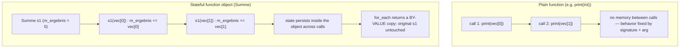

A **function object** (*Funktionsobjekt*), also called a *functor* (*Funktor*), is an object that can be called like a function because it overloads `operator()` (see [[concepts/operator-overloading]]). It can be passed as a parameter wherever a function name is expected, e.g. to the algorithm `for_each()` (see [[algorithms/stl-algorithms]]).

## Problem it solves

Plain functions can only vary their behavior through the parameters passed to them at each call — they carry no memory between calls. Function objects solve this by being *objects*: they can hold member variables, so they can accumulate or carry state across repeated invocations by the same algorithm, while still being invoked with ordinary call syntax `obj(x)`.

## 0.5.11.1 Example: adder as a function object (*Addierer*)

```cpp
template <typename T>
class Addierer
{
public:
  Addierer (T summand);
  void operator() (T& param);
private:
  const T m_summand;
};

template <typename T>
Addierer<T>::Addierer (T summand):
  m_summand(summand)
{}
template <typename T>
void Addierer<T>::operator()(T& param)
{
  param += m_summand;
}
```

```cpp
//main.cpp
/* ... */
  Addierer<int> plusDrei(3);
  int a = 4;
  plusDrei(a);
    //bewirkt Aufruf von
    //plusDrei.operator()(a);
  cout << a << endl;
```

`plusDrei(a)` only *looks* like a function call; it is in reality a call to `plusDrei.operator()(a)`. Output: `7`.

## 0.5.11.2 Function objects as parameters of STL algorithms

```cpp
Addierer<int> plusDrei(3);
for_each(vec.begin(), vec.end(),   //Sequenz
         plusDrei);                //Operation
```

`for_each` calls `plusDrei` for all elements: `plusDrei(vec[0])`, `plusDrei(vec[1])`, ...

Same example, shorter, using a temporary:

```cpp
for_each(vec.begin(), vec.end(),       //Sequenz
         Addierer<int>(3));           //Operation
```

When `for_each` is called, a temporary function object of type `Addierer<int>(3)` is created and executed with each element of the sequence as parameter; both versions behave identically.

```cpp
for_each(vec.begin(), vec.end(), Addierer<int>(*vec.begin()));
```

Here `*vec.begin()` is the content of the first element of `vec`; `for_each` creates a temporary `Addierer<int>` whose constructor receives that value, so this call adds the first element of `vec` to all elements of `vec`.

### Advantages of function objects

- Function objects are more powerful than plain functions.
- They can have member functions and member variables.
- They can thereby take on and change **state at runtime**.
- Different instances of function objects can simultaneously have different states.
- This allows different behavior of different function objects despite an identical signature — not possible with plain functions, whose behavior is only variable through the parameters passed at each call.

## Generic implementation of `for_each`

```cpp
template<typename T, typename F> F for_each (T anf, T end, F obj)
{
  while (anf != end) obj(*anf++);
  return obj;
}
```

```
1. function for_each(anf, end, obj):
2.     while anf != end:
3.         obj(*anf)
4.         anf = anf + 1
5.     return obj
```

- `T` is a template parameter for an iterator type; `F` is a template parameter for a function-object type.
- `for_each` calls `obj(*anf)` and increments.
- The function object `obj` is passed **by value** (*Übergabe als Kopie*, see [[concepts/parameter-passing]]).
- The return value of `for_each` is the internal copy of `obj`.
- `for_each` can also be used with plain functions, not only `operator()`-encapsulated objects:

```cpp
template<typename T> void gibAus(T t) {std::cout << t << std::endl;}
int main (int argc, char* argv[])
{
  vector<unsigned short> vec;
  vec.push_back(3);
  vec.push_back(5);
  for_each(vec.begin(), vec.end(), gibAus<unsigned short>);
}
```

> [!warning] Transcription note
> The source notes include a partially illegible handwritten annotation near this listing about explicit function-pointer casting (something like `static_cast<double(*)(double)>(gibAus);`), apparently illustrating disambiguation of an overloaded template function pointer passed to an algorithm. The exact wording could not be fully transcribed; flagged here rather than guessed.

## 0.5.11.3 Example: forming a sum with function objects (*Summe*)

```cpp
//summe.hpp
template<typename T> class Summe
{
public:
  Summe();
  void operator() (T& x);
  T ergebnis() const;
private:
  T m_ergebnis;
};

template<typename T>
Summe<T>::Summe():
  m_ergebnis(0)
{}

template<typename T>
void Summe<T>::operator() (T& x)
{
  m_ergebnis += x;
}

template<typename T>
T Summe<T>::ergebnis() const
{
  return m_ergebnis;
}
```

```cpp
//main.cpp
/* ... */
Summe<double> s1, s2, s3;    // 3 Funktoren
s2 = for_each(vec1.begin(), vec1.end(), s1);
s3 = for_each(vec2.begin(), vec2.end(), s1);
// Call by Value, s1 bleibt unverändert
// for_each liefert Kopien als s2 und s3
```

- `s1`, `s2`, and `s3` are initialized to `0` in the constructor.
- The `for_each` call apparently triggers `s1(vec1[0])`, `s1(vec1[1])`, ... for the first line, and `s1(vec2[0])`, `s1(vec2[1])`, ... for the second.
- `for_each`, however, calls and mutates a **local copy** of `s1` (*by value*); the return value of `for_each` is that copy, so `s1` itself remains unchanged.
- `s2` and `s3` each end up with their own, different accumulated state.
- This behavior cannot be realized with a plain function, since a function cannot carry state between separate calls.

## Numbered pseudocode: accumulating with a stateful functor

```
1. function Summe.call(self, x):
2.     self.m_ergebnis = self.m_ergebnis + x
3.
4. s1 = Summe(0)
5. s2 = for_each(vec1.begin, vec1.end, copy_of(s1))   // s2 holds sum of vec1
6. s3 = for_each(vec2.begin, vec2.end, copy_of(s1))   // s3 holds sum of vec2
7. // s1 itself is never mutated: for_each only ever touches a by-value copy
```

## Mermaid: plain function vs. stateful functor



## Consequences / trade-offs

- Functors let algorithms like `for_each` express accumulation/state without any explicit loop in client code.
- Because algorithms accept the functor **by value**, the caller must retrieve the mutated state from the algorithm's *return value*, not from the argument passed in — a common source of confusion.
- Different functor instances can hold independent states simultaneously, enabling parallel accumulation patterns (`s2`, `s3` above) impossible with plain functions.

## Misuse & anti-patterns

- Expecting the original functor argument (e.g. `s1`) to reflect mutations performed by `for_each` — it does not, since a copy was mutated.
- Relying on reference semantics inside a value-passed functor without understanding that the *algorithm's* copy, not the caller's instance, accumulates the state.

## Related

- [[algorithms/stl-algorithms]]
- [[concepts/predicates]]
- [[concepts/lambda-expressions]]
- [[concepts/operator-overloading]]
- [[concepts/templates]]
- [[concepts/parameter-passing]]

## Sources

- [[sources/grigat-cpp-concepts-generic]] §0.5.11, §0.5.11.1, §0.5.11.2, §0.5.11.3
