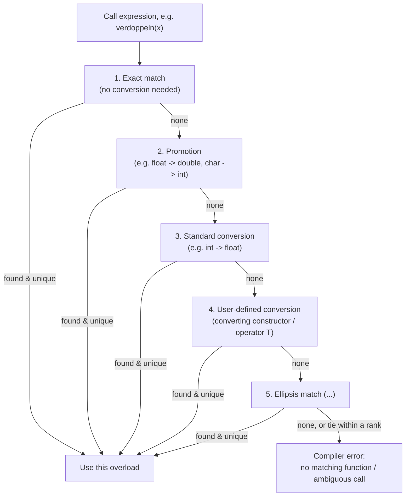
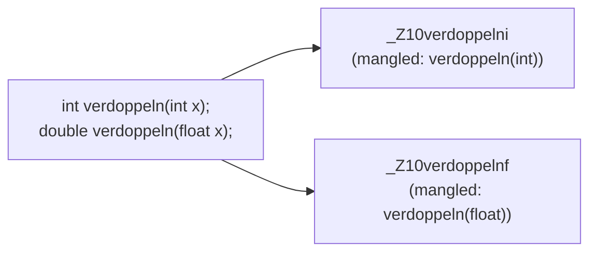

## Definition

Function overloading (*Überladen von Funktionen*) lets several functions share
the same name as long as they differ in their parameter lists; the compiler
picks the right one for each call by matching the call against the function's
*signature*.

## Problem it solves

A function name should describe only the functionality, be reusable across
data types, and avoid redundant naming such as separate `verdoppeln_int` and
`verdoppeln_float` functions for "doubling an int" vs. "doubling a float"
(§0.2.4.9):

```cpp
int verdoppeln_int(int x);
double verdoppeln_float(float x);
```

Overloading solves this by reusing one name:

```cpp
int verdoppeln(int x);
double verdoppeln(float x);
```

```cpp
int a = 5;
double b = verdoppeln(a); //verdoppeln(int), Ergebnis nach double konvertiert
```

The compiler decides which overload is meant by the *Signatur* (signature) —
the list of parameter types — of the call.

## Overload resolution procedure

The compiler ranks every overload that is callable against a given call
expression and picks the best-ranked, unambiguous match. The standard ranking
(best to worst) is:



```
1. collect every overload of the called name visible at the call site
2. discard overloads whose parameter count cannot match the call
   (ignoring parameters with default arguments / variadics)
3. for each remaining overload, rank each argument by the best conversion
   needed to its parameter type:
      rank 1: exact match (incl. trivial qualification/reference binding)
      rank 2: promotion (e.g. float -> double, char/short -> int)
      rank 3: standard conversion (e.g. int -> float, derived* -> base*)
      rank 4: user-defined conversion (converting constructor or
              conversion operator)
      rank 5: match via ellipsis (...)
4. an overload's overall rank is its worst-ranked argument
5. if exactly one overload has the best overall rank, call it
6. if two or more overloads tie for the best rank, the call is ambiguous
   -> compiler error
7. if no overload matches at any rank, the call does not compile
   -> "no matching function" error
```

This is why `double b = verdoppeln(a);` above resolves to `verdoppeln(int)`
(exact match for `int a`) rather than `verdoppeln(float)` (which would need a
standard conversion), and why mixing `int`/`float` overloads callable from the
same literal can produce the "ambiguous call" error mentioned below.

## Name mangling

Because overloads share one source-level name, the compiler must still emit a
distinct linker symbol per overload. It does so by **name mangling** (*Name
Mangling*) — encoding the parameter types (and, for members, the class) into
the symbol name:



The exact mangling scheme is compiler/ABI-specific (the diagram shows the
Itanium C++ ABI style used by GCC/Clang); the point is only that one source
name becomes several distinct symbols, which is also what lets the
[[concepts/modularization-and-build-pipeline|linker]] tell the overloads apart
across translation units.

## Signature vs. type of a function (§0.2.4.10-0.2.4.11)

- The **signature** of an ordinary function is the number and type of its
  (call) parameters. For template functions, the signature also includes the
  template parameters.
- The compiler reports an error for ambiguities caused by implicit type
  conversions among the signatures of overloaded functions.
- The **(return) type** of a normal function is *not* part of the signature,
  because it cannot be inferred from the call expression alone. Consequently,
  two functions cannot be distinguished by return type only:

```cpp
int search(string key);     // Signatur: string, Typ: int
string search(string name); // nicht zulässig, Signatur identisch
```

## `auto` as a placeholder for return types

`auto` is useful for complex types and for defining function templates. The
actual return type can be written explicitly *after* the function head — a
**trailing return type**:

```cpp
auto add(float, float) -> double {/* Funktionsblock*/}
```

The trailing return type may be omitted if the compiler can deduce it from the
`return` statement(s), subject to rules:

- All `return` statements in the function must have exactly the same type.
- The compiler must know the function's definition before its first call.
- A recursive call must be preceded by at least one `return` statement.

## Consequences / trade-offs

- Overloading keeps call-site code readable (`verdoppeln(x)` regardless of
  `x`'s type) at the cost of the compiler needing an unambiguous signature
  match.
- Return-type-only "overloads" are rejected at compile time — this is a direct
  consequence of the signature definition above, not an arbitrary restriction.

## Misuse & anti-patterns

- Relying on the return type to disambiguate overloaded calls — this does not
  compile, as `search` above shows.
- Overloading with signatures that are ambiguous under implicit conversions
  (e.g., both `int` and `float` overloads callable from a literal that
  converts to either) causes compiler errors rather than a clean dispatch.

## Related
- [[concepts/function-declarations]]
- [[concepts/type-aliases]]
- [[concepts/parameter-passing]]
- [[concepts/modularization-and-build-pipeline]]
- [[concepts/operator-overloading]] — operator functions are resolved by the
  same overload-resolution procedure as named functions
- [[concepts/templates]] — function templates participate in overload
  resolution alongside ordinary overloads
- [[concepts/type-conversions]] — standard and user-defined conversions are
  exactly the ranks used above

## Sources
- [[sources/grigat-oop-teil1]] §0.2.4.9-0.2.4.11
